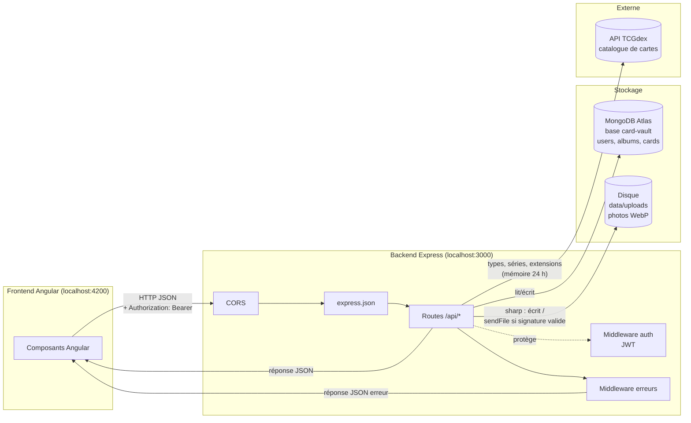
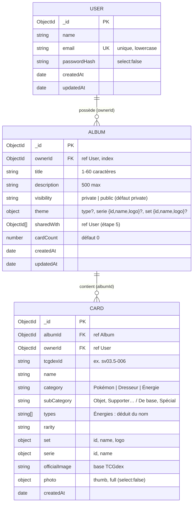
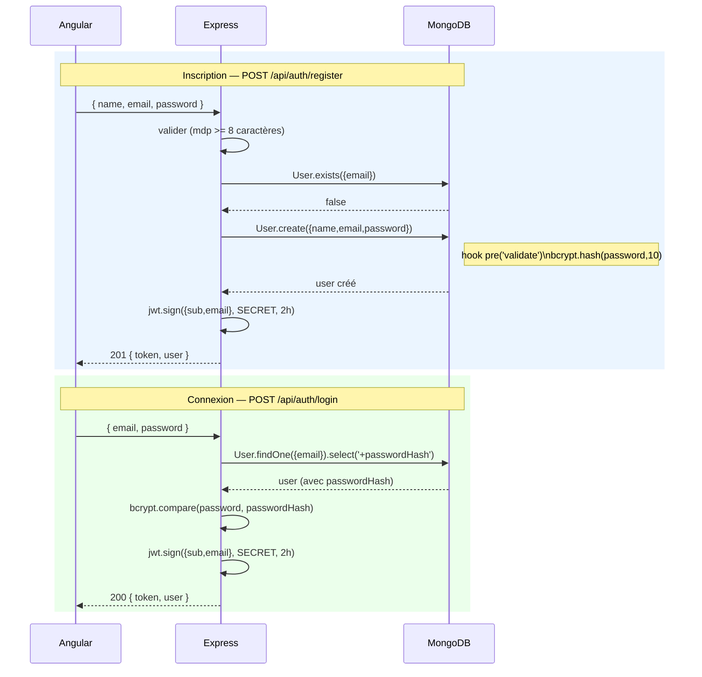
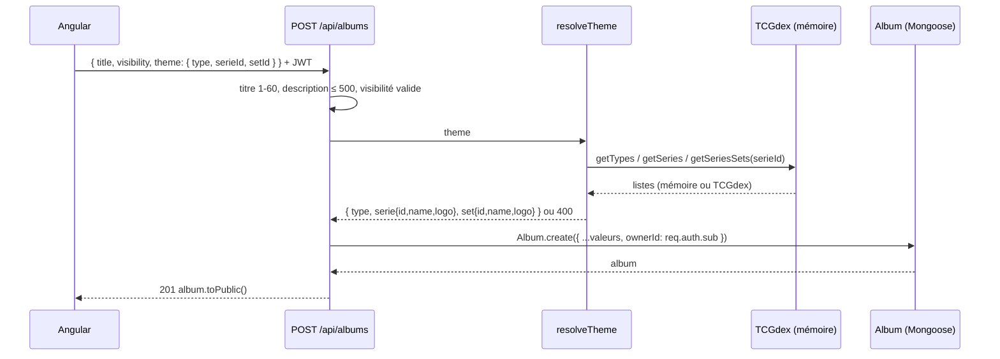
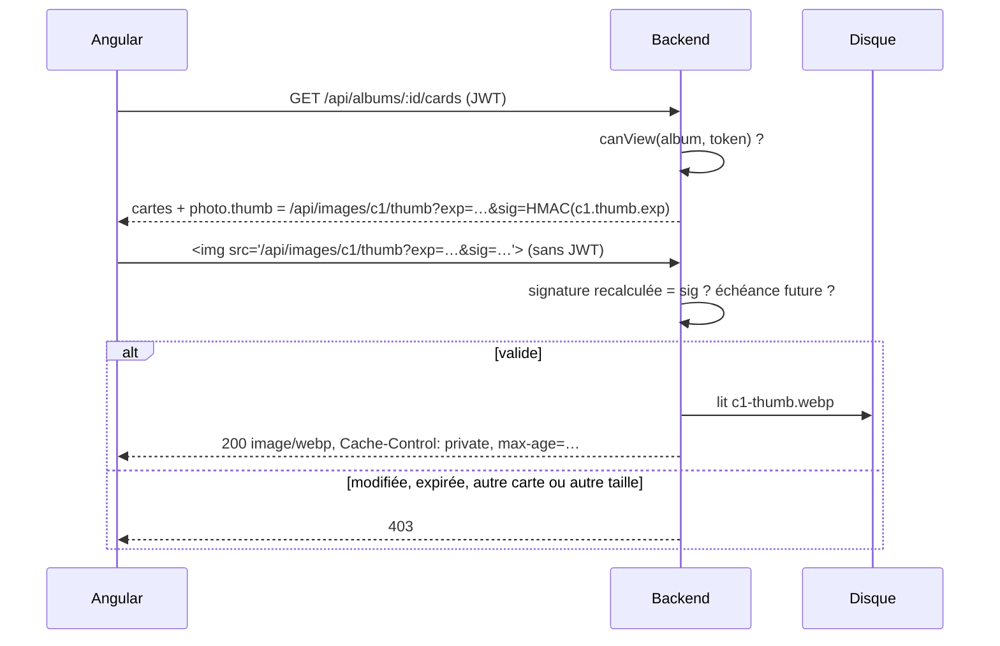
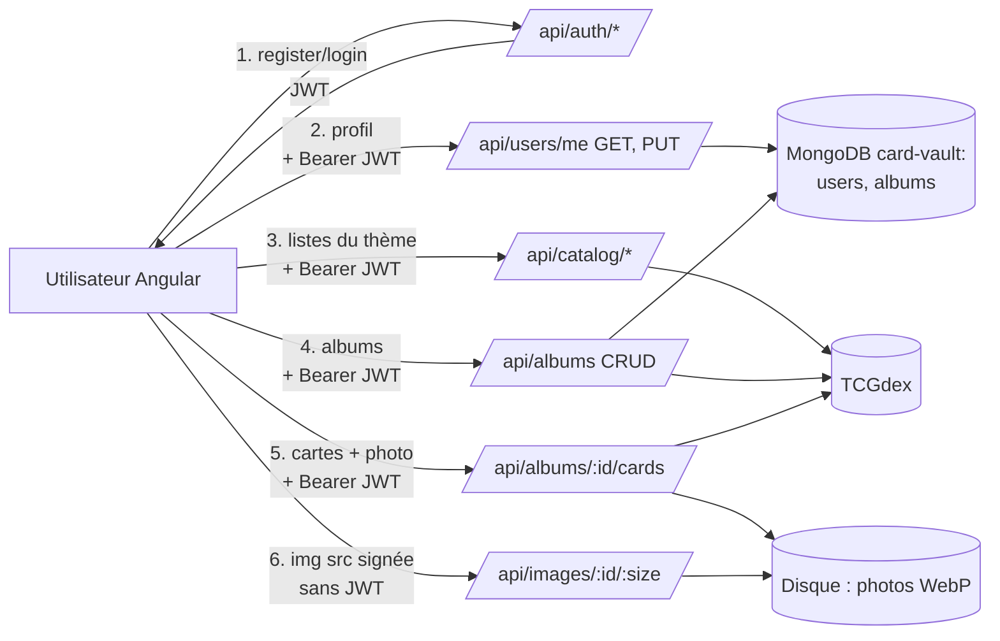

# Analyse du backend — Card Vault API

> Généré à partir du code source dans `backend/src/`. Ce document décrit
> l'architecture **actuelle**, les technologies, l'authentification et les
> échanges avec la base de données. Mis à jour à chaque étape de la V2
> (journal en §9).
>
> **01/11/2026 — V2, étape 1** : la partie audio de la V1 (modèle `Track`,
> routes `/api/tracks`, upload Multer audio) a été retirée ; sa description
> reste consultable dans la version taguée `v1.0` de ce fichier.

## 1. Vue d'ensemble

Le backend est une **API REST** minimaliste en **Node.js / Express 5**, avec
persistance **MongoDB** (via Mongoose, base `card-vault` depuis la V2).
Elle sert l'application Angular **Card Vault** (`frontend-starter/`). À
l'étape 3 de la V2, elle gère l'inscription, la connexion, le profil, les
**albums**, le **catalogue de cartes** (API publique TCGdex, interrogée par
le serveur) et les **cartes** rangées dans les albums, avec leur **photo**
(traitée par `sharp`, stockée sur le disque local, servie par URL signées).
Les fonctions sociales arrivent aux étapes 4 à 7.

### 1.1 Stack technique

| Domaine | Technologie | Rôle |
|---|---|---|
| Runtime | Node.js (ESM, `"type": "module"`) | Exécution du serveur |
| Framework HTTP | Express 5.1 | Routage, middlewares |
| Base de données | MongoDB Atlas (cloud), base `card-vault` (V2) | Persistance des données |
| ODM | Mongoose 9 | Schémas, validation, requêtes |
| Authentification | jsonwebtoken (JWT) | Sessions sans état |
| Hachage mot de passe | bcryptjs | Stockage sécurisé des mots de passe |
| Upload fichiers | Multer 2 (`memoryStorage`, 10 Mo) | Réception des photos de cartes (étape 3) ; rien n'est écrit tel quel sur le disque |
| Images | **sharp** 0.35 (libvips) — ajouté à l'étape 3 | Vérifie qu'un fichier est une image, redresse, retire les métadonnées EXIF (GPS), produit 2 versions WebP |
| CORS | cors | Autoriser les appels depuis Angular (localhost:4200) |
| Catalogue de cartes | API publique TCGdex (`fetch` natif de Node, délai 8 s, mémoire 24 h) | Types, séries, extensions (V2, étape 2) |
| Tests | `node:test` + `node:assert/strict` | Tests unitaires/API légers |

### 1.2 Arborescence

```text
backend/
├── src/
│   ├── app.js            # Construction de l'app Express (middlewares, auth, routes, erreurs)
│   ├── server.js         # Point d'entrée : connexion Mongo + écoute HTTP
│   ├── config.js         # UPLOADS (dossier des photos) et SECRET (JWT + signatures d'images)
│   ├── errors.js         # HttpError (erreur métier portant son code HTTP)
│   ├── access.js         # Règles d'accès aux albums : isOwner, canView
│   ├── models/
│   │   ├── User.js       # Schéma Mongoose Utilisateur (+ hachage mdp)
│   │   ├── Album.js      # Album (visibilité, thème, sharedWith, cardCount)
│   │   └── Card.js       # Carte d'un album (fiche TCGdex recopiée + photo)
│   ├── routes/
│   │   ├── albums.js     # /api/albums (CRUD, 409 de changement de thème, cascade)
│   │   ├── cards.js      # /api/albums/:id/cards, /api/cards/:id, /api/images
│   │   └── catalog.js    # /api/catalog (types, séries, extensions, recherche et détail de cartes)
│   └── services/
│       ├── tcgdex.js     # Accès à TCGdex (mémoire, Pocket exclue, 502)
│       ├── theme.js      # Validation du thème d'un album
│       ├── card-info.js  # Fiche d'une carte, type des Énergies, cohérence avec le thème
│       └── images.js     # sharp + URL signées (HMAC-SHA256)
├── data/uploads/         # Photos WebP (hors Git), jamais servies directement
├── test/                 # 66 tests node:test (sans MongoDB ni vrai TCGdex)
│   ├── helpers.js        # serveur de test, tokens, faux TCGdex (cartes, recherche)
│   ├── api.test.js, access.test.js, catalog.test.js, albums.test.js
│   ├── card-info.test.js # type des Énergies, règles de cohérence
│   ├── images.test.js    # vraies images : redressement, EXIF/GPS, tailles, signatures
│   └── cards.test.js     # recherche, détail, ajout avec photo, classeur, images, suppressions
├── .env                  # Secrets locaux (MONGODB_URI, JWT_SECRET, PORT) — jamais versionné
└── package.json
```

### 1.3 Diagramme de composants



**Séparation `app.js` / `server.js`** : `createApp()` construit l'application
Express *sans ouvrir de port*, ce qui permet aux tests (`test/api.test.js`)
d'instancier la même app sans dépendre de Mongo ni d'un port fixe.
`server.js` est le seul fichier qui se connecte à MongoDB et appelle
`.listen()`.

---

## 2. Modèle de données (MongoDB / Mongoose)

### 2.1 Schémas



- **User** (`src/models/User.js`) : le mot de passe en clair n'est **jamais
  stocké**. Un champ virtuel `password` (non persisté) déclenche un hook
  `pre('validate')` qui calcule `passwordHash = bcrypt.hash(password, 10)`.
  `passwordHash` a `select: false` : il n'est renvoyé par une requête que si
  on le demande explicitement avec `.select('+passwordHash')` (utilisé au
  login).
- **Album** (`src/models/Album.js`, étape 2) : le **thème est facultatif**
  (sans thème : collection libre). La série et l'extension sont stockées
  avec leur **nom et leur logo** (recopiés depuis TCGdex au moment de
  l'enregistrement) : l'affichage n'a jamais besoin du catalogue. Un index
  `{ ownerId: 1, updatedAt: -1 }` sert la liste « Mes albums ».
  `sharedWith` (amis destinataires d'un partage) est prévu pour l'étape 5
  et n'est pas exposé par `toPublic()`.
- **Card** (`src/models/Card.js`, étape 3) : la fiche TCGdex est **recopiée
  à l'ajout** (catégorie, types calculés, extension, série…), comme pour le
  thème de l'album : afficher un classeur n'interroge jamais TCGdex. Les noms
  des fichiers de la photo ont `select: false` : ils ne sortent jamais de
  l'API (URL signées à la place). Index `{ albumId: 1, createdAt: 1 }` pour
  le classeur. Doublons autorisés.
- `toPublic()` construit l'objet réellement envoyé au frontend (transforme
  `_id` en `id` string, retire les champs internes).

### 2.2 Cycle de vie d'une requête base de données

```text
requête HTTP → route Express → middleware(s) → handler async
             → appel Mongoose (User.xxx) → driver MongoDB
             → réponse JSON (via toPublic())
```

---

## 3. Authentification (JWT)

### 3.1 Principe

L'authentification est **sans état (stateless)** : à la connexion, le
serveur signe un JWT contenant `{ sub: userId, email }`, valable **2 heures**
(`expiresIn: "2h"`). Le frontend doit renvoyer ce token dans l'en-tête
`Authorization: Bearer <token>` pour chaque route protégée. Aucun mot de
passe ni token n'est journalisé.

### 3.2 Inscription / Connexion



### 3.3 Middleware `auth` (protection des routes)

```mermaid
flowchart TD
    A[Requête entrante] --> B{Header Authorization\nprésent et\ncommence par 'Bearer '?}
    B -- non --> C[401 Authentification requise]
    B -- oui --> D[jwt.verify(token, SECRET)]
    D -- invalide/expiré --> E[401 Jeton invalide ou expiré]
    D -- valide --> F[req.auth = payload\n(sub, email)]
    F --> G[next\ncontinue vers le handler]
```

Le middleware `auth` (src/app.js:23) est appliqué explicitement à chaque
route qui en a besoin (`/api/users/me` ; les routes d'albums et sociales des étapes suivantes) — pas globalement —
ce qui laisse `/api/health`, `/api/auth/register` et `/api/auth/login`
publiques. L'identité utilisée dans les handlers vient **toujours de
`req.auth.sub`** (extrait du JWT vérifié), jamais d'un champ envoyé par le
client, ce qui empêche un utilisateur d'agir au nom d'un autre.

### 3.4 Routes d'authentification / utilisateur

| Méthode | Route | Protégée | Description |
|---|---|---|---|
| POST | `/api/auth/register` | non | Créer un compte, retourne `{token, user}` |
| POST | `/api/auth/login` | non | Vérifier les identifiants, retourne `{token, user}` |
| GET | `/api/users/me` | oui | Profil de l'utilisateur connecté |
| PUT | `/api/users/me` | oui | Modifier le nom de l'utilisateur connecté |

---

## 4. Albums, catalogue et cartes (V2, étapes 2 et 3)

### 4.1 Catalogue TCGdex (`services/tcgdex.js`)

- Le **backend** interroge TCGdex, jamais Angular : le contrôle de
  cohérence entre une carte et le thème d'un album (étape 3) doit être fait
  par le serveur, sinon un client modifié pourrait mentir.
- **Mémoire de 24 h** par chemin (`Map` en mémoire) : les listes ne changent
  qu'à la sortie d'une extension. TCGdex envoie `Cache-Control: no-store`,
  mais une mémoire serveur courte reste raisonnable pour ce type de données.
- **Délai de 8 s** (`AbortSignal.timeout`) ; TCGdex injoignable ou en erreur
  → `HttpError(502, "Catalogue de cartes indisponible")`. Une ressource
  inexistante (404 TCGdex) renvoie `null`.
- La série **Pocket** (`tcgp`, cartes numériques) est exclue ; les
  identifiants sont contrôlés (`/^[a-z0-9.-]{1,40}$/i`) **avant** d'être
  insérés dans une URL ; les logos reçoivent leur extension `.png`.

### 4.2 Validation du thème (`services/theme.js`)

```mermaid
flowchart TD
    A["resolveTheme({ type?, serieId?, setId? })"] --> B{setId sans serieId ?}
    B -- oui --> E1[400 Une extension nécessite de choisir sa série]
    B -- non --> C{type fourni ?}
    C -- oui --> C1{dans getTypes() ?}
    C1 -- non --> E2[400 Type inconnu]
    C1 -- oui --> D
    C -- non --> D{serieId fourni ?}
    D -- non --> OK["thème (éventuellement vide = collection libre)"]
    D -- oui --> D1{dans getSeries() ?\n(Pocket exclue)}
    D1 -- non --> E3[400 Série inconnue]
    D1 -- oui --> F{setId fourni ?}
    F -- non --> OK
    F -- oui --> F1{dans getSeriesSets(serieId) ?}
    F1 -- non --> E4[400 Extension inconnue pour cette série]
    F1 -- oui --> OK
```

Le thème retourné contient les noms et logos officiels, enregistrés tels
quels dans l'album.

### 4.3 Règles d'accès (`access.js`)

| Fonction | Règle (étape 2) | Utilisée par |
|---|---|---|
| `isOwner(album, userId)` | `album.ownerId` = identité du token (comparaison en chaîne, ObjectId vs string) | `PUT /albums/:id` |
| `canView(album, userId)` | propriétaire, **ou** album `public` | `GET /albums/:id` |

`DELETE` applique la même règle directement dans la requête
(`findOneAndDelete({ _id, ownerId: req.auth.sub })`). Refus = **`404`**,
jamais `403` : un utilisateur ne peut pas savoir si un album privé existe.
L'étape 5 étendra `canView` au partage (`sharedWith`).

### 4.4 Routes (`routes/albums.js`, `routes/catalog.js`)

Montées dans `app.js` par `app.use("/api/albums", albumRoutes(auth))` :
chaque fichier exporte une fonction qui reçoit le middleware `auth` et
renvoie un `express.Router()`. Détail des routes, corps et erreurs :
`../API_CONTRACT.md`.



### 4.5 Cartes et cohérence (`services/card-info.js`, étape 3)

TCGdex ne donne pas tout au même endroit : la **recherche** renvoie des
fiches courtes (id, numéro, nom, image) ; le **détail** d'une carte donne
catégorie, types et extension, mais **pas la série**, obtenue par le détail
de l'**extension** (`/sets/:id`). `loadCardInfo()` enchaîne les deux
(mémoire 24 h) et `describeCard()` produit la fiche enregistrée.

**Type des Énergies.** Le champ `types` manque souvent dans TCGdex. Ordre :
`types` s'il existe, sinon déduit du **nom**, sinon « sans type ». La
déduction compare des **mots entiers** (découpage aux espaces, tirets et
majuscules : « GrassFireWater » → grass, fire, water) avec une table de mots
français et anglais par type, établie sur les **130 noms d'Énergies réels**
du catalogue. Exemples : *Énergie Lightning Vélocité* → Électrique ;
*Énergie Cadeau* → aucun (contient « eau » mais pas le mot « eau ») ;
*Énergie Unitaire GrassFireWater* → aucun (trois types).

**`checkTheme(info, theme)`** renvoie `{ compatible, reasons[] }` : type
vérifié pour les Pokémon (un des types suffit) et les Énergies typées ;
série et extension vérifiées pour toutes les cartes. Utilisée à trois
endroits : verdict affiché (`GET /catalog/cards/:id`), **contrôle à l'ajout**
(`POST /albums/:id/cards`, la vérité côté serveur) et **changement de thème**
d'un album (`PUT`, `409` si des cartes ne le respectent plus).

**Ordre des contrôles à l'ajout** : propriétaire → photo présente → carte
existante → cohérence → **seulement alors** traitement de la photo. Une
carte refusée ne coûte ni traitement d'image ni écriture sur le disque ; un
test le vérifie (carte hors thème + fichier invalide → c'est le thème qui
est signalé).

### 4.6 Photos et URL signées (`services/images.js`, étape 3)

**Traitement** (`processPhoto`) : Multer garde le fichier en mémoire (10 Mo
max) ; `sharp(buffer).metadata()` lit le **contenu** (un faux fichier est
refusé, quel que soit son type MIME annoncé) ; formats acceptés JPEG, PNG,
WebP ; `rotate()` redresse selon l'orientation EXIF ; deux sorties WebP,
`thumb` (400 px) et `full` (1600 px max) ; sharp ne recopiant aucune
métadonnée par défaut, **l'EXIF et la position GPS disparaissent**. Vérifié
sur une vraie photo de test (GPS + orientation 6) : fichier servi en
portrait, sans EXIF. En cas d'échec après écriture, les fichiers sont
supprimés (pas d'orphelin).

**Recadrage (01/11/2026)** : la route lit deux champs facultatifs avec
`readAdjustments` : `rotation` (quarts de tour, sens horaire, 0 à 3) et
`crop` (JSON, entiers, `width` ≥ 100), sinon `400 « Recadrage invalide »`.
`processPhoto(buffer, { rotation, crop })` applique, **dans cet ordre** :
redressement EXIF, rotation demandée, contrôle que le cadre est dans
l'image (sinon `400`), `extract(crop)`, puis les deux versions WebP. Le
cadre est donc exprimé dans le repère de la photo telle que l'utilisateur
la voit (redressée puis tournée), comme le calcule le recadreur côté
Angular. Le découpage se fait sur l'**original** (pleine qualité), pas sur
une image réduite par le navigateur. Les champs sont lus **avant** l'appel
à TCGdex : une requête mal formée est refusée sans rien demander au
catalogue. Tests avec des images à zones de couleur : la zone choisie est
bien celle gardée, y compris sur une photo couchée (EXIF 6) et après un
quart de tour.

**Affichage** : une balise `` n'envoie pas le JWT. Le serveur délivre
donc, avec chaque carte, des URL de la forme
`/api/images/<carte>/<taille>?exp=<échéance>&sig=<signature>`.



- **Signature** : HMAC-SHA256 de `carte.taille.échéance` avec le **secret du
  serveur** (celui des JWT) ; impossible à fabriquer ou à modifier sans lui.
  Comparaison en temps constant (`timingSafeEqual`).
- **Échéance arrondie** à la fin de l'heure suivante : la même URL est
  produite pendant toute l'heure, donc le **cache du navigateur** fonctionne
  (validité 1 à 2 h). Côté Angular, une photo qui ne se charge plus (URL
  expirée) déclenche un rechargement de la page du classeur, une seule fois.
- **Limite assumée** : une URL déjà délivrée reste valable jusqu'à son
  échéance, même si l'album repasse en privé entre-temps (pas de révocation
  individuelle). Durée courte pour cette raison.

**Suppressions** : `DELETE /cards/:id` (propriétaire) supprime la carte, ses
deux fichiers et décrémente `cardCount` ; `DELETE /albums/:id` supprime
l'album, toutes ses cartes et leurs fichiers.

---

## 5. Gestion des erreurs et journalisation

Toutes les routes utilisent `try/catch` + `next(error)`. Un middleware
d'erreurs central (fin de `app.js`) mappe les erreurs connues vers des codes
HTTP cohérents :

```mermaid
flowchart TD
    E[Erreur interceptée] --> M{Type d'erreur}
    M -- HttpError\n(src/errors.js) --> R0[son code : 400, 404, 502…]
    M -- MulterError\n(photo > 10 Mo) --> R1[400 Photo trop volumineuse]
    M -- ValidationError\n(Mongoose) --> R2[400 Bad Request]
    M -- CastError\n(id MongoDB invalide) --> R3[404 Not Found]
    M -- autre --> R4[next(error)\n-> gestionnaire par défaut Express]
```

Chaque requête est aussi journalisée en fin de traitement (méthode, URL,
code de statut, durée) via un middleware placé en tête de la pile
(`res.on('finish', ...)`), sans jamais logguer les corps sensibles
(mots de passe, tokens).

---

## 6. Démarrage du serveur (`server.js`)

```mermaid
flowchart TD
    A[node src/server.js] --> B[Lire MONGODB_URI depuis .env]
    B -- absente --> X[throw Error\narrêt immédiat]
    B -- présente --> C[mongoose.connect]
    C -- échec --> X2[throw Error\narrêt immédiat]
    C -- succès --> D[Vérifier / créer\ncompte démo\ndemo@example.com]
    D --> E[createApp().listen(port)]
    E --> F[API prête\nhttp://localhost:PORT/api/health]
```

Depuis la V2 (01/11/2026), l'URI de `.env` désigne la base **`card-vault`**
(vierge au départ) ; les données de la V1 sont restées dans la base `test`,
utilisée par défaut quand l'URI ne contient pas de nom de base.

Le serveur **refuse de démarrer** sans URI MongoDB valide et sans connexion
effective — il n'accepte jamais de requêtes dans un état "base
indisponible". Un compte de démonstration (`demo@example.com`) est créé
automatiquement au premier démarrage s'il n'existe pas déjà.

---

## 7. Points d'attention relevés

- **Secrets en clair localement** : `backend/.env` contient une URI MongoDB
  Atlas complète (avec identifiants) et un `JWT_SECRET` réels. Le fichier est
  bien exclu par `.gitignore`. `backend/.env.example` n'existe plus ; choix
  fait le 16/10/2026 : le README racine décrit directement le contenu
  attendu de `.env` au lieu de recréer ce fichier.
- **JWT_SECRET par défaut** : si `JWT_SECRET` n'est pas défini,
  `src/app.js` retombe sur la valeur codée en dur
  `"tp1-development-secret"` — acceptable en développement uniquement.
- **Pas de rate limiting** ni de protection anti-bruteforce sur
  `/api/auth/login`.
- **Aucune limite de nombre de photos par utilisateur** ni de quota total
  de stockage disque (chaque photo pèse quelques dizaines à centaines de
  Ko après conversion WebP).
- **Dépendances** : `npm audit` signalait 4 vulnérabilités (Express et ses
  sous-dépendances, Multer) ; corrigées le 01/11/2026 par `npm audit fix`
  (mises à jour compatibles, 0 vulnérabilité ensuite).

---

## 8. Résumé du flux applicatif global



Les flux sociaux (étapes 4 à 7) seront ajoutés au fil des étapes de la V2.

---

## 9. Journal des mises à jour de ce document

- **Version initiale** (Phase 0) — analyse du backend fourni.
- **TP2** — filtre `title` sur `GET /api/tracks` ; **TP3** — tests backend.
- **01/11/2026** — V2, étape 1 : retrait de l'audio (modèle `Track`,
  routes `/api/tracks`, configuration Multer), base `card-vault`, tests
  réorientés vers `/api/users/me` (§1, §1.1, §1.2, §1.3, §2, §4, §5, §6,
  §7, §8).
- **01/11/2026** — V2, étape 2 : modèle `Album`, routes `/api/albums` et
  `/api/catalog`, service TCGdex (mémoire, 502), validation du thème,
  règles d'accès `canView`/`isOwner`, `HttpError` et gestionnaire d'erreurs,
  organisation en `routes/` et `services/`, 29 tests (§1, §1.1, §1.2, §1.3,
  §2, §4, §5, §8).
- **01/11/2026** — V2, étape 3 : modèle `Card`, routes des cartes et des
  images, recherche et détail de cartes, `card-info.js` (type des Énergies,
  cohérence), `images.js` (sharp, URL signées), `config.js`, `409` au
  changement de thème, suppression en cascade, `npm audit fix`, 66 tests
  (§1, §1.1, §1.2, §1.3, §2.1, §4.5, §4.6, §7, §8).
- **01/11/2026** — V2, étape 3 (complément) : recadrage et rotation de la
  photo à l'ajout (`readAdjustments`, `processPhoto` avec `crop` et
  `rotation`), 74 tests (§4.6) ; message de démarrage renommé « Card Vault API » (reste de la V1).
