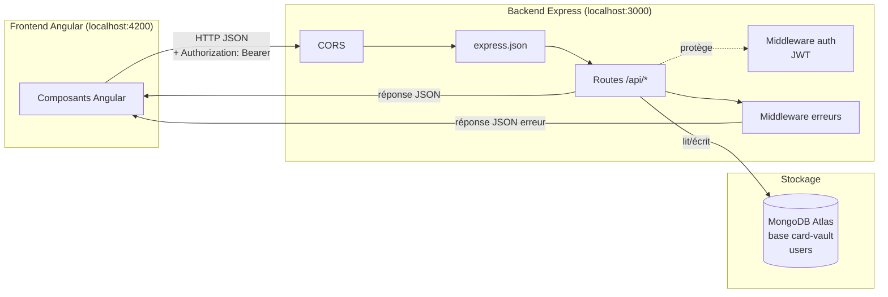
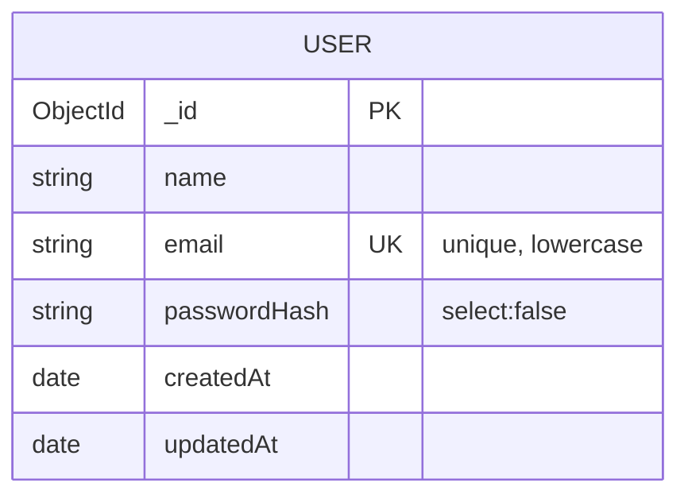
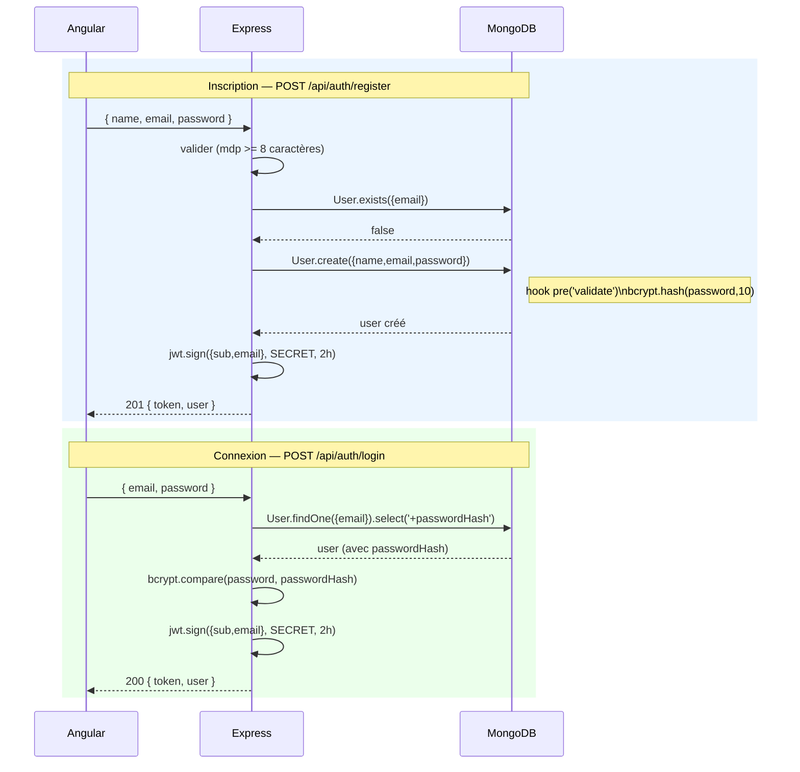
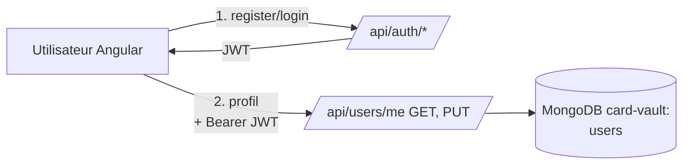

# Analyse du backend — Card Vault API

> Généré à partir du code source dans `backend/src/`. Ce document décrit
> l'architecture **actuelle**, les technologies, l'authentification et les
> échanges avec la base de données. Mis à jour à chaque étape de la V2
> (journal en §9).
>
> **01/11/2026 — V2, étape 1** : la partie audio de la V1 (modèle `Track`,
> routes `/api/tracks`, upload Multer audio) a été retirée ; sa description
> reste consultable dans la version taguée `v1.0` de ce fichier.

## 1. Vue d'ensemble

Le backend est une **API REST** minimaliste en **Node.js / Express 5**, avec
persistance **MongoDB** (via Mongoose, base `card-vault` depuis la V2).
Elle sert l'application Angular **Card Vault** (`frontend-starter/`). À
l'étape 1 de la V2, elle ne gère que l'inscription, la connexion et le
profil ; les albums, les photos de cartes (stockées sur le disque local)
et les fonctions sociales arrivent aux étapes suivantes.

### 1.1 Stack technique

| Domaine | Technologie | Rôle |
|---|---|---|
| Runtime | Node.js (ESM, `"type": "module"`) | Exécution du serveur |
| Framework HTTP | Express 5.1 | Routage, middlewares |
| Base de données | MongoDB Atlas (cloud), base `card-vault` (V2) | Persistance des données |
| ODM | Mongoose 9 | Schémas, validation, requêtes |
| Authentification | jsonwebtoken (JWT) | Sessions sans état |
| Hachage mot de passe | bcryptjs | Stockage sécurisé des mots de passe |
| Upload fichiers | Multer 2 | Dépendance conservée mais **plus utilisée** depuis le retrait de l'audio (V2, étape 1) ; réutilisée pour les photos de cartes (étape 3) |
| CORS | cors | Autoriser les appels depuis Angular (localhost:4200) |
| Tests | `node:test` + `node:assert/strict` | Tests unitaires/API légers |

### 1.2 Arborescence

```text
backend/
├── src/
│   ├── app.js            # Construction de l'app Express (routes, middlewares)
│   ├── server.js         # Point d'entrée : connexion Mongo + écoute HTTP
│   └── models/
│       └── User.js       # Schéma Mongoose Utilisateur (+ hachage mdp)
├── data/uploads/         # Fichiers envoyés (hors Git) ; vide depuis l'étape 1, photos à l'étape 3
├── test/api.test.js      # 6 tests (V2, étape 1) : health, schéma User, 401 ×2, JWT valide, /api/tracks retirée
├── .env                  # Secrets locaux (MONGODB_URI, JWT_SECRET, PORT) — jamais versionné
└── package.json
```

### 1.3 Diagramme de composants



**Séparation `app.js` / `server.js`** : `createApp()` construit l'application
Express *sans ouvrir de port*, ce qui permet aux tests (`test/api.test.js`)
d'instancier la même app sans dépendre de Mongo ni d'un port fixe.
`server.js` est le seul fichier qui se connecte à MongoDB et appelle
`.listen()`.

---

## 2. Modèle de données (MongoDB / Mongoose)

### 2.1 Schémas



- **User** (`src/models/User.js`) : le mot de passe en clair n'est **jamais
  stocké**. Un champ virtuel `password` (non persisté) déclenche un hook
  `pre('validate')` qui calcule `passwordHash = bcrypt.hash(password, 10)`.
  `passwordHash` a `select: false` : il n'est renvoyé par une requête que si
  on le demande explicitement avec `.select('+passwordHash')` (utilisé au
  login).
- `toPublic()` construit l'objet réellement envoyé au frontend (transforme
  `_id` en `id` string, retire les champs sensibles).
- Le modèle `Track` (pistes audio) a été supprimé à l'étape 1 de la V2.
  Les modèles `Album`, `Card`, `Friendship`, `Like`, `Comment` et
  `Activity` arriveront aux étapes 2 à 7 (voir `../REPORT.md`, §4).

### 2.2 Cycle de vie d'une requête base de données

```text
requête HTTP → route Express → middleware(s) → handler async
             → appel Mongoose (User.xxx) → driver MongoDB
             → réponse JSON (via toPublic())
```

---

## 3. Authentification (JWT)

### 3.1 Principe

L'authentification est **sans état (stateless)** : à la connexion, le
serveur signe un JWT contenant `{ sub: userId, email }`, valable **2 heures**
(`expiresIn: "2h"`). Le frontend doit renvoyer ce token dans l'en-tête
`Authorization: Bearer <token>` pour chaque route protégée. Aucun mot de
passe ni token n'est journalisé.

### 3.2 Inscription / Connexion



### 3.3 Middleware `auth` (protection des routes)

```mermaid
flowchart TD
    A[Requête entrante] --> B{Header Authorization\nprésent et\ncommence par 'Bearer '?}
    B -- non --> C[401 Authentification requise]
    B -- oui --> D[jwt.verify(token, SECRET)]
    D -- invalide/expiré --> E[401 Jeton invalide ou expiré]
    D -- valide --> F[req.auth = payload\n(sub, email)]
    F --> G[next\ncontinue vers le handler]
```

Le middleware `auth` (src/app.js:38) est appliqué explicitement à chaque
route qui en a besoin (`/api/users/me` ; les routes d'albums et sociales des étapes suivantes) — pas globalement —
ce qui laisse `/api/health`, `/api/auth/register` et `/api/auth/login`
publiques. L'identité utilisée dans les handlers vient **toujours de
`req.auth.sub`** (extrait du JWT vérifié), jamais d'un champ envoyé par le
client, ce qui empêche un utilisateur d'agir au nom d'un autre.

### 3.4 Routes d'authentification / utilisateur

| Méthode | Route | Protégée | Description |
|---|---|---|---|
| POST | `/api/auth/register` | non | Créer un compte, retourne `{token, user}` |
| POST | `/api/auth/login` | non | Vérifier les identifiants, retourne `{token, user}` |
| GET | `/api/users/me` | oui | Profil de l'utilisateur connecté |
| PUT | `/api/users/me` | oui | Modifier le nom de l'utilisateur connecté |

---

## 4. Upload de fichiers

_Retiré à l'étape 1 de la V2 (01/11/2026), réintroduit à l'étape 3 pour
les photos de cartes (`sharp` : vérification de l'image, miniature,
suppression des métadonnées EXIF ; URL signées pour l'affichage)._

L'upload audio de la V1 (Multer `diskStorage`, filtre MIME audio, 25 Mo,
nettoyage du fichier orphelin si MongoDB échoue) est décrit dans la
version taguée `v1.0` de ce fichier.

---

## 5. Gestion des erreurs et journalisation

Toutes les routes utilisent `try/catch` + `next(error)`. Un middleware
d'erreurs central (fin de `app.js`) mappe les erreurs connues vers des codes
HTTP cohérents :

```mermaid
flowchart TD
    E[Erreur interceptée] --> M{Type d'erreur}
    M -- ValidationError\n(Mongoose) --> R2[400 Bad Request]
    M -- CastError\n(id MongoDB invalide) --> R3[404 Not Found]
    M -- autre --> R4[next(error)\n-> gestionnaire par défaut Express]
```

Chaque requête est aussi journalisée en fin de traitement (méthode, URL,
code de statut, durée) via un middleware placé en tête de la pile
(`res.on('finish', ...)`), sans jamais logguer les corps sensibles
(mots de passe, tokens).

---

## 6. Démarrage du serveur (`server.js`)

```mermaid
flowchart TD
    A[node src/server.js] --> B[Lire MONGODB_URI depuis .env]
    B -- absente --> X[throw Error\narrêt immédiat]
    B -- présente --> C[mongoose.connect]
    C -- échec --> X2[throw Error\narrêt immédiat]
    C -- succès --> D[Vérifier / créer\ncompte démo\ndemo@example.com]
    D --> E[createApp().listen(port)]
    E --> F[API prête\nhttp://localhost:PORT/api/health]
```

Depuis la V2 (01/11/2026), l'URI de `.env` désigne la base **`card-vault`**
(vierge au départ) ; les données de la V1 sont restées dans la base `test`,
utilisée par défaut quand l'URI ne contient pas de nom de base.

Le serveur **refuse de démarrer** sans URI MongoDB valide et sans connexion
effective — il n'accepte jamais de requêtes dans un état "base
indisponible". Un compte de démonstration (`demo@example.com`) est créé
automatiquement au premier démarrage s'il n'existe pas déjà.

---

## 7. Points d'attention relevés

- **Secrets en clair localement** : `backend/.env` contient une URI MongoDB
  Atlas complète (avec identifiants) et un `JWT_SECRET` réels. Le fichier est
  bien exclu par `.gitignore`. `backend/.env.example` n'existe plus ; choix
  fait le 16/10/2026 : le README racine décrit directement le contenu
  attendu de `.env` au lieu de recréer ce fichier.
- **JWT_SECRET par défaut** : si `JWT_SECRET` n'est pas défini,
  `src/app.js` retombe sur la valeur codée en dur
  `"tp1-development-secret"` — acceptable en développement uniquement.
- **Pas de rate limiting** ni de protection anti-bruteforce sur
  `/api/auth/login`.
- **Aucune limite de nombre de fichiers par utilisateur** ni de quota total
  de stockage disque (à garder en tête pour les photos, étape 3).

---

## 8. Résumé du flux applicatif global



Les flux albums, cartes et social seront ajoutés au fil des étapes de la V2.

---

## 9. Journal des mises à jour de ce document

- **Version initiale** (Phase 0) — analyse du backend fourni.
- **TP2** — filtre `title` sur `GET /api/tracks` ; **TP3** — tests backend.
- **01/11/2026** — V2, étape 1 : retrait de l'audio (modèle `Track`,
  routes `/api/tracks`, configuration Multer), base `card-vault`, tests
  réorientés vers `/api/users/me` (§1, §1.1, §1.2, §1.3, §2, §4, §5, §6,
  §7, §8).
