# Compte-rendu V2 — Card Vault (mini projet TP4 à TP6)

> Journal détaillé, étape par étape. Synthèse pour l'enseignant :
> [../REPORT.md](../REPORT.md). Sujet : [../SUJET_ETUDIANT_TP456.md](../SUJET_ETUDIANT_TP456.md).
> Captures : `captures/v2-etapeX-sujet.png`.

## Étape 0 — Préparation (01/11/2026)

### Conception avec l'assistant IA (points 1 à 4 du sujet)

Décisions détaillées dans `../REPORT.md` (sections 2 à 5). En résumé :

1. **Fonctionnalités** : réseau de collectionneurs de cartes Pokémon ;
   albums en classeur, publics ou privés, partagés avec des amis choisis ;
   amis, activité, likes et commentaires (amis seulement), récents,
   recherche.
2. **Interfaces** : Angular Material, thème sombre (holo, puis or / bleu nuit à l'étape 1), classeur 3×3,
   ajout de carte en deux étapes (carte puis photo), barre du haut.
3. **Choix techniques** : catalogue TCGdex appelé par le backend, URL
   signées pour les images, `sharp`, règles d'accès centralisées.
4. **Découpage** : 9 étapes (0 à 8).

Points de vigilance relevés pendant la conception :
- **impossible de vérifier qu'une photo montre une carte Pokémon** sans
  vision artificielle : on vérifie à la place que c'est une image, et que
  la carte déclarée (catalogue) respecte le thème ;
- **le premier modèle social envisagé ne couvrait pas le sujet** (public =
  visible par mes amis seulement) : réadapté pour que public = visible par
  tous, et privé = partageable avec des amis choisis ;
- **données TCGdex incomplètes** : type souvent absent des Énergies, déduit
  du nom.

### Préparation

- [x] Sujet transcrit : `SUJET_ETUDIANT_TP456.md`
- [x] Branche `V2` créée depuis `main` (= tag `v1.0`)
- [x] Base MongoDB `card-vault` (vierge) : seul le nom de base a changé
      dans `backend/.env` (non versionné) ; les données V1 restent dans la
      base `test`
- [x] Règles mises à jour : backend modifiable (`frontend-starter/AGENTS.md`,
      `CLAUDE.md`), tests obligatoires par étape (`Tests.md`)
- [x] `REPORT.md` créé, README mis à jour
- [x] Commit de l'étape 0 (`90ba567`, le 01/11/2026 ; documents complétés à l'étape 1 dans `e9a9f08`)

## Étape 1 — Nettoyage de l'audio, identité, navigation (01/11/2026)

- [x] Backend : modèle `Track`, routes `/api/tracks`, configuration Multer
      audio et `escapeRegExp` supprimés ; 5 fichiers audio (15 Mo)
      supprimés de `data/uploads`
- [x] Frontend : page de pistes, `TrackService`, modèle `Track` et
      `fichiers-audio-de-test/` supprimés
- [x] `serverErrorMessage()` déplacée dans `shared/utils/http-error.ts`
- [x] Identité **Card Vault** : titre, logo, thème Material **sombre**
      **or / bleu nuit**, reflet or métallique, couleurs des 11 types
- [x] Barre du haut `MatToolbar` : Accueil · Recherche · Amis, menu profil
      (`MatMenu`), menu mobile
- [x] Connexion, inscription, profil réécrits en Angular Material
- [x] Pages d'attente Accueil, Recherche, Amis (protégées)
- [x] Tests backend (6) et frontend (23), vérification croisée
- [x] `npm run build`, vérification dans le navigateur
- [x] Documentation : `API_CONTRACT.md`, `analyse.md` (front, back),
      `Tests.md`, `REPORT.md`, README, rapport IA

### Implémentation

**Backend.** `app.js` ne garde que la santé, l'authentification et le
profil. Le dossier `data/uploads` est conservé (créé au démarrage) pour
les photos de l'étape 3, et la dépendance `multer` reste installée pour la
même raison. `API_CONTRACT.md` ne liste plus que les 5 routes restantes.

**Frontend.**
- **Thème** (`material-theme.scss`) : `mat.theme()` avec des palettes
  **générées** par `ng generate @angular/material:theme-color` (fichier
  `_theme-colors.scss`) : or `#C9A24D` (principale), bleu `#4A78C2`
  (accents), neutre bleu nuit `#1B2236` (surfaces). Les palettes
  prédéfinies de Material n'ont pas de vrai doré (`yellow` = jaune
  citron). `color-scheme: dark` choisit la version sombre des couleurs.
- **Identité** (`styles.css`) : fond bleu nuit avec halos discrets or et
  bleu, dégradé **or métallique** (`--cv-gold`, classe `.cv-gold-text`
  pour le logo et les titres), variables de couleur des 11 types pour les
  badges à venir. L'ancien style vert de la V1 est supprimé.
- **Évolution du thème** : une première version violet / cyan
  « holographique » a été écartée après essai (jugée trop « IA
  générique ») ; puis le bleu pastel irisé du dégradé a été retiré au
  profit d'un reflet or métallique. Le thème reste ajustable plus tard.
- **Barre du haut** : `MatToolbar` collante et translucide ; liens
  `mat-button` avec `routerLinkActive` ; avatar (initiale du pseudo sur
  fond or métallique) ouvrant un `MatMenu` (pseudo, email, Mon profil,
  Déconnexion) ; sous 720 px, les liens passent dans un menu « burger ».
- **Formulaires** : `MatCard` + `MatFormField` (`appearance="outline"`)
  + `<mat-error>` ; les erreurs serveur passent par `serverErrorMessage()`.
  Le profil confirme l'enregistrement par une `MatSnackBar`.
- **Pages d'attente** : un seul composant `PlaceholderPageComponent`,
  configuré par la propriété `data` de chaque route.
- **Icônes** : `MAT_ICON_DEFAULT_OPTIONS` aligne `<mat-icon>` sur la
  police *Material Symbols Outlined* chargée par `index.html`.

### Bug trouvé : un test qui ne pouvait pas échouer

La vérification croisée (bugs introduits exprès) a montré que le test
« la page Recherche est protégée par `authGuard` » **passait encore** quand
on retirait le guard. Cause, établie par un test de diagnostic : avec la
version de Vitest du projet, `expect(undefined).toContain(x)` réussit.
Une route sans guard a `canActivate` à `undefined`, donc l'assertion
`toContain(authGuard)` ne pouvait rien détecter. Corrigé avec
`toEqual([authGuard])`. Le même piège touchait les tests du message
d'erreur de connexion (`querySelector('.error')?.textContent`), corrigés
en ramenant le texte à une chaîne (`?? ''`). Détail, et impact sur
5 assertions de la V1 : `../Tests.md`, section V2.

### Vérifications dans le navigateur

Harnais Playwright (hors dépôt), base `card-vault` vierge :

| Vérification | Attendu | Observé |
|---|---|---|
| Visiteur sur `/` | redirection `/login`, barre « Connexion / Inscription » | ✅ |
| Thème | fond bleu nuit `rgb(13, 18, 32)`, icônes en *Material Symbols* (24 px) | ✅ (remesuré avec le thème final) |
| Inscription sur la nouvelle base | `201`, redirection `/profile` | ✅ |
| Navigation | Accueil, Recherche, Amis : bonne page, lien actif surligné | ✅ |
| Menu profil | pseudo, email, Mon profil, Déconnexion | ✅ |
| Modification du pseudo | SnackBar « Profil enregistré. », nouveau pseudo affiché | ✅ (carte de profil, puis menu profil) |
| Mobile (390 px) | liens masqués, menu « burger » complet | ✅ |
| Ancienne URL `/tracks` | redirection vers l'accueil | ✅ |
| Déconnexion | token supprimé, redirection `/login` | ✅ |
| Compte de démonstration | recréé sur la nouvelle base, connexion `200` | ✅ |
| Console | ni mot de passe ni JWT | ✅ |

### Captures

Connexion et inscription (thème sombre or / bleu nuit) :

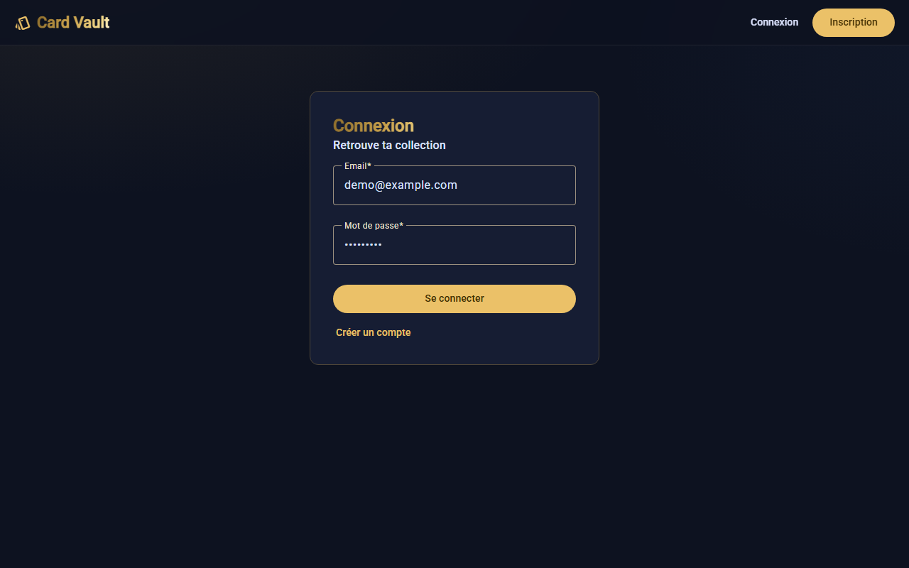
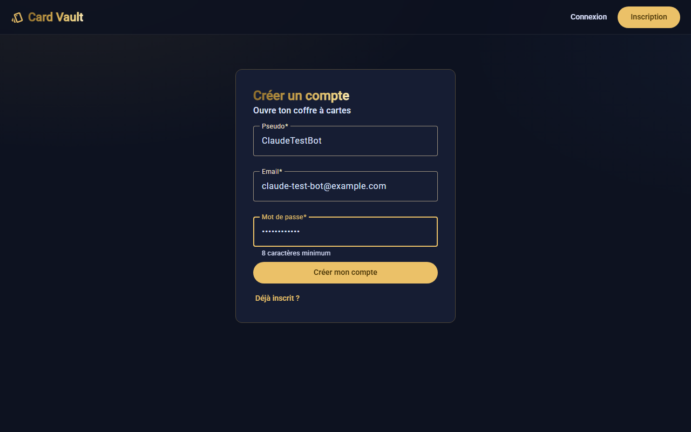

Accueil (page d'attente) avec le menu profil ouvert :

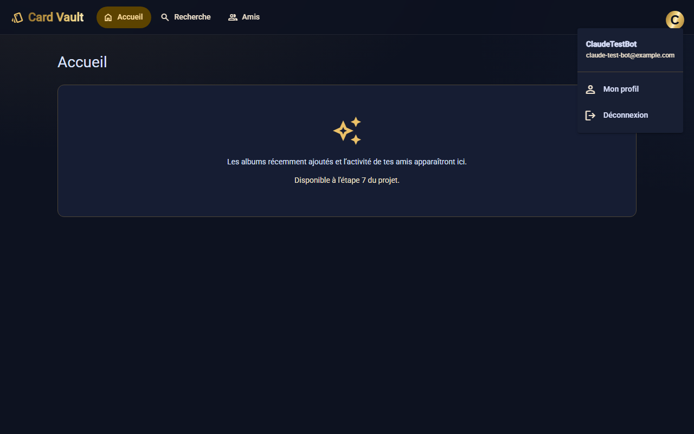

Profil : enregistrement du pseudo confirmé par une SnackBar :

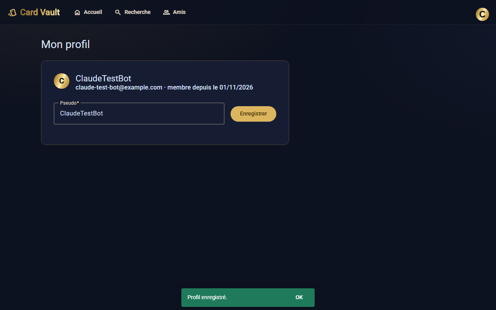

Mobile : menu de navigation :

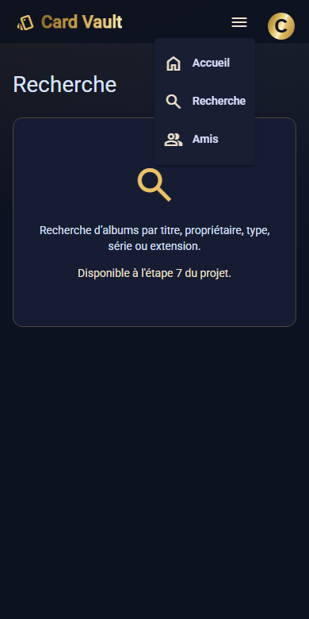

## Étape 2 — Albums (01/11/2026)

Choix faits au plan : thème **facultatif** (sans thème = collection
libre) ; **« Mes albums » dans la barre** de navigation ; suppression avec
**confirmation simple**.

- [x] Backend : modèle `Album`, routes `/api/albums` (CRUD), règles
      d'accès `canView` / `isOwner`
- [x] Backend : catalogue TCGdex via le serveur (`/api/catalog` : types,
      séries, extensions), mémoire 24 h, série Pocket exclue, `502` si
      TCGdex est injoignable
- [x] Validation du thème par le serveur (l'extension doit appartenir à la
      série) ; noms et logos recopiés dans l'album
- [x] `API_CONTRACT.md` : 8 nouvelles routes documentées
- [x] Frontend : « Mes albums » (couvertures, état vide, pagination),
      fenêtre de création / modification, page d'album (en-tête, classeur
      3×3 vide, Modifier / Supprimer pour le propriétaire)
- [x] Tests backend (29) et frontend (56), vérification croisée (13 bugs)
- [x] `npm run build`, vérification dans le navigateur (vrai TCGdex)
- [x] Documentation

### Implémentation

**Backend.** Le code est maintenant rangé par rôle :
- `routes/` contient les routes, regroupées en `Router` Express ;
- `services/` gère le catalogue TCGdex et la validation du thème ;
- `access.js` contient les règles d'accès ;
- `errors.js` définit `HttpError`, une erreur qui porte son code HTTP et
  que le gestionnaire central traduit en `{ message }`.

Un album appartient toujours à l'utilisateur du token (`ownerId =
req.auth.sub`). Un refus renvoie **404**, jamais 403 : on ne peut pas
deviner qu'un album privé existe.

**Frontend.**
- **Couverture d'album** : façon classeur, avec un « cuir » teinté par la
  couleur du type, un dos et un liseré doré. L'emblème est le logo de
  l'extension (sinon celui de la série, sinon l'icône du type). La
  visibilité est indiquée par une icône **et** par un texte pour les
  lecteurs d'écran.
- **Formulaire** : l'extension ne se choisit qu'après la série, et elle est
  vidée si on change de série. Les listes du catalogue ne sont demandées
  qu'**une fois par session**. En cas d'erreur serveur, la fenêtre reste
  ouverte avec le message.
- **Page d'album** : un en-tête aux couleurs du thème, puis le classeur (une
  page de 9 pochettes au format d'une carte, 63 × 88). Modifier et Supprimer
  ne sont affichés qu'au propriétaire ; c'est de toute façon le backend qui
  refuse les autres.

### Bugs trouvés

1. **Adresse directe d'un album = page blanche.** En ouvrant
   `/albums/<id>` directement (lien partagé, F5), le navigateur cherchait
   les fichiers de l'application dans `/albums/`. La cause : `index.html`
   n'avait pas de `<base href="/">`, et ce depuis le starter de la V1. Ça
   ne posait pas de problème tant que les adresses n'avaient qu'un niveau.
   Trouvé grâce au second compte de test, qui ouvrait l'adresse d'un album
   directement. Les tests unitaires ne pouvaient pas le voir : ils ne
   chargent pas `index.html`.
2. **Fenêtre de formulaire coupée à gauche** : une largeur minimale sur le
   formulaire, plus grande que la fenêtre. Vu sur une capture, corrigé en
   fixant la taille à l'ouverture de la fenêtre.
3. **Titre doré terne** : le dégradé s'étalait sur toute la largeur du
   titre. Un titre court n'en recevait que la partie sombre. Corrigé
   (`inline-block`), et les extrémités du dégradé ont été légèrement
   éclaircies.
4. **Test manquant** : la vérification croisée a montré qu'aucun test ne
   couvrait la création **sans thème**. Ajouté.

### Vérifications dans le navigateur

Harnais Playwright (hors dépôt), **vrai catalogue TCGdex**, deux comptes :

| Vérification | Attendu | Observé |
|---|---|---|
| « Mes albums » sans album | état vide « Ton coffre est encore vide » | ✅ |
| Création : thème complet (Psy, Écarlate et Violet, 151), public | `201`, SnackBar, logo officiel de l'extension sur la couverture | ✅ |
| Création : type seul (Feu), série seule (Épée et Bouclier), sans thème | `201` ×3 ; icône du type, logo de la série, « Collection libre » | ✅ |
| Liste des extensions | logos officiels, chargées après le choix de la série | ✅ |
| Page d'album | titre, « Album public · par ClaudeTestBot », puces du thème, classeur de 9 pochettes | ✅ |
| Modification | formulaire pré-rempli (extension « 151 » comprise), titre mis à jour, SnackBar | ✅ |
| Second compte, album public (adresse directe) | visible, **sans** Modifier ni Supprimer | ✅ (après correction de `<base href>`) |
| Second compte, album privé | « Album introuvable » | ✅ |
| Suppression | confirmation, `204`, SnackBar, retour à la liste | ✅ |
| Catalogue | types et séries demandés **une fois** pour 5 ouvertures du formulaire | ✅ |
| Mobile (390 px) | couvertures en une colonne | ✅ |
| Console | ni mot de passe ni JWT | ✅ |

### Captures

« Mes albums » vide, puis avec quatre albums (thème complet, série seule,
type seul, collection libre) :

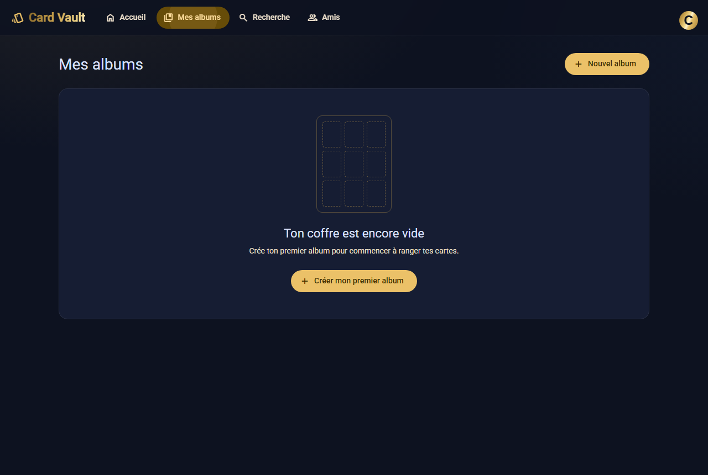
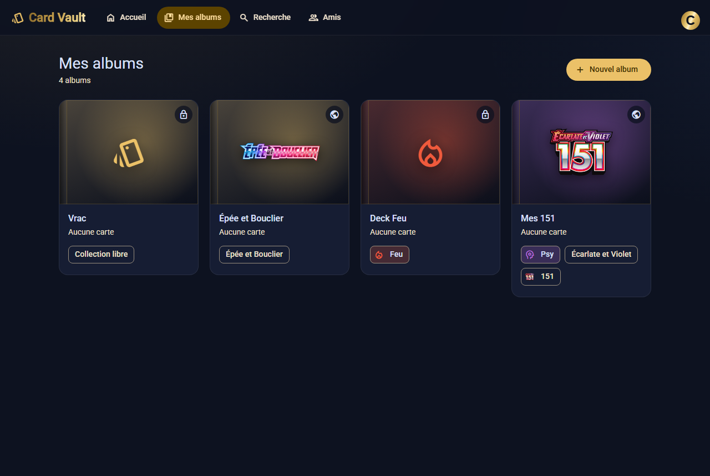

Fenêtre de création : visibilité, type, série et liste des extensions
avec leurs logos :

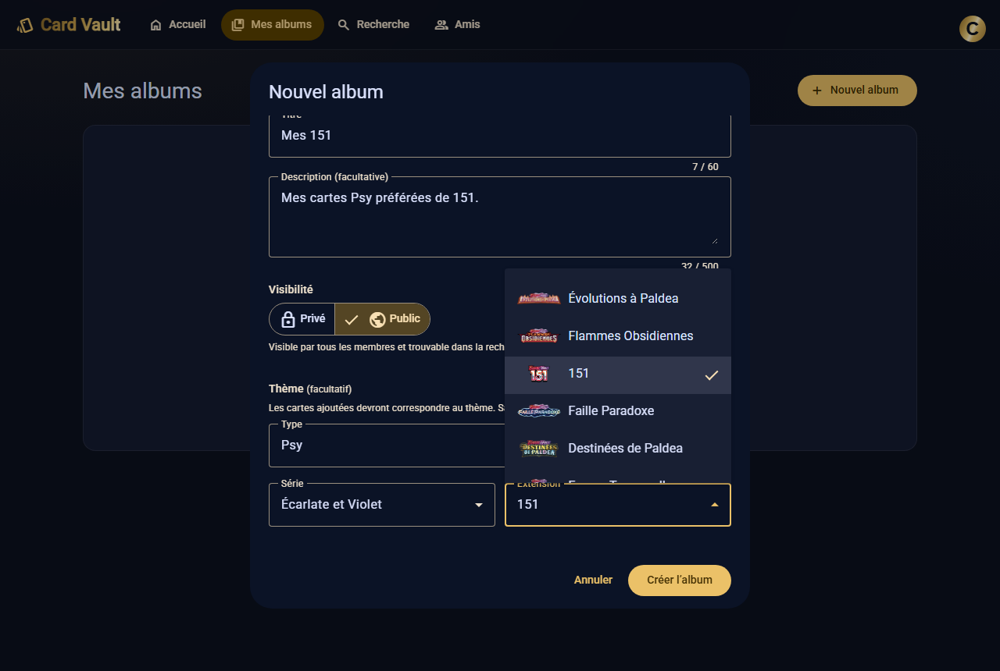

Page d'un album :

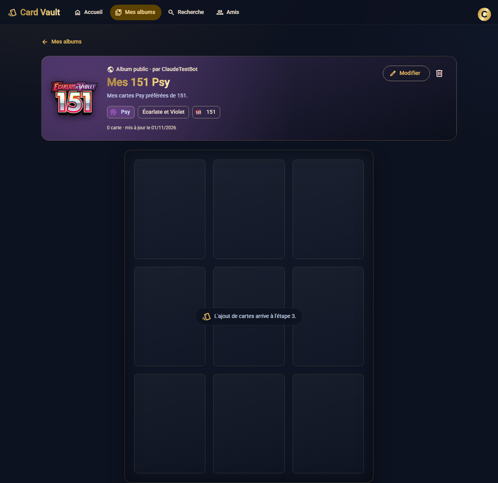

Album privé ouvert par un autre compte :

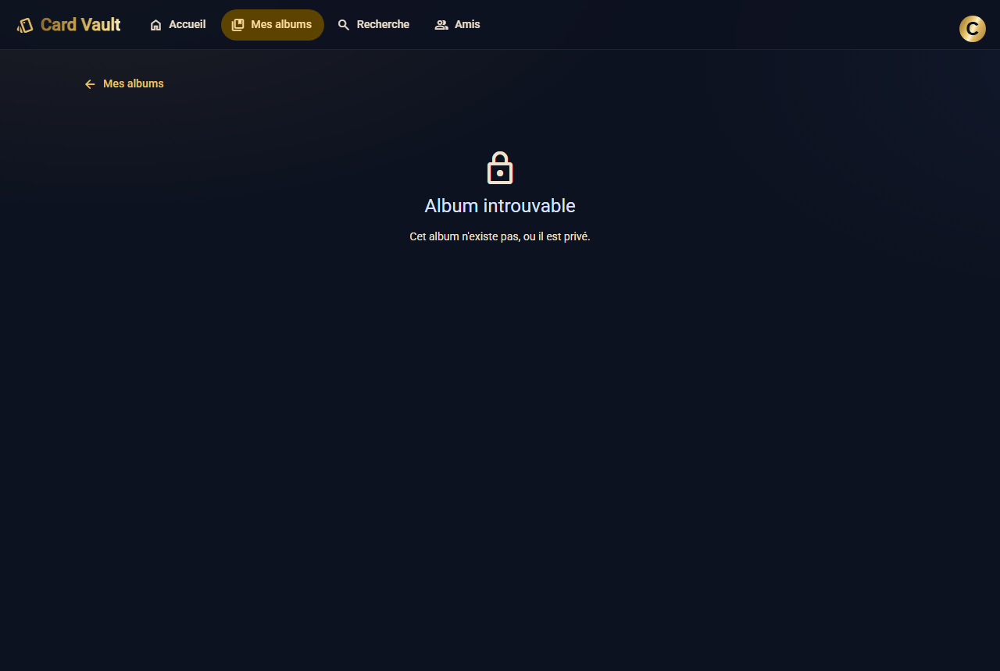

Confirmation de suppression :

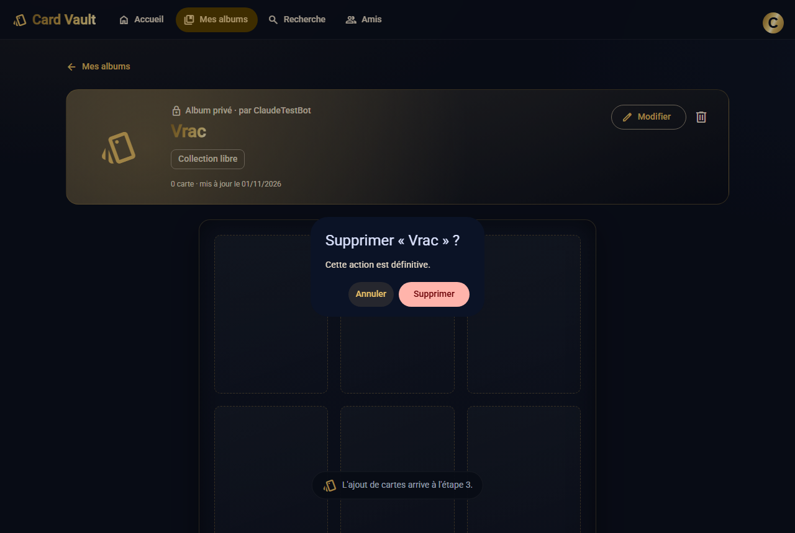

Mobile :

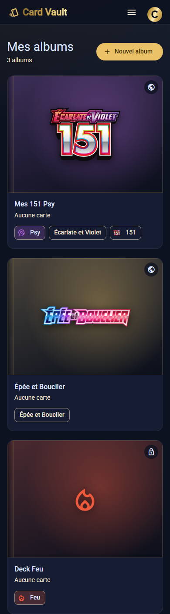

## Étape 3 — Cartes et classeur

_À faire._

## Étape 4 — Amis

_À faire._

## Étape 5 — Partage

_À faire._

## Étape 6 — Likes et commentaires

_À faire._

## Étape 7 — Découverte (récents, activité, recherche)

_À faire._

## Étape 8 — Profil, finitions, livraison V2

_À faire._
