# Compte-rendu V2 — Card Vault (mini projet TP4 à TP6)

> Journal détaillé, étape par étape. Synthèse pour l'enseignant :
> [../REPORT.md](../REPORT.md). Sujet : [../SUJET_ETUDIANT_TP456.md](../SUJET_ETUDIANT_TP456.md).
> Captures : `captures/v2-etapeX-sujet.png`.

## Étape 0 — Préparation (01/11/2026)

### Conception avec l'assistant IA (points 1 à 4 du sujet)

Décisions détaillées dans `../REPORT.md` (sections 2 à 5). En résumé :

1. **Fonctionnalités** : réseau de collectionneurs de cartes Pokémon ;
   albums en classeur, publics ou privés, partagés avec des amis choisis ;
   amis, activité, likes et commentaires (amis seulement), récents,
   recherche.
2. **Interfaces** : Angular Material, thème sombre (holo, puis or / bleu nuit à l'étape 1), classeur 3×3,
   ajout de carte en deux étapes (carte puis photo), barre du haut.
3. **Choix techniques** : catalogue TCGdex appelé par le backend, URL
   signées pour les images, `sharp`, règles d'accès centralisées.
4. **Découpage** : 9 étapes (0 à 8).

Points de vigilance relevés pendant la conception :
- **impossible de vérifier qu'une photo montre une carte Pokémon** sans
  vision artificielle : on vérifie à la place que c'est une image, et que
  la carte déclarée (catalogue) respecte le thème ;
- **le premier modèle social envisagé ne couvrait pas le sujet** (public =
  visible par mes amis seulement) : réadapté pour que public = visible par
  tous, et privé = partageable avec des amis choisis ;
- **données TCGdex incomplètes** : type souvent absent des Énergies, déduit
  du nom.

### Préparation

- [x] Sujet transcrit : `SUJET_ETUDIANT_TP456.md`
- [x] Branche `V2` créée depuis `main` (= tag `v1.0`)
- [x] Base MongoDB `card-vault` (vierge) : seul le nom de base a changé
      dans `backend/.env` (non versionné) ; les données V1 restent dans la
      base `test`
- [x] Règles mises à jour : backend modifiable (`frontend-starter/AGENTS.md`,
      `CLAUDE.md`), tests obligatoires par étape (`Tests.md`)
- [x] `REPORT.md` créé, README mis à jour
- [x] Commit de l'étape 0 (`90ba567`, le 01/11/2026 ; documents complétés à l'étape 1 dans `e9a9f08`)

## Étape 1 — Nettoyage de l'audio, identité, navigation (01/11/2026)

- [x] Backend : modèle `Track`, routes `/api/tracks`, configuration Multer
      audio et `escapeRegExp` supprimés ; 5 fichiers audio (15 Mo)
      supprimés de `data/uploads`
- [x] Frontend : page de pistes, `TrackService`, modèle `Track` et
      `fichiers-audio-de-test/` supprimés
- [x] `serverErrorMessage()` déplacée dans `shared/utils/http-error.ts`
- [x] Identité **Card Vault** : titre, logo, thème Material **sombre**
      **or / bleu nuit**, reflet or métallique, couleurs des 11 types
- [x] Barre du haut `MatToolbar` : Accueil · Recherche · Amis, menu profil
      (`MatMenu`), menu mobile
- [x] Connexion, inscription, profil réécrits en Angular Material
- [x] Pages d'attente Accueil, Recherche, Amis (protégées)
- [x] Tests backend (6) et frontend (23), vérification croisée
- [x] `npm run build`, vérification dans le navigateur
- [x] Documentation : `API_CONTRACT.md`, `analyse.md` (front, back),
      `Tests.md`, `REPORT.md`, README, rapport IA

### Implémentation

**Backend.** `app.js` ne garde que la santé, l'authentification et le
profil. Le dossier `data/uploads` est conservé (créé au démarrage) pour
les photos de l'étape 3, et la dépendance `multer` reste installée pour la
même raison. `API_CONTRACT.md` ne liste plus que les 5 routes restantes.

**Frontend.**
- **Thème** (`material-theme.scss`) : `mat.theme()` avec des palettes
  **générées** par `ng generate @angular/material:theme-color` (fichier
  `_theme-colors.scss`) : or `#C9A24D` (principale), bleu `#4A78C2`
  (accents), neutre bleu nuit `#1B2236` (surfaces). Les palettes
  prédéfinies de Material n'ont pas de vrai doré (`yellow` = jaune
  citron). `color-scheme: dark` choisit la version sombre des couleurs.
- **Identité** (`styles.css`) : fond bleu nuit avec halos discrets or et
  bleu, dégradé **or métallique** (`--cv-gold`, classe `.cv-gold-text`
  pour le logo et les titres), variables de couleur des 11 types pour les
  badges à venir. L'ancien style vert de la V1 est supprimé.
- **Évolution du thème** : une première version violet / cyan
  « holographique » a été écartée après essai (jugée trop « IA
  générique ») ; puis le bleu pastel irisé du dégradé a été retiré au
  profit d'un reflet or métallique. Le thème reste ajustable plus tard.
- **Barre du haut** : `MatToolbar` collante et translucide ; liens
  `mat-button` avec `routerLinkActive` ; avatar (initiale du pseudo sur
  fond or métallique) ouvrant un `MatMenu` (pseudo, email, Mon profil,
  Déconnexion) ; sous 720 px, les liens passent dans un menu « burger ».
- **Formulaires** : `MatCard` + `MatFormField` (`appearance="outline"`)
  + `<mat-error>` ; les erreurs serveur passent par `serverErrorMessage()`.
  Le profil confirme l'enregistrement par une `MatSnackBar`.
- **Pages d'attente** : un seul composant `PlaceholderPageComponent`,
  configuré par la propriété `data` de chaque route.
- **Icônes** : `MAT_ICON_DEFAULT_OPTIONS` aligne `<mat-icon>` sur la
  police *Material Symbols Outlined* chargée par `index.html`.

### Bug trouvé : un test qui ne pouvait pas échouer

La vérification croisée (bugs introduits exprès) a montré que le test
« la page Recherche est protégée par `authGuard` » **passait encore** quand
on retirait le guard. Cause, établie par un test de diagnostic : avec la
version de Vitest du projet, `expect(undefined).toContain(x)` réussit.
Une route sans guard a `canActivate` à `undefined`, donc l'assertion
`toContain(authGuard)` ne pouvait rien détecter. Corrigé avec
`toEqual([authGuard])`. Le même piège touchait les tests du message
d'erreur de connexion (`querySelector('.error')?.textContent`), corrigés
en ramenant le texte à une chaîne (`?? ''`). Détail, et impact sur
5 assertions de la V1 : `../Tests.md`, section V2.

### Vérifications dans le navigateur

Harnais Playwright (hors dépôt), base `card-vault` vierge :

| Vérification | Attendu | Observé |
|---|---|---|
| Visiteur sur `/` | redirection `/login`, barre « Connexion / Inscription » | ✅ |
| Thème | fond bleu nuit `rgb(13, 18, 32)`, icônes en *Material Symbols* (24 px) | ✅ (remesuré avec le thème final) |
| Inscription sur la nouvelle base | `201`, redirection `/profile` | ✅ |
| Navigation | Accueil, Recherche, Amis : bonne page, lien actif surligné | ✅ |
| Menu profil | pseudo, email, Mon profil, Déconnexion | ✅ |
| Modification du pseudo | SnackBar « Profil enregistré. », nouveau pseudo affiché | ✅ (carte de profil, puis menu profil) |
| Mobile (390 px) | liens masqués, menu « burger » complet | ✅ |
| Ancienne URL `/tracks` | redirection vers l'accueil | ✅ |
| Déconnexion | token supprimé, redirection `/login` | ✅ |
| Compte de démonstration | recréé sur la nouvelle base, connexion `200` | ✅ |
| Console | ni mot de passe ni JWT | ✅ |

### Captures

Connexion et inscription (thème sombre or / bleu nuit) :

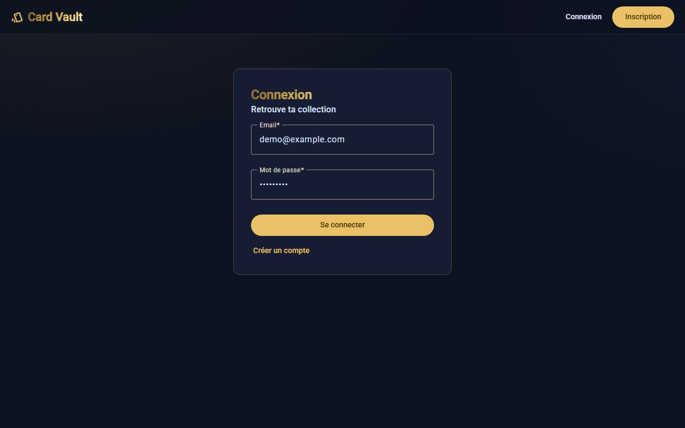
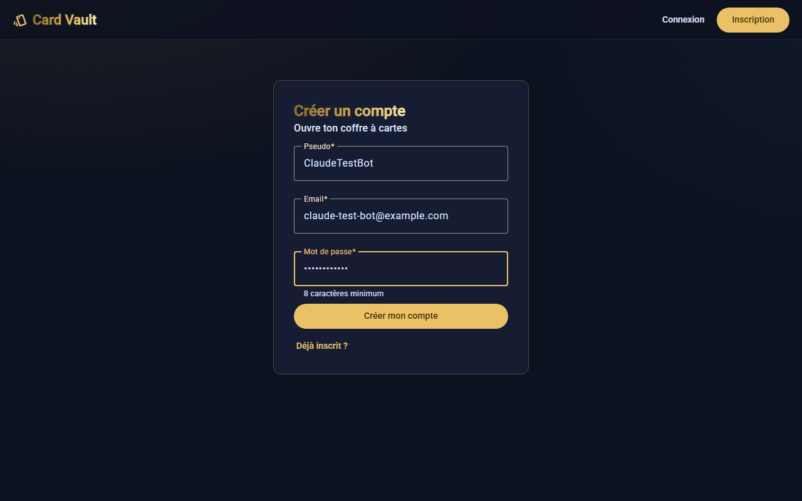

Accueil (page d'attente) avec le menu profil ouvert :

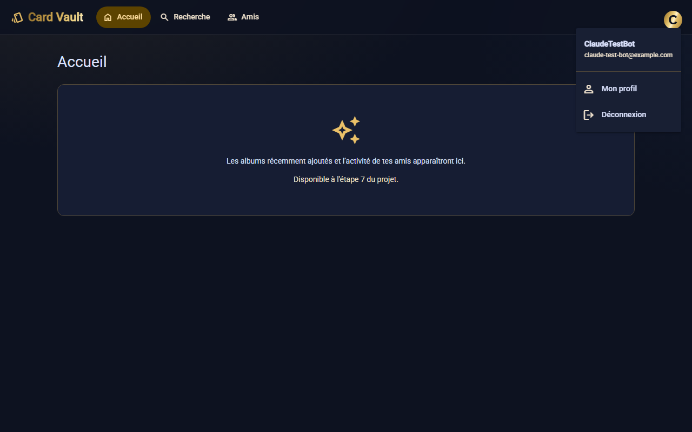

Profil : enregistrement du pseudo confirmé par une SnackBar :

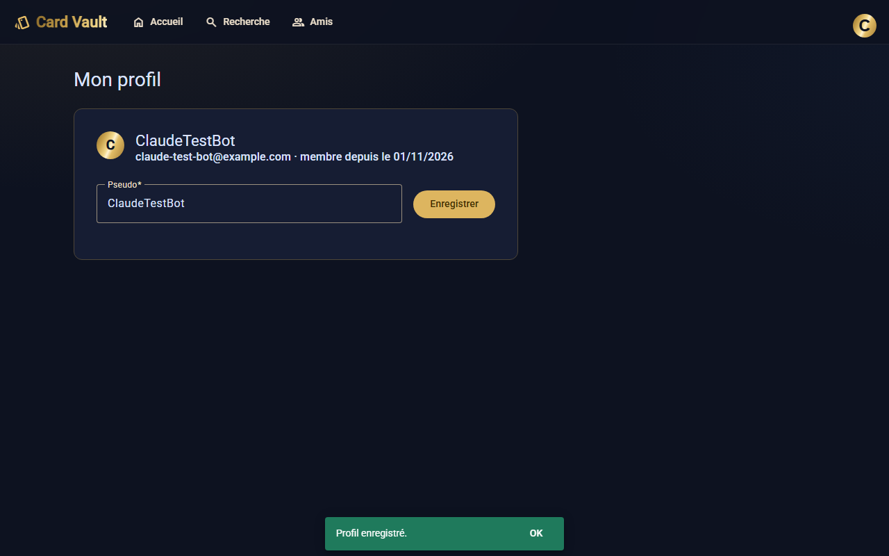

Mobile : menu de navigation :

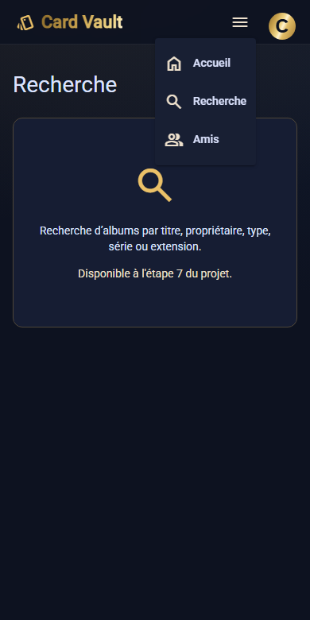

## Étape 2 — Albums (01/11/2026)

Choix faits au plan : thème **facultatif** (sans thème = collection
libre) ; **« Mes albums » dans la barre** de navigation ; suppression avec
**confirmation simple**.

- [x] Backend : modèle `Album`, routes `/api/albums` (CRUD), règles
      d'accès `canView` / `isOwner`
- [x] Backend : catalogue TCGdex via le serveur (`/api/catalog` : types,
      séries, extensions), mémoire 24 h, série Pocket exclue, `502` si
      TCGdex est injoignable
- [x] Validation du thème par le serveur (l'extension doit appartenir à la
      série) ; noms et logos recopiés dans l'album
- [x] `API_CONTRACT.md` : 8 nouvelles routes documentées
- [x] Frontend : « Mes albums » (couvertures, état vide, pagination),
      fenêtre de création / modification, page d'album (en-tête, classeur
      3×3 vide, Modifier / Supprimer pour le propriétaire)
- [x] Tests backend (29) et frontend (56), vérification croisée (13 bugs)
- [x] `npm run build`, vérification dans le navigateur (vrai TCGdex)
- [x] Documentation

### Implémentation

**Backend.** Le code est maintenant rangé par rôle :
- `routes/` contient les routes, regroupées en `Router` Express ;
- `services/` gère le catalogue TCGdex et la validation du thème ;
- `access.js` contient les règles d'accès ;
- `errors.js` définit `HttpError`, une erreur qui porte son code HTTP et
  que le gestionnaire central traduit en `{ message }`.

Un album appartient toujours à l'utilisateur du token (`ownerId =
req.auth.sub`). Un refus renvoie **404**, jamais 403 : on ne peut pas
deviner qu'un album privé existe.

**Frontend.**
- **Couverture d'album** : façon classeur, avec un « cuir » teinté par la
  couleur du type, un dos et un liseré doré. L'emblème est le logo de
  l'extension (sinon celui de la série, sinon l'icône du type). La
  visibilité est indiquée par une icône **et** par un texte pour les
  lecteurs d'écran.
- **Formulaire** : l'extension ne se choisit qu'après la série, et elle est
  vidée si on change de série. Les listes du catalogue ne sont demandées
  qu'**une fois par session**. En cas d'erreur serveur, la fenêtre reste
  ouverte avec le message.
- **Page d'album** : un en-tête aux couleurs du thème, puis le classeur (une
  page de 9 pochettes au format d'une carte, 63 × 88). Modifier et Supprimer
  ne sont affichés qu'au propriétaire ; c'est de toute façon le backend qui
  refuse les autres.

### Bugs trouvés

1. **Adresse directe d'un album = page blanche.** En ouvrant
   `/albums/<id>` directement (lien partagé, F5), le navigateur cherchait
   les fichiers de l'application dans `/albums/`. La cause : `index.html`
   n'avait pas de `<base href="/">`, et ce depuis le starter de la V1. Ça
   ne posait pas de problème tant que les adresses n'avaient qu'un niveau.
   Trouvé grâce au second compte de test, qui ouvrait l'adresse d'un album
   directement. Les tests unitaires ne pouvaient pas le voir : ils ne
   chargent pas `index.html`.
2. **Fenêtre de formulaire coupée à gauche** : une largeur minimale sur le
   formulaire, plus grande que la fenêtre. Vu sur une capture, corrigé en
   fixant la taille à l'ouverture de la fenêtre.
3. **Titre doré terne** : le dégradé s'étalait sur toute la largeur du
   titre. Un titre court n'en recevait que la partie sombre. Corrigé
   (`inline-block`), et les extrémités du dégradé ont été légèrement
   éclaircies.
4. **Test manquant** : la vérification croisée a montré qu'aucun test ne
   couvrait la création **sans thème**. Ajouté.

### Vérifications dans le navigateur

Harnais Playwright (hors dépôt), **vrai catalogue TCGdex**, deux comptes :

| Vérification | Attendu | Observé |
|---|---|---|
| « Mes albums » sans album | état vide « Ton coffre est encore vide » | ✅ |
| Création : thème complet (Psy, Écarlate et Violet, 151), public | `201`, SnackBar, logo officiel de l'extension sur la couverture | ✅ |
| Création : type seul (Feu), série seule (Épée et Bouclier), sans thème | `201` ×3 ; icône du type, logo de la série, « Collection libre » | ✅ |
| Liste des extensions | logos officiels, chargées après le choix de la série | ✅ |
| Page d'album | titre, « Album public · par ClaudeTestBot », puces du thème, classeur de 9 pochettes | ✅ |
| Modification | formulaire pré-rempli (extension « 151 » comprise), titre mis à jour, SnackBar | ✅ |
| Second compte, album public (adresse directe) | visible, **sans** Modifier ni Supprimer | ✅ (après correction de `<base href>`) |
| Second compte, album privé | « Album introuvable » | ✅ |
| Suppression | confirmation, `204`, SnackBar, retour à la liste | ✅ |
| Catalogue | types et séries demandés **une fois** pour 5 ouvertures du formulaire | ✅ |
| Mobile (390 px) | couvertures en une colonne | ✅ |
| Console | ni mot de passe ni JWT | ✅ |

### Captures

« Mes albums » vide, puis avec quatre albums (thème complet, série seule,
type seul, collection libre) :

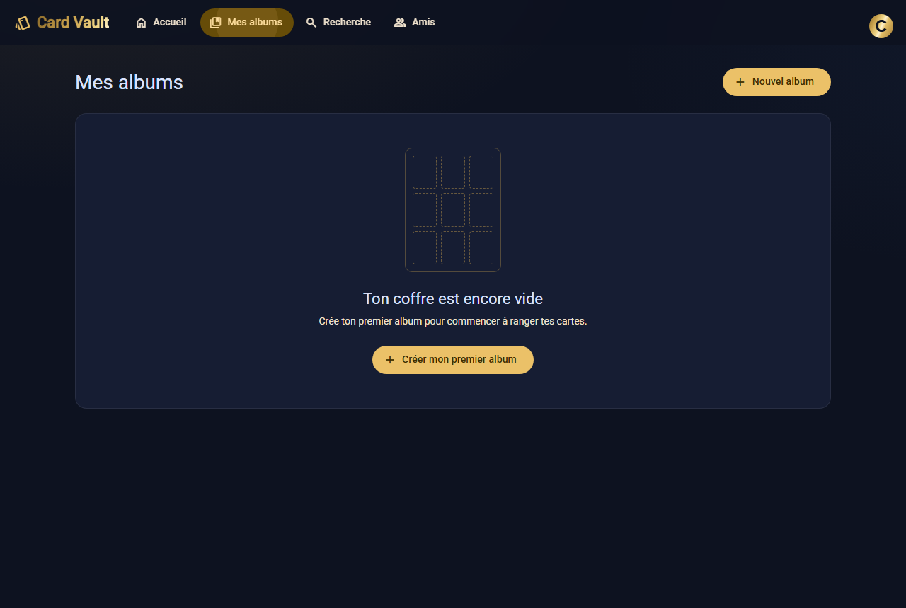
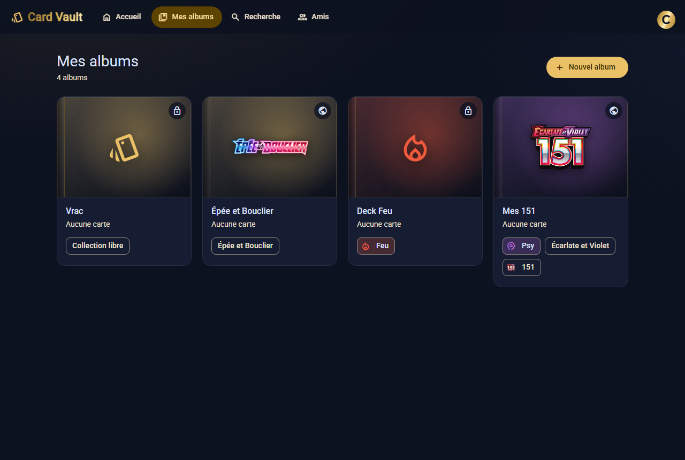

Fenêtre de création : visibilité, type, série et liste des extensions
avec leurs logos :

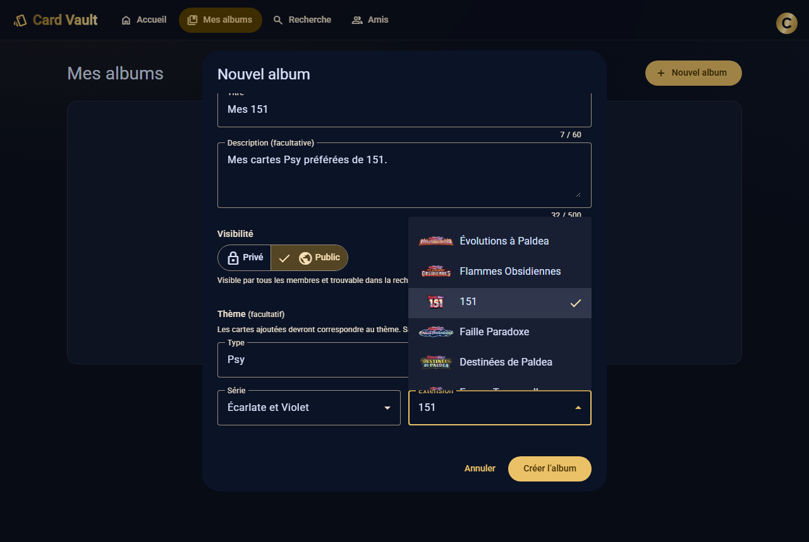

Page d'un album :

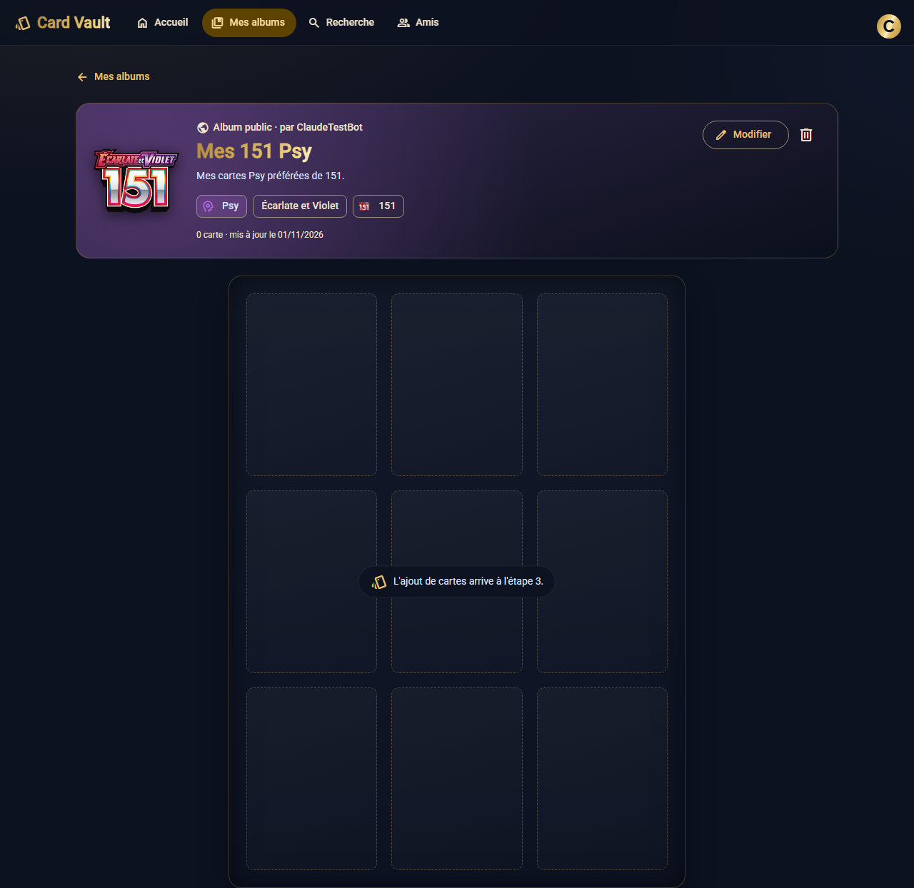

Album privé ouvert par un autre compte :

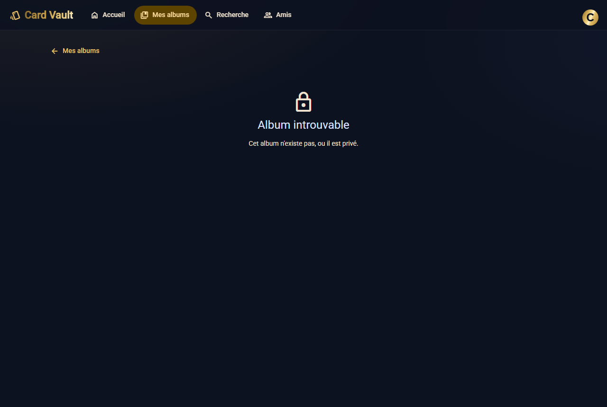

Confirmation de suppression :

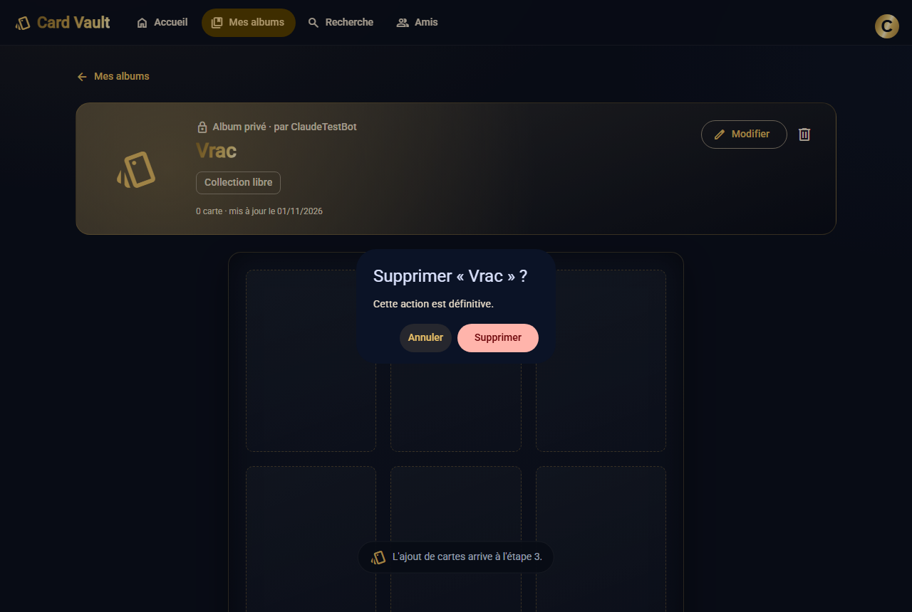

Mobile :

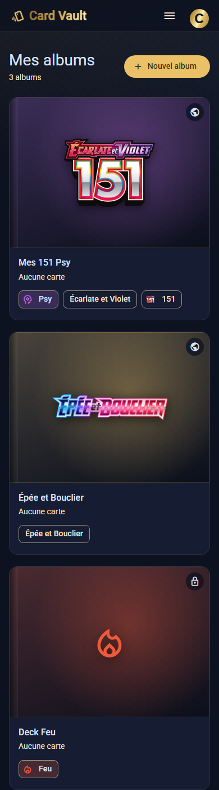

## Étape 3 — Cartes et classeur (01/11/2026)

Choix faits au plan : cartes incompatibles **affichées grisées** (avec la
raison) dans la recherche ; **doublons autorisés** ; photo **obligatoire** ;
couverture d'album **inchangée** (logo), les photos ne se voient que dans
l'album.

- [x] Explication détaillée de l'API TCGdex et de son utilisation (voir
      ci-dessous et `../REPORT.md`, §4.1)
- [x] Backend : recherche et détail de cartes, type des Énergies déduit du
      nom, contrôle de cohérence avec le thème
- [x] Backend : modèle `Card`, ajout avec photo (Multer en mémoire +
      `sharp`), classeur paginé et filtrable, suppression (carte, album en
      cascade), `409` au changement de thème
- [x] Backend : photos servies par **URL signées**
- [x] Frontend : fenêtre d'ajout en deux étapes (`MatStepper`), classeur
      3×3 (pagination, filtre, reflet, squelettes), zoom
- [x] Tests backend (66) et frontend (78), vérification croisée (22 bugs)
- [x] `npm run build`, vérification dans le navigateur (vrai TCGdex, vraies
      photos de test)
- [x] Documentation

### L'API TCGdex en bref

TCGdex est une base publique de toutes les cartes Pokémon : on l'interroge
par une URL (`https://api.tcgdex.net/v2/fr/...`), elle répond en JSON, en
français, sans clé. Quatre questions servent :

| Question | Ce qu'elle donne | Ce qu'elle ne donne pas |
|---|---|---|
| `/cards?name=dracaufeu` (recherche) | id, numéro, nom, image ; recherche partielle, insensible à la casse ; filtre `set.id` possible | type, catégorie, nom de l'extension ; pas de filtre par série ; le tri est ignoré |
| `/cards/sv03.5-006` (détail) | catégorie, types, rareté, extension | la série |
| `/sets/sv03.5` (extension) | sa série | — |
| image `…/006/low.webp` ou `high.webp` | vignette (27 Ko) ou grand format (98 Ko) | certaines cartes n'ont pas d'image |

C'est **le backend** qui l'interroge, jamais Angular, pour quatre raisons :
le contrôle du thème doit être fait par le serveur (un client peut mentir),
la mémoire (une carte n'est demandée qu'une fois), le regroupement des
informations (nom de l'extension, série) et une seule adresse pour Angular.
Seules les images officielles, publiques, sont chargées directement depuis
TCGdex par le navigateur.

Particularités découvertes en interrogeant la vraie API : le type est
souvent absent des Énergies (déduit du nom, y compris des noms anglais et
collés comme « GrassFireWater ») ; la recherche renvoie aussi les cartes
Pocket (retirées) ; 22 des 113 Dracaufeu n'ont pas d'image ; aucune Énergie
Feu n'a d'image en français.

### Implémentation

**Backend.**
- `services/card-info.js` décrit une carte (catégorie, sous-catégorie,
  types, extension, série) et la compare au thème (`checkTheme`), avec la
  raison en clair (« Type Eau : l'album est réservé au type Feu »).
- `services/images.js` traite la photo avec `sharp` :
  - lecture du contenu (un faux fichier est refusé) ;
  - redressement ;
  - suppression des métadonnées, dont la position GPS ;
  - deux versions WebP.

  Il signe aussi les URL : signature HMAC-SHA256 avec le secret du
  serveur, valable 1 à 2 h, identique pendant l'heure pour profiter du
  cache du navigateur.
- À l'ajout d'une carte, le serveur contrôle dans cet ordre :
  1. le propriétaire ;
  2. la photo présente ;
  3. la carte existante ;
  4. la cohérence avec le thème ;
  5. **seulement ensuite**, il traite la photo.
- `config.js` regroupe le dossier des photos et le secret, partagés par
  `app.js` et le service d'images.

**Frontend.**
- **Fenêtre d'ajout** :
  - recherche avec un délai de frappe de 300 ms (`debounceTime`) ; une
    nouvelle frappe annule la requête en cours (`switchMap`) ;
  - options avec vignette officielle, cartes refusées grisées en fin de
    liste ;
  - détail avec le **verdict du serveur** : « Suivant » est bloqué si la
    carte est refusée ;
  - photo vérifiée (format, taille) et prévisualisée, puis envoyée avec
    barre de progression.
- **Classeur** :
  - 9 pochettes par page ;
  - photos au format carte, avec un reflet or qui balaie la carte au
    survol ;
  - pastilles de type et de sous-catégorie ;
  - squelettes animés pendant le chargement ;
  - filtre par catégorie et pagination.
- **Zoom** : ta photo à côté de l'image officielle, avec les informations
  de la carte.

### Bugs et améliorations trouvés

1. **Focus perdu à l'ouverture de la fenêtre d'ajout.** Le focus allait
   sur l'en-tête du stepper, et la frappe au clavier était perdue. Le
   harnais l'a révélé : sa saisie s'arrêtait à « dra ». Le focus est
   maintenant placé sur le champ de recherche.
2. **Cartes compatibles noyées dans la liste.** Dans un album de série, les
   2 cartes acceptées sur 19 arrivaient en dernier. Le serveur les trie
   maintenant en tête ; un test le vérifie.
3. **Test manquant sur l'ordre des contrôles** (vérification croisée) :
   traiter la photo avant le contrôle du thème donnait le même résultat
   final. Un test qui rend l'ordre visible a été ajouté.
4. **Vulnérabilités de dépendances** (Express, Multer) signalées à
   l'installation de `sharp` : corrigées par `npm audit fix`, avec des mises
   à jour compatibles et sans `--force`.
5. **Windows** : un test gardait les fichiers d'image ouverts (`EBUSY` à la
   suppression). Le test a été corrigé ; l'application n'est pas concernée.

### Vérifications dans le navigateur

Harnais Playwright (hors dépôt), vrai TCGdex. Photos de test réalistes :
l'image officielle posée sur une « table en bois », avec une position GPS
dans les métadonnées ; l'une est prise « couchée » (orientation EXIF 6).

| Vérification | Attendu | Observé |
|---|---|---|
| Dracaufeu-ex dans « Mes 151 Psy » | refusé : « Type Feu : l'album est réservé au type Psy », « Suivant » bloqué | ✅ |
| Mewtwo, Alakazam-ex dans « Mes 151 Psy » | ajoutés (`201`), SnackBar | ✅ |
| Dracaufeu-ex, Hyper Ball (Dresseur), Énergie Feu dans « Deck Feu » | ajoutés ; Énergie typée Feu **par son nom** | ✅ |
| Carapuce dans « Deck Feu » | refusé : « Type Eau… » | ✅ |
| Album de série « Épée et Bouclier » | 17 options sur 19 grisées, les 2 acceptées en tête | ✅ |
| Photo prise couchée | affichée droite (1200 × 1600) | ✅ |
| Photo servie | `image/webp`, `Cache-Control: private`, **aucun EXIF** | ✅ |
| Filtre Dresseur / Énergie / Pokémon / Toutes | une seule carte par catégorie, puis les trois | ✅ |
| « Deck Feu » → type Eau | `409` « 2 carte(s) ne le respectent pas (ex. Dracaufeu-ex) » | ✅ |
| Autre compte, album public | 2 cartes visibles, photos chargées, pas de « Ajouter » | ✅ |
| Autre compte, cartes d'un album privé | `404` | ✅ |
| URL d'image sans signature | `403` | ✅ |
| Retrait d'Hyper Ball depuis le zoom | confirmation, SnackBar, carte retirée | ✅ |
| Mobile (390 px) | classeur 3×3 lisible | ✅ |
| Console | ni mot de passe ni JWT | ✅ |

### Captures

Recherche d'une carte, puis carte acceptée et carte refusée :

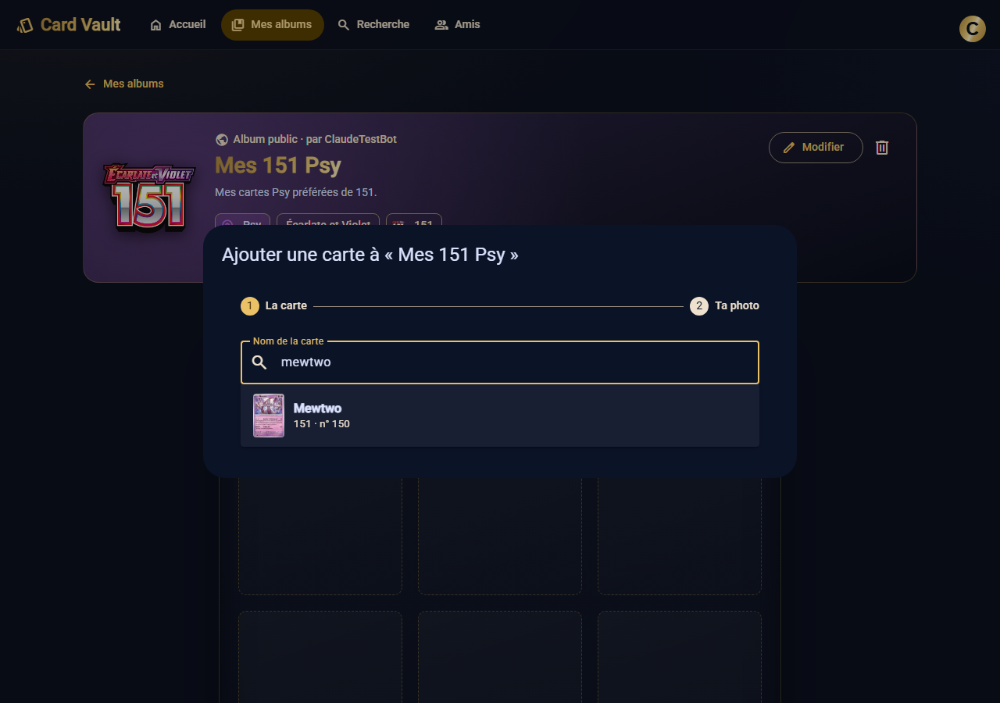
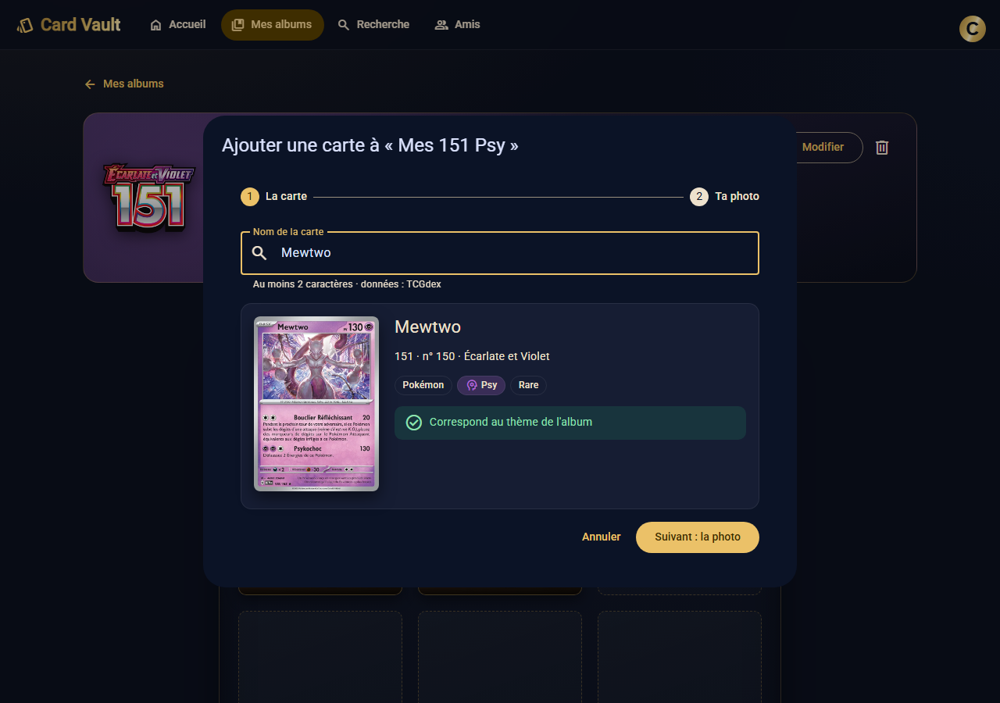
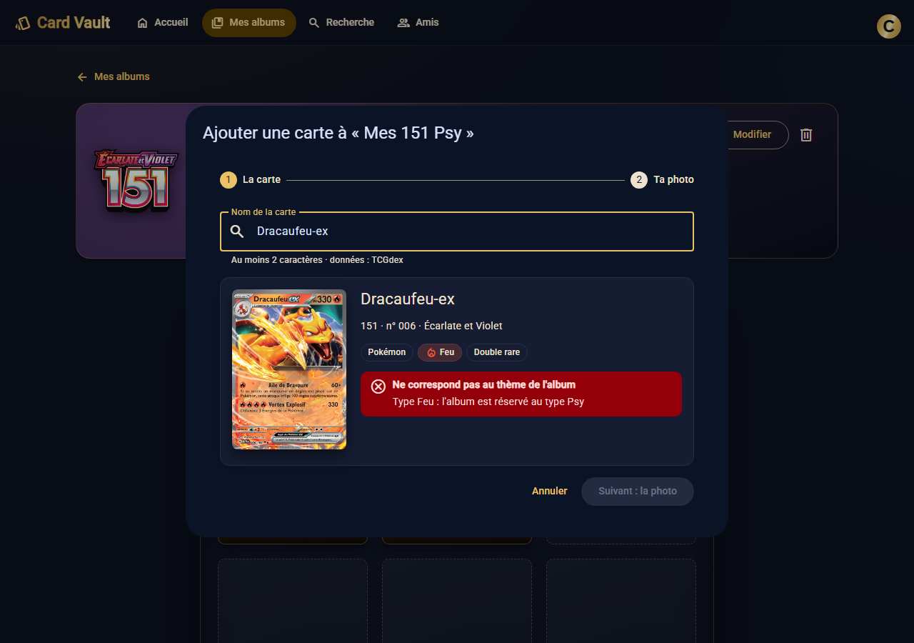

Album de série : cartes acceptées en tête, les autres grisées avec la
raison :

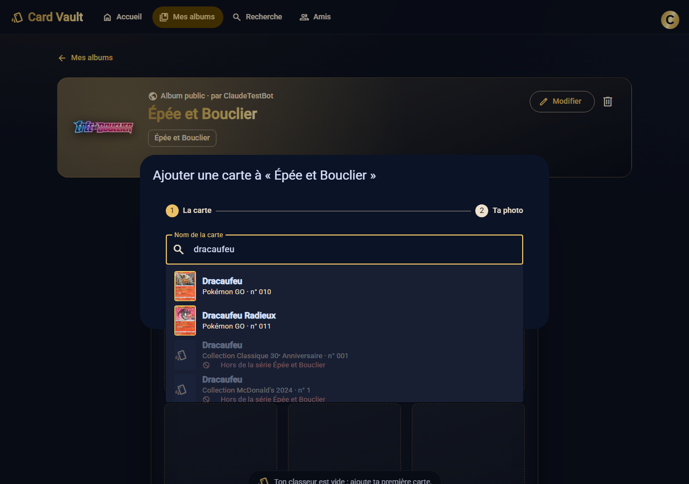

Étape photo :

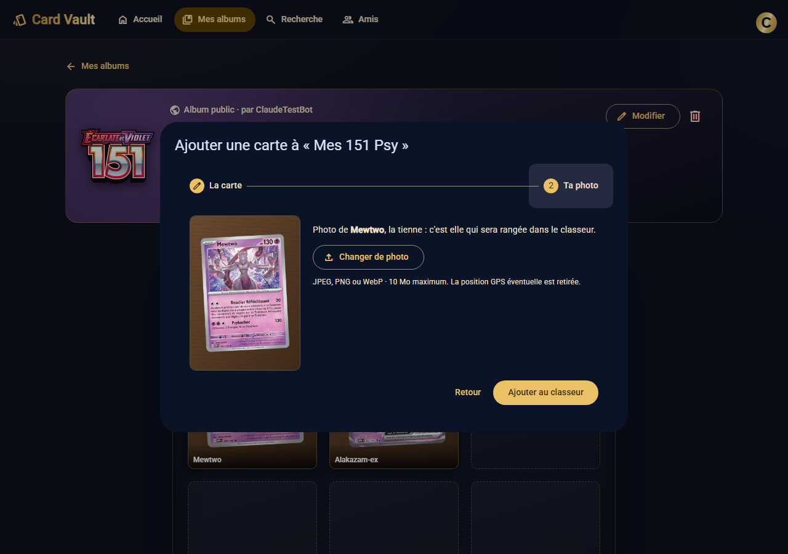

Le classeur, le reflet au survol, et le filtre « Dresseur » :

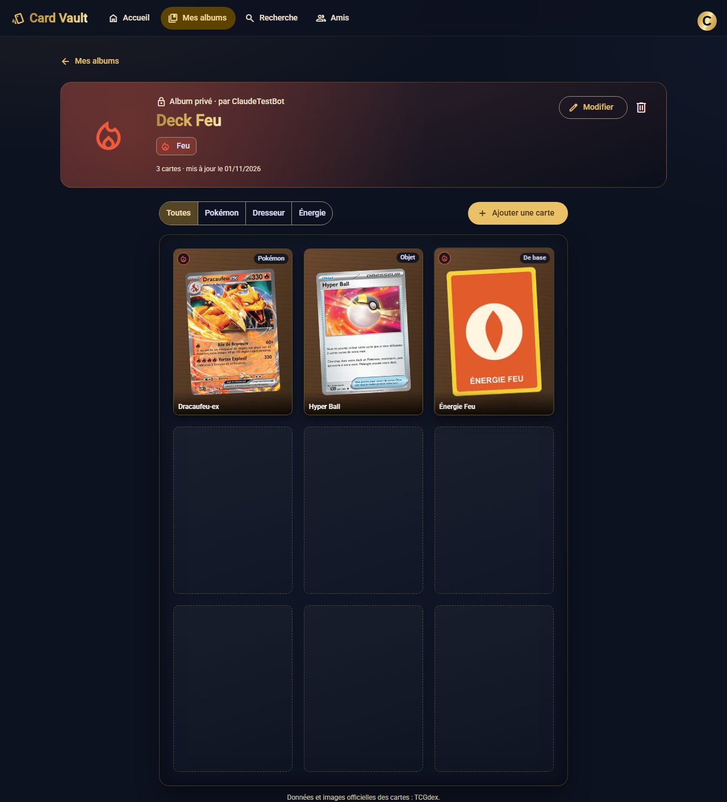
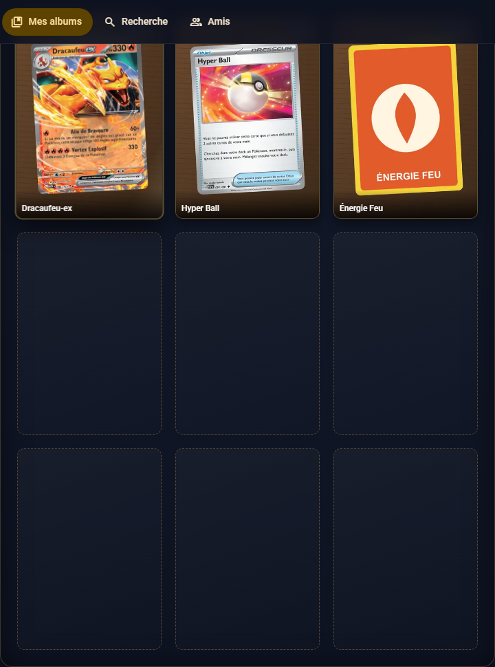
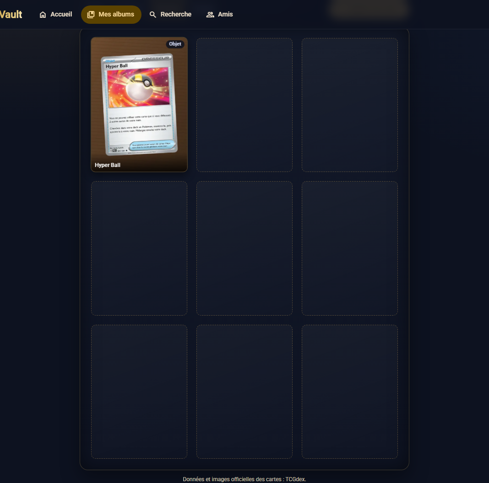

Zoom (photo prise couchée, affichée droite, à côté de l'image officielle) :

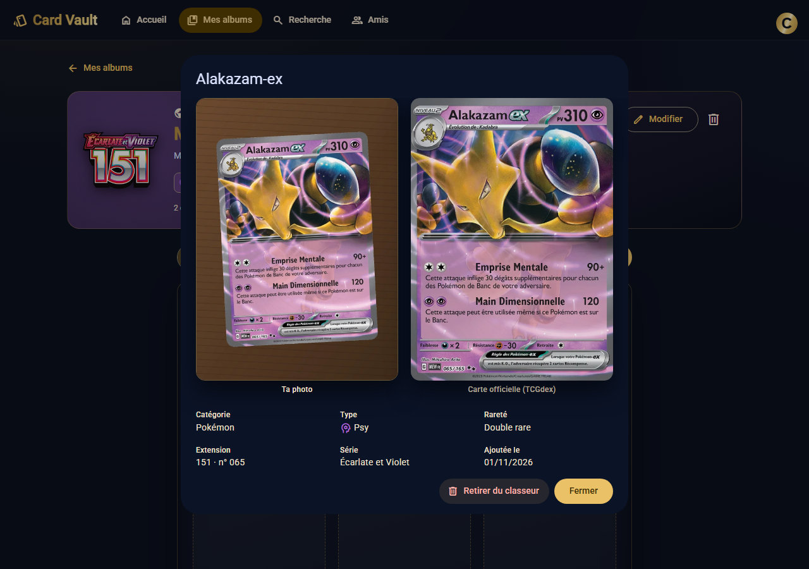

Mobile :

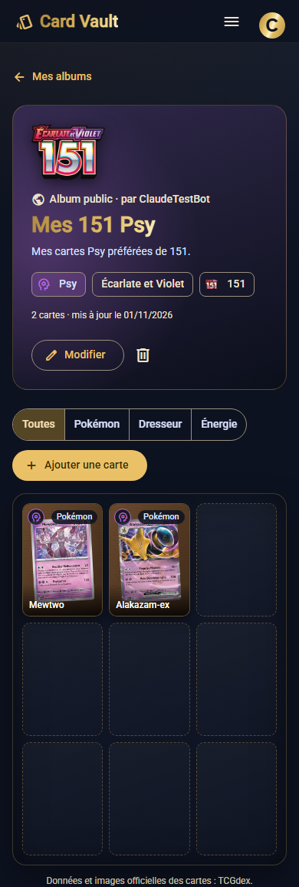

### Complément : recadrage de la photo (01/11/2026)

**Pourquoi.** En testant avec une vraie photo prise au téléphone,
l'utilisateur a demandé si la photo était « juste mise dans le cadre ».
C'était le cas : la pochette affichait la photo en « remplissage », coupée
**au centre**, sans savoir où était la carte. Une photo prise de loin
montrait surtout la table. Trois options ont été comparées (recadrage
manuel, détection automatique des bords, simple conseil de cadrage) ; le
**recadrage manuel** a été retenu, avec des boutons de rotation.

**Fonctionnement.**
- À l'étape « Ta photo », un **cadre au format carte** (63:88) est posé sur
  la photo ; on le déplace et on le redimensionne. Un aperçu montre le
  résultat. Deux boutons tournent la photo d'un quart de tour.
- Le navigateur n'envoie **que les coordonnées** du cadre et le nombre de
  quarts de tour, avec la photo d'origine. Le serveur redresse, tourne,
  vérifie que le cadre est dans l'image, puis **découpe l'original** avec
  `sharp` : la qualité est celle de la photo, pas d'une copie réduite.
- Librairie utilisée : `ngx-image-cropper` (licence MIT, compatible
  Angular 22).

**Tests** : backend 74/74, frontend 84/84, build OK ; 15 bugs introduits
volontairement, tous détectés (l'un seulement après l'ajout d'un test, voir
[Tests.md](../Tests.md)).

| Vérification dans le navigateur | Attendu | Observé |
|---|---|---|
| Photo couchée et décentrée, ¼ de tour à gauche | photo droite dans le recadreur | ✅ |
| Cadre tiré jusqu'aux coins de la carte | aperçu = la carte seule | ✅ |
| Envoi | `rotation: 3`, cadre en pixels, `201` | ✅ |
| Photo rangée | 316 × 441 (format carte), droite, sans la table | ✅ |
| Mobile (390 px) | utilisable, pas de défilement horizontal | ✅ |
| Console | aucune erreur | ✅ |

Défaut trouvé à la capture et corrigé : les icônes des boutons de rotation
étaient décalées (boutons prévus pour du texte) ; ce sont maintenant des
boutons-icônes avec info-bulle.

Photo couchée et décentrée, telle que choisie :

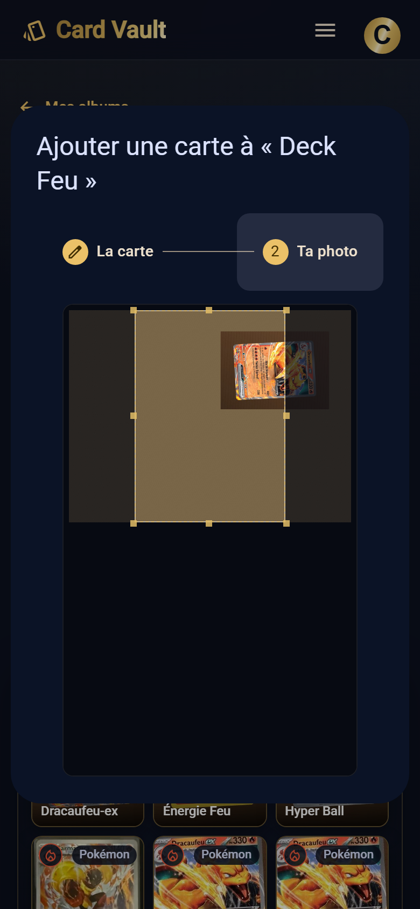

Après un quart de tour et le cadre ajusté sur la carte (aperçu à droite) :

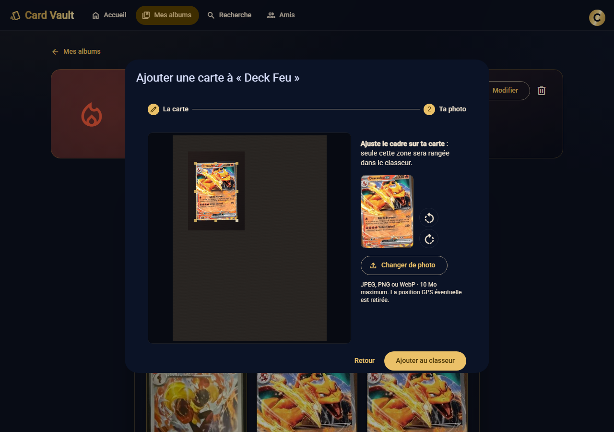

Dans le classeur, la carte recadrée (2e ligne, au centre) remplit sa
pochette, contrairement aux photos non recadrées :

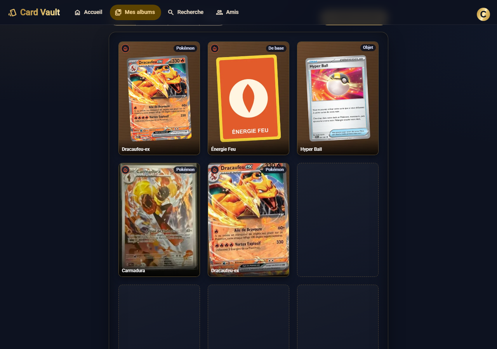

## Étape 4 — Amis (02/11/2026)

Choix faits au plan :
- recherche des collectionneurs **par pseudo** (les emails ne sont jamais
  montrés) ;
- invitation refusée **supprimée sans prévenir** l'expéditeur, qui peut
  réinviter plus tard ;
- badge d'invitations rechargé **à chaque changement de page et après
  chaque action**, sans requête en arrière-plan ;
- bouton **« Inviter en ami » sur la page d'un album** d'un autre
  utilisateur.

Retenu par défaut : si j'invite quelqu'un qui m'avait déjà invité, son
invitation est **acceptée automatiquement** (invitations croisées).

- [x] Backend : modèle `Friendship` (un seul lien par paire
      d'utilisateurs), service `friends.js` (relation, `areFriends`,
      `friendIds` pour les étapes 5 à 7)
- [x] Backend : recherche d'utilisateurs, liste des amis, invitations
      (envoyer, accepter, refuser, annuler), retrait d'un ami ;
      `owner.relation` ajouté à la lecture d'un album
- [x] `API_CONTRACT.md` : 7 nouvelles routes, `GET /albums/:id` complété
- [x] Frontend : page Amis (recherche, onglets Amis / Reçues / Envoyées),
      bouton d'amitié réutilisable, badge dans la barre du haut, bouton
      sur la page d'album
- [x] Tests backend (91) et frontend (110), vérification croisée (27 bugs)
- [x] `npm run build`, vérification dans le navigateur (3 comptes, vraie base)
- [x] Documentation

### Le principe, en bref

Une amitié fonctionne comme **une lettre qui attend une réponse** :
1. Alice invite Bob : un lien « en attente » est créé.
2. Bob accepte, et ils deviennent amis. S'il refuse, le lien disparaît.
3. Chacun peut ensuite retirer l'autre, et le lien disparaît aussi.

Chaque paire d'utilisateurs a **au plus un lien**. La base le garantit
grâce à une clé formée des deux identifiants triés. Le même point de vue
se lit dans les deux sens : pour Alice, Bob est « invité » (`sent`) ; pour
Bob, Alice l'« a invité » (`received`).

### Implémentation

**Backend.**
- Chaque action est **une seule requête** filtrée sur la paire de
  l'utilisateur du token. Seul l'invité peut accepter. Un refus ne peut
  pas supprimer une amitié, et un retrait ne peut pas supprimer une
  invitation.
- La recherche par pseudo traite la saisie comme du texte. Taper `.*` ne
  renvoie donc pas tout le monde.
- Un autre utilisateur n'est jamais décrit que par son identifiant et son
  pseudo.
- La route d'un album renvoie la relation avec son propriétaire. Le bouton
  « Inviter » s'affiche donc sans requête de plus.

**Frontend.**
- **Page Amis** : en haut, une recherche (même principe que la recherche
  de carte : 300 ms d'attente après la frappe, une nouvelle frappe annule
  la requête en cours) ; en dessous, trois onglets avec leur nombre.
  Avatar à l'initiale du pseudo, comme le menu profil.
- **Bouton d'amitié** : un seul composant, qui affiche « Inviter »,
  « Invitation envoyée », « Accepter » ou « Ami ». Il sert dans les
  résultats de recherche et sur la page d'album.
- **Badge** : nombre d'invitations reçues sur le lien « Amis », sur le
  menu « burger » et dans le menu mobile, avec un texte pour les lecteurs
  d'écran.
- Après chaque action, une SnackBar s'affiche et les listes sont
  rechargées. Les boutons concernés restent désactivés pendant l'action.

### Bugs trouvés

1. **Test manquant** (vérification croisée) : afficher le bouton d'amitié
   sur son **propre** album n'était détecté par aucun test. Le cas existe
   pourtant juste après un F5, quand le profil n'est pas encore rechargé.
   Test ajouté.
2. **Badge sans chiffre** : en Material 3, un badge de petite taille
   n'affiche qu'un point. Le test passait, car le nombre est bien présent
   dans la page. Vu sur la capture ; corrigé avec la taille standard.
3. **Erreur de l'agent dans le harnais**, sans effet sur l'application :
   un sélecteur visait deux éléments (la zone de recherche et son champ
   portent le même libellé).

### Remarque, hors étape 4

Sur l'album d'un autre utilisateur, la barre surligne « Mes albums » et
le lien de retour s'appelle « Mes albums ». C'est le comportement des
étapes 2 et 3. À revoir quand les pages de profil et de découverte
existeront (étapes 7 et 8).

### Vérifications dans le navigateur

Harnais Playwright (hors dépôt), vraie base, comptes ClaudeTestBot,
ClaudeTestBot2 et Demo :

| Vérification | Attendu | Observé |
|---|---|---|
| Recherche (API) | `id`, `name`, `relation` seulement ; je ne me trouve pas | ✅ |
| S'inviter soi-même ; utilisateur inconnu | `400` ; `404` | ✅ |
| Page Amis sans ami | message, onglets à 0 | ✅ |
| Invitation depuis la recherche | SnackBar, bouton « Invitation envoyée », onglet Envoyées (1) | ✅ |
| Destinataire | badge « 1 » sur « Amis » | ✅ (chiffre visible après correction) |
| Refus | SnackBar, badge masqué, rien chez l'expéditeur | ✅ |
| Réinvitation ; invitation en double ; l'expéditeur accepte | `201` ; `409` ; `404` | ✅ |
| Acceptation | SnackBar, ami listé avec sa date | ✅ |
| Album d'un ami | « Ami », sans bouton | ✅ |
| Album d'un inconnu | « Inviter » puis « Invitation envoyée » | ✅ |
| Mon propre album | aucun bouton d'amitié | ✅ |
| Recherche de quelqu'un qui m'a invité | bouton « Accepter » | ✅ |
| Invitations croisées | `200`, amis | ✅ |
| Retrait | confirmation, SnackBar, plus amis des deux côtés | ✅ |
| Mobile (390 px) | badge sur le « burger » et dans le menu, pas de défilement horizontal | ✅ |
| Console | aucune erreur, ni mot de passe ni JWT | ✅ |

État laissé pour la suite : ClaudeTestBot et ClaudeTestBot2 sont amis
(utile au partage, étape 5) ; Demo n'a aucun lien.

### Captures

Page Amis vide, puis recherche d'un collectionneur :

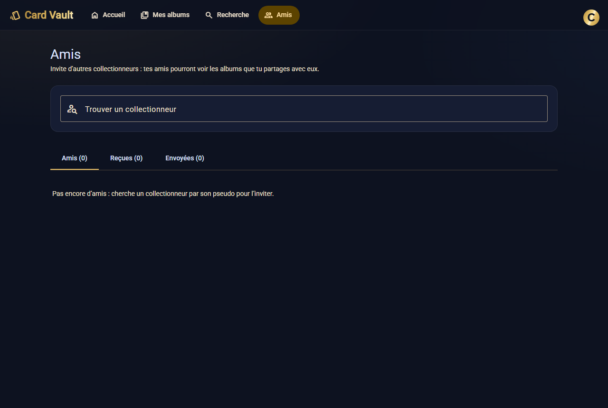
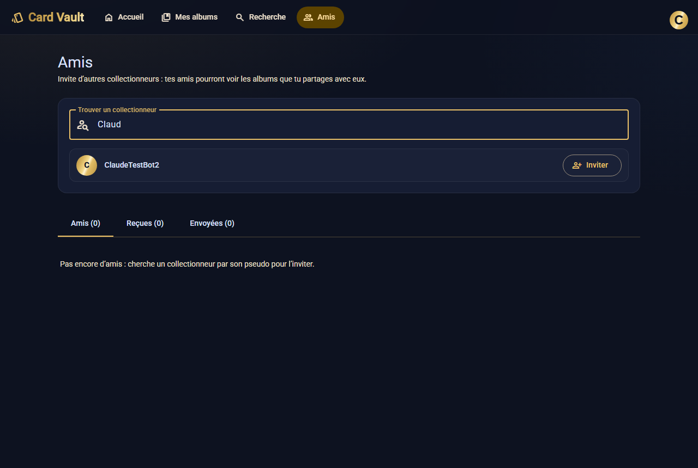

Invitation envoyée, puis vue par le destinataire (badge, onglet Reçues) :

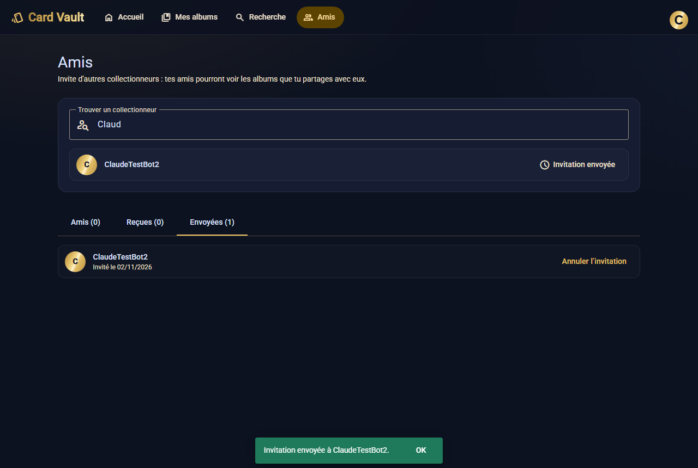
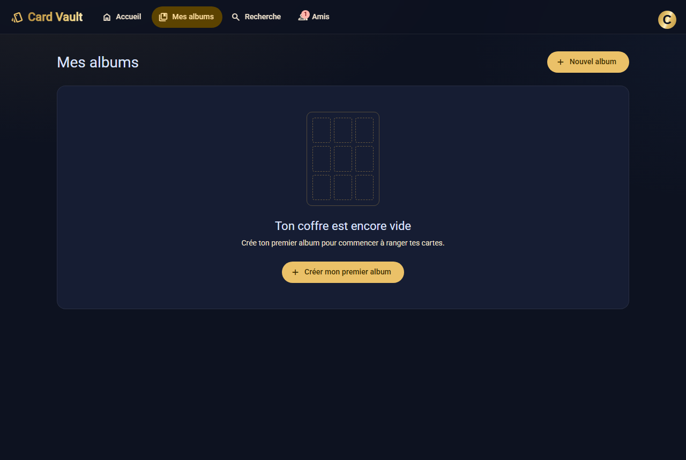
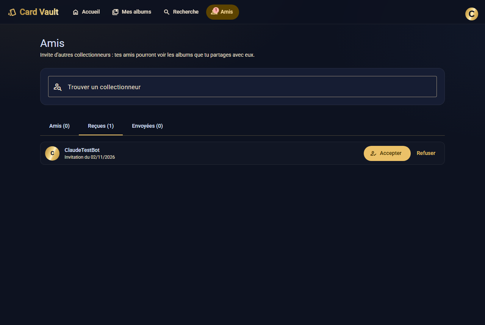

Invitation acceptée :

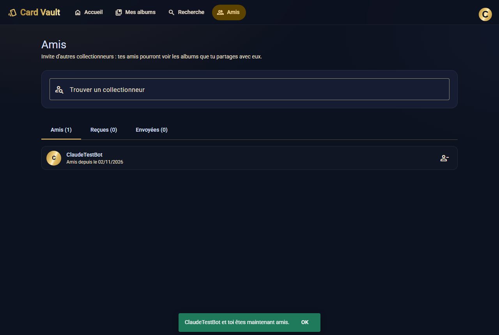

Inviter depuis l'album public d'un autre collectionneur :

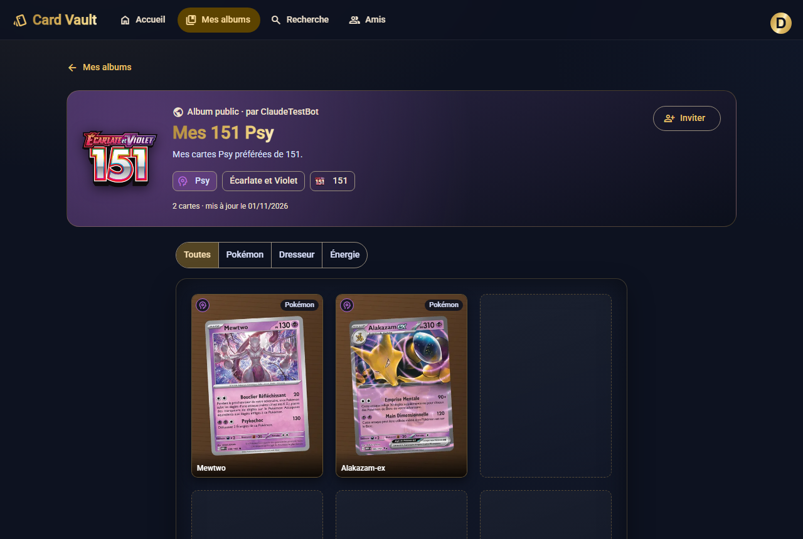

Retrait d'un ami, avec confirmation :

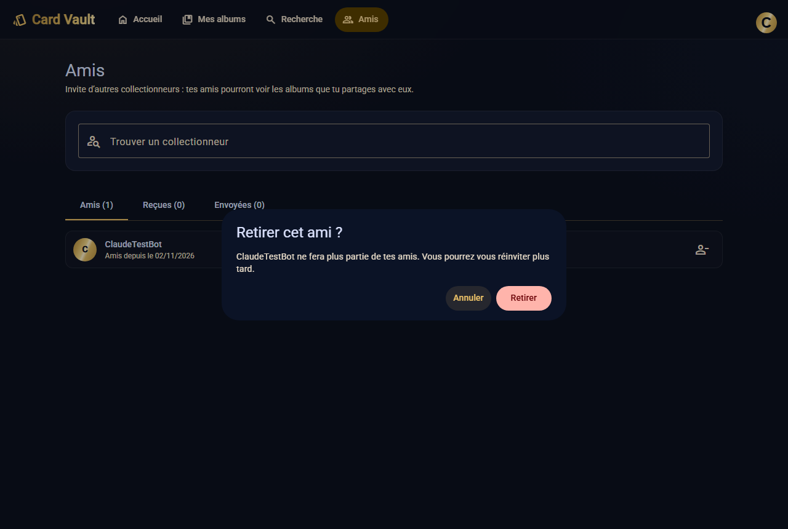

Mobile : onglet Reçues, puis menu avec le nombre d'invitations :

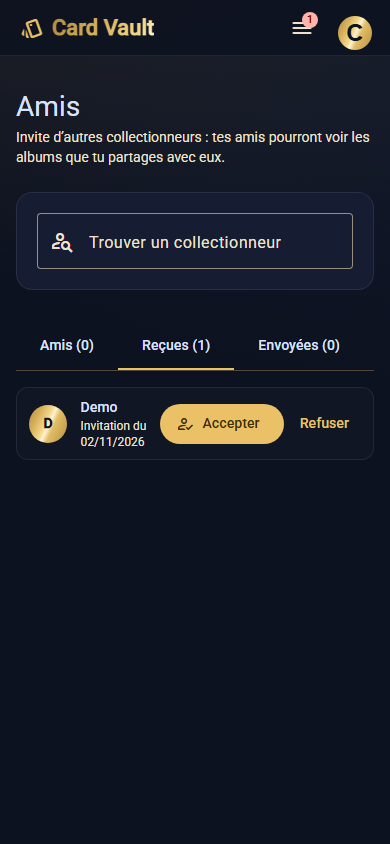
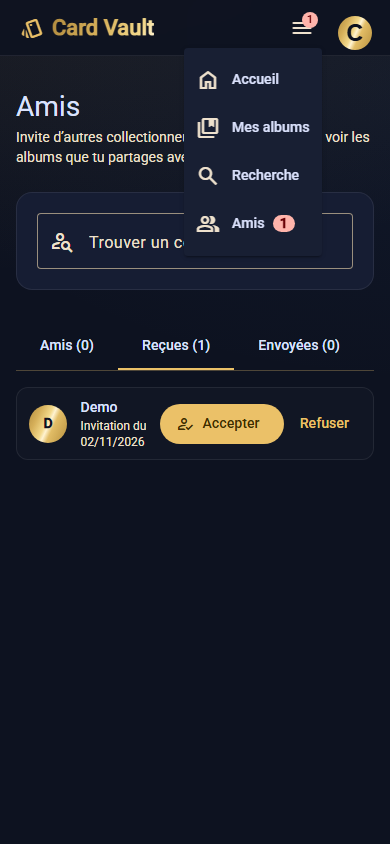

## Étape 5 — Partage (02/11/2026)

Choix faits au plan :
- un ami retrouve les albums partagés avec lui dans un **onglet
  « Partagés avec moi »** de la page Mes albums ;
- la liste de partage est **conservée** si l'album devient public (sans
  effet tant qu'il l'est), et reprend effet s'il redevient privé ;
- **seul le propriétaire** arrête un partage, et le destinataire ne peut
  pas le faire lui-même.

Ce qui était déjà décidé : le partage est réservé aux amis, et retirer un
ami arrête ses partages. L'étape 5 a été lancée juste après l'étape 4,
avant son commit, à la demande de l'utilisateur : les deux seront
commitées ensemble.

- [x] Backend : `canView` étendu au partage ; liste de partage, partager /
      arrêter, « partagés avec moi » ; partages arrêtés au retrait d'un ami
- [x] `API_CONTRACT.md` : 3 nouvelles routes, `sharedCount`, visibilité
      d'un album privé
- [x] Frontend : fenêtre de partage (liste d'amis à cocher), bouton
      « Partager », en-tête et couverture « partagé avec N amis »,
      onglet « Partagés avec moi »
- [x] Tests backend (102) et frontend (125), vérification croisée (24 bugs)
- [x] `npm run build`, vérification dans le navigateur (vraie base, vraies photos)
- [x] Documentation

### Le principe, en bref

Un album privé est une **pièce fermée à clé**. Son propriétaire donne un
double de la clé à certains amis : ils peuvent regarder l'album (classeur
et photos), mais ni le modifier ni le repartager.
- **Décocher** un ami lui reprend sa clé : il tombe sur « Album
  introuvable », comme pour n'importe quel album privé.
- **Retirer** un ami lui reprend toutes les clés, dans les deux sens. Une
  nouvelle amitié ne les rend pas automatiquement.

### Implémentation

**Backend.**
- La règle centrale `canView` accepte maintenant aussi « l'utilisateur
  est dans la liste de partage ». Les cartes et les URL signées des photos
  passaient déjà par `canView` : elles ont suivi sans autre changement.
- Pour partager, l'application envoie la **liste complète** des amis
  cochés, qui remplace l'ancienne. Une liste vide arrête tous les
  partages. Le serveur refuse tout identifiant qui n'est pas un ami (`400`).
- La liste n'est jamais envoyée au navigateur d'un destinataire. Seul le
  propriétaire reçoit le **nombre** de destinataires (`sharedCount`).

**Frontend.**
- **Fenêtre de partage** : liste des amis à cocher, résumé (« Visible par
  toi seul », « Partagé avec 2 amis »). « Enregistrer » ne s'active que si
  la sélection a changé. Sans ami, un message renvoie vers la page Amis.
- **Page d'album** : bouton « Partager » sur ses albums privés ; en-tête
  « Album privé · partagé avec 2 amis » chez le propriétaire, et « Album
  privé · partagé avec toi » chez le destinataire.
- **Mes albums** : icône « groupe » et info-bulle « Privé : partagé avec
  1 ami » sur la couverture. Le nouvel onglet « Partagés avec moi »
  affiche le propriétaire sous le titre (« par ClaudeTestBot »).

### Vérification croisée

24 bugs introduits volontairement (12 backend, 12 frontend), **tous
détectés dès le premier passage**. Détail dans [Tests.md](../Tests.md).

### Vérifications dans le navigateur

Harnais Playwright (hors dépôt), vraie base. ClaudeTestBot partage son
album privé « Deck Feu » (6 cartes) avec ClaudeTestBot2 ; Demo n'est pas
leur ami.

| Vérification | Attendu | Observé |
|---|---|---|
| Avant partage, l'ami ouvre l'album | `404` | ✅ |
| Propriétaire | « Album privé », bouton « Partager » | ✅ |
| Fenêtre | mes amis seulement (pas Demo) ; « Enregistrer » inactif sans changement | ✅ |
| Partage | SnackBar, en-tête et couverture « partagé avec 1 ami » | ✅ |
| Partage avec un non-ami | `400` | ✅ |
| Destinataire : liste de partage, modification | `404`, `404` | ✅ |
| Non-ami | album toujours `404` | ✅ |
| Destinataire | `200` sans la liste ni le nombre de destinataires ; album dans « Partagés avec moi » avec son propriétaire ; « partagé avec toi », ni Partager ni Modifier ; **6 photos chargées** | ✅ |
| Album public | pas de « Partager » | ✅ |
| Passage en public, puis retour en privé | visible mais absent de « Partagés avec moi » ; puis partage de nouveau actif | ✅ |
| Arrêt du partage (décocher) | SnackBar « Partage arrêté », l'ami tombe sur « Album introuvable », onglet vide | ✅ |
| Ami retiré | album de nouveau `404`, plus aucun destinataire ; une nouvelle amitié ne rétablit pas le partage | ✅ |
| Mobile (390 px) | fenêtre sans défilement horizontal | ✅ |
| Console | aucune erreur hors du `404` attendu, ni mot de passe ni JWT | ✅ |

Non vérifié dans le navigateur : la fenêtre **sans aucun ami**, parce
que Demo n'a pas d'album privé. Ce cas est couvert par un test de
composant.

**Erreurs du harnais**, sans effet sur l'application :
- l'image a été vérifiée avant la fin de son chargement ; la capture
  montrait pourtant les photos, et l'attente a été corrigée ;
- le `404` volontaire était compté comme une erreur de console.

État laissé pour vos essais : ClaudeTestBot et ClaudeTestBot2 sont amis,
et « Deck Feu » (privé) est partagé avec ClaudeTestBot2.

### Captures

Fenêtre de partage, puis album partagé côté propriétaire :

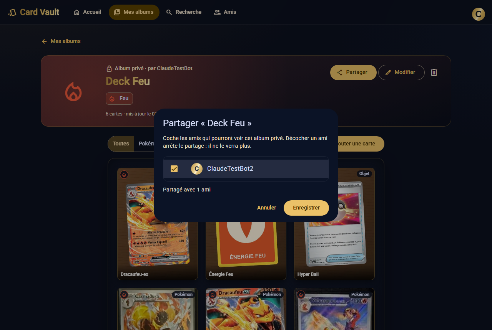
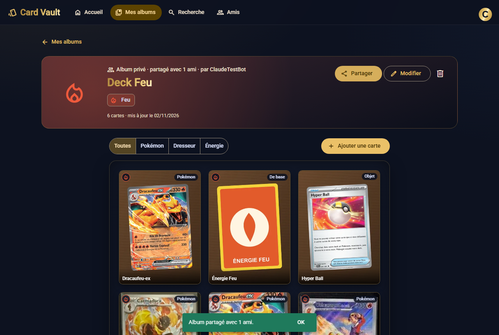

Mes albums : couverture d'un album partagé (info-bulle) :

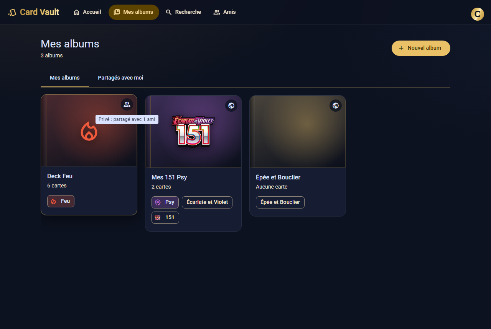

Côté ami : onglet « Partagés avec moi », puis l'album ouvert :

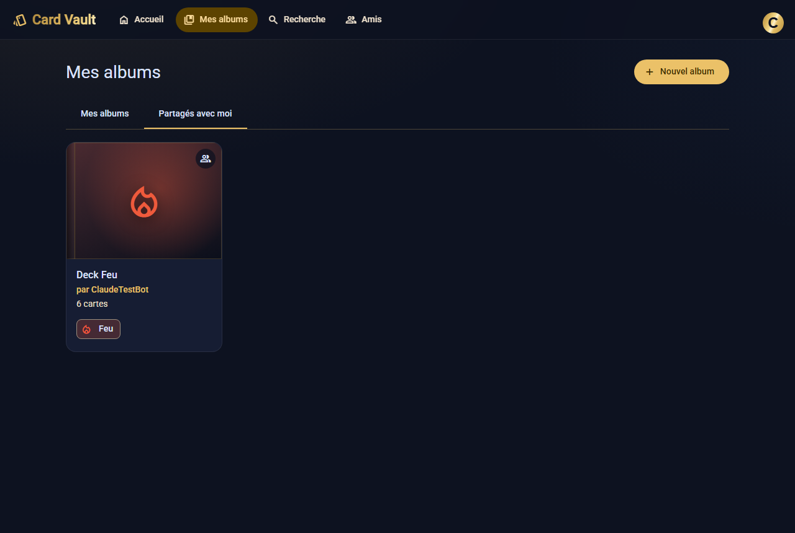
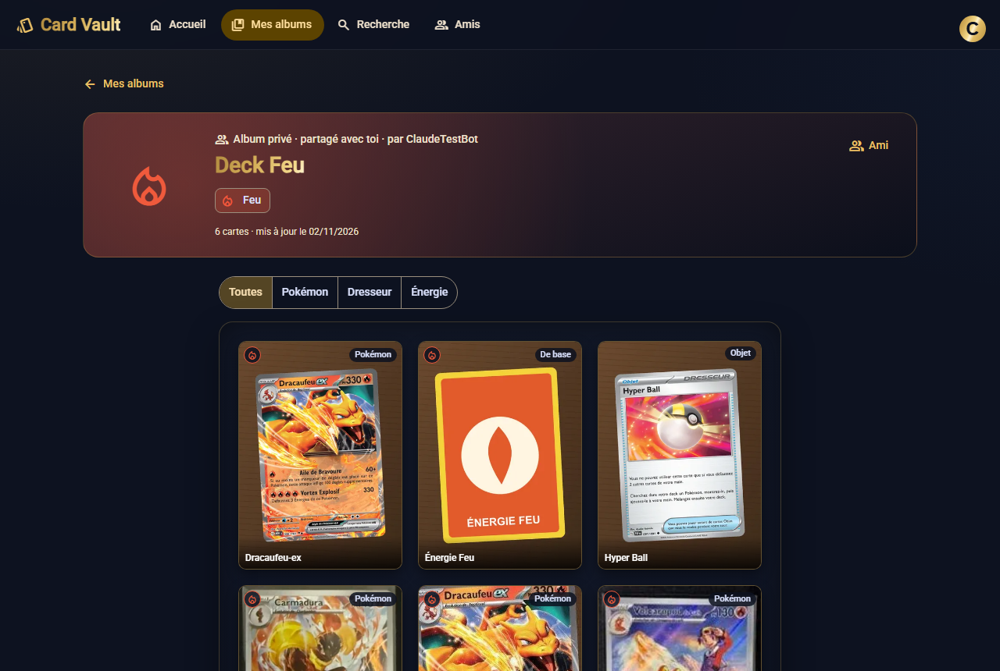

Après l'arrêt du partage :

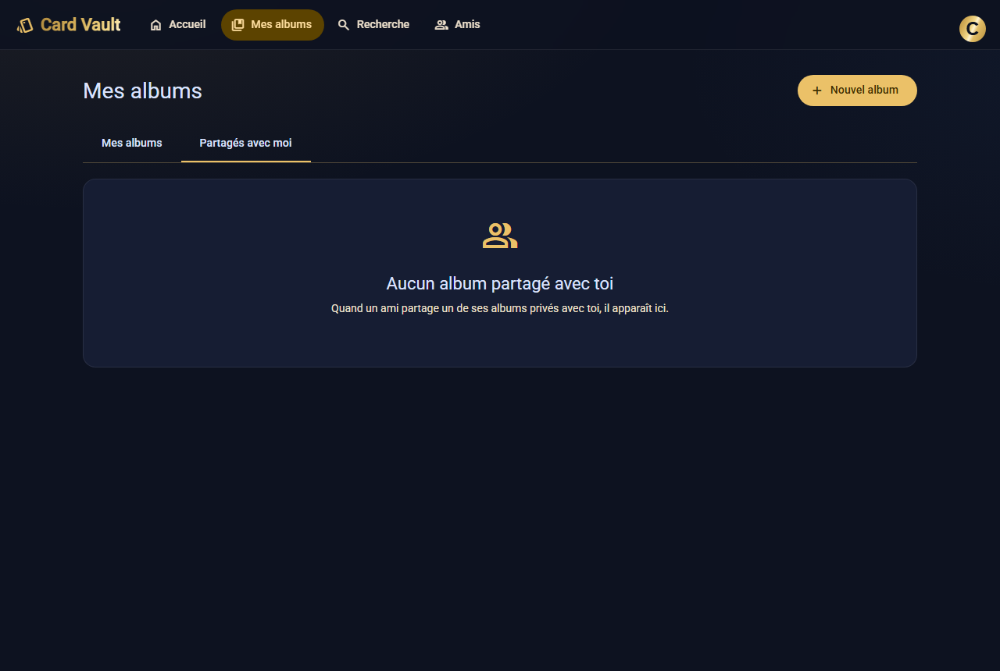

Mobile :

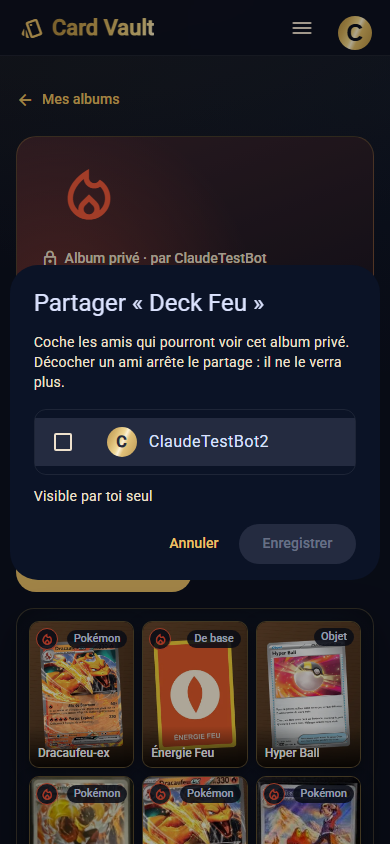

### Correction après test de l'utilisateur : légende du zoom (02/11/2026)

**Constat de l'utilisateur.** Dans un album partagé avec moi, le zoom sur
une carte légendait la photo « Ta photo », alors que c'est la photo de
l'ami. Le défaut existait déjà depuis l'étape 3 pour les albums **publics**
d'un autre utilisateur.

**Correction.** La page d'album transmet au zoom le pseudo du propriétaire
quand l'album n'est pas le mien (`owner.relation !== 'self'`). La légende
devient « Photo de ClaudeTestBot », et reste « Ta photo » dans mes
albums.

**Vérifications.**
- Tests : 127/127 (+2), build OK.
- Les deux bugs réintroduits (pseudo non transmis, légende figée) sont
  détectés par les nouveaux tests.
- Navigateur : « Photo de ClaudeTestBot » pour ClaudeTestBot2, « Ta
  photo » pour ClaudeTestBot.

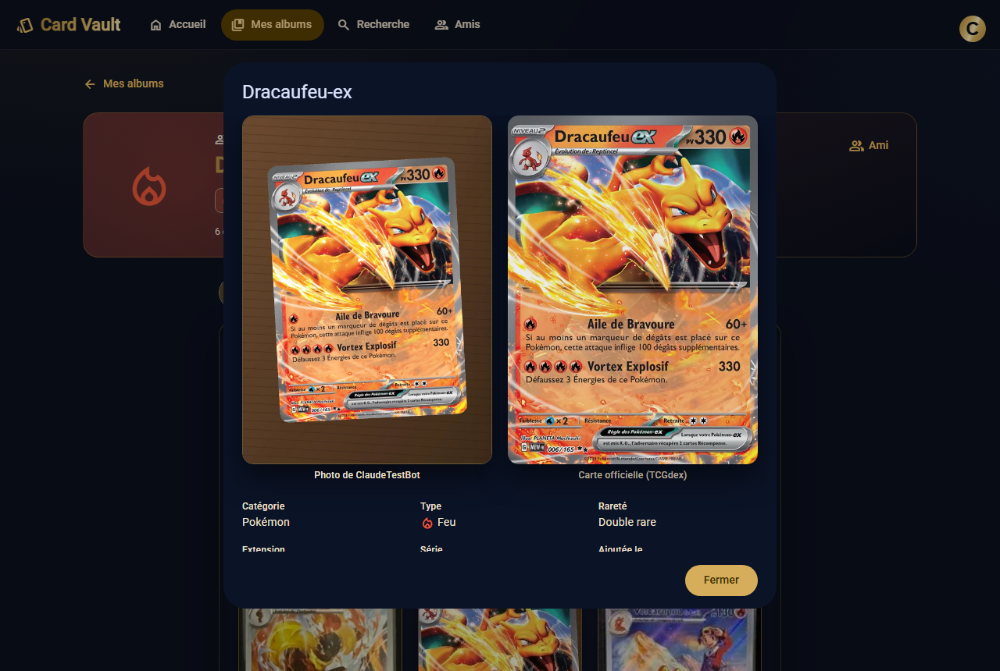

## Étape 6 — Likes et commentaires (02/11/2026)

Les étapes 4 et 5 ont été commitées et poussées juste avant (`832af77`).

Choix faits au plan :
- un visiteur qui **n'est pas ami** voit les likes et les commentaires
  d'un album public, **en lecture seule** ;
- le propriétaire **ne peut pas aimer** son propre album ; il ne le
  commente pas non plus, mais **répond** aux commentaires de ses amis
  (correction demandée après essai, voir plus bas) ;
- quand deux personnes ne sont plus amies, leurs réactions déjà
  laissées sont **conservées**.

Déjà décidé : réactions réservées aux amis ; chacun supprime les siennes,
et le propriétaire supprime aussi celles reçues sur ses albums.

- [x] Backend : modèles `Like` (un par personne et par album) et `Comment`
      (500 caractères), règle `reactionRights`, routes des réactions,
      compteurs sur l'album, suppression en cascade avec l'album
- [x] `API_CONTRACT.md` : 7 nouvelles routes, `likeCount` / `commentCount`
- [x] Frontend : barre « J'aime » (cœur, compteur, « Aimé par »),
      section Commentaires (formulaire, « Afficher plus », suppression),
      lecture seule pour un visiteur non ami
- [x] Tests backend (116) et frontend (146), vérification croisée (28 bugs)
- [x] `npm run build`, vérification dans le navigateur (3 comptes)
- [x] Documentation

### Le principe, en bref

- **Le like est un cœur** : on le met ou on l'enlève, et chaque personne
  ne compte qu'une fois, même si elle clique deux fois.
- **Les commentaires** forment un petit fil de discussion sous le
  classeur, du plus récent au plus ancien.
- **Deux questions, deux réponses** :
  - « est-ce que je vois l'album ? » : si non, `404`, comme partout ;
  - « ai-je le droit de réagir ? » : si non, `403`, car l'album existe
    pour moi et seule l'action est interdite.

### Implémentation

**Backend.**
- **Aimer** crée le like seulement s'il n'existe pas. L'index unique
  `{ albumId, userId }` le garantit, même en cas de double clic.
- **Compteurs** : `likeCount` et `commentCount` sont tenus à jour sur
  l'album (comme `cardCount`) et ne descendent jamais sous zéro. Ils
  serviront aux couvertures et à la découverte (étape 7).
- **Ex-ami** : il garde ses réactions et peut retirer les siennes, mais ne
  peut plus en ajouter.

**Frontend.**
- **Barre « J'aime »**, sous l'en-tête de l'album :
  - le cœur réagit tout de suite, puis s'aligne sur la réponse du serveur ;
    en cas de refus, il revient en arrière avec le message du serveur ;
  - « 1 j'aime » ouvre la liste « Aimé par », où le propriétaire peut
    retirer un like ;
  - un visiteur non ami voit « Seuls les amis de ClaudeTestBot peuvent
    aimer et commenter cet album. ».
- **Commentaires**, sous le classeur :
  - un formulaire réactif avec un compteur « n / 500 » ; un texte fait
    seulement d'espaces ne peut pas être publié ;
  - une poubelle sur ses commentaires (et, pour le propriétaire, sur tous
    ceux de son album), avec confirmation ;
  - « Afficher plus » charge les commentaires suivants sans doublon, même
    si d'autres ont été ajoutés ou supprimés entre-temps.

### Bugs trouvés

1. **Cœur jamais rempli** (vu sur une capture). La police d'icônes était
   chargée par l'ancienne adresse de Google Fonts, qui fournit une
   version figée sans l'axe « remplissage ». La règle CSS qui remplit le
   cœur n'avait donc aucun effet. Le lien d'`index.html` demande
   maintenant cet axe ; les autres icônes ne changent pas. Aucun test
   unitaire ne pouvait le voir : jsdom ne dessine pas les polices.
2. **Test manquant** (vérification croisée) : le bouton « retirer ce
   like » affiché à tout le monde n'était détecté par aucun test. On
   vérifiait que le propriétaire le voit, pas qu'un ami ne le voit pas.
   Test ajouté.
3. **Test lent, enfin stable** : le premier test du formulaire d'album
   dépassait de plus en plus souvent la limite de 5 s à mesure que la
   suite grossissait (mesuré : dépassement de temps, pas d'erreur). Sa
   limite est portée à 15 s pour ce fichier, avec un commentaire ; trois
   passages complets de suite ont réussi.
4. **Piège évité** : le formulaire de commentaire écoute l'événement
   natif `submit`. Sans `[formGroup]`, `ngSubmit` n'aurait pas été émis :
   c'est le bug déjà rencontré au TP2.
5. **Erreurs du harnais**, sans effet sur l'application : une ancienne
   SnackBar lue à la place de la nouvelle, puis un sélecteur visant deux
   éléments.

### Vérifications dans le navigateur

Harnais Playwright (hors dépôt), vraie base. Album public « Mes 151 Psy »
de ClaudeTestBot ; ClaudeTestBot2 est son ami ; Demo ne l'est pas.

| Vérification | Attendu | Observé |
|---|---|---|
| Ami : aimer | « Aimé », « 1 j'aime », conservé après rechargement ; aimer deux fois (API) = toujours 1 | ✅ |
| Ami : commenter | compteur « 53 / 500 », SnackBar, commentaire affiché, champ vidé | ✅ |
| Non-ami | pas de cœur, message « Seuls les amis de ClaudeTestBot… », commentaires visibles sans formulaire ni poubelle ; aimer et commenter `403` | ✅ |
| Album privé non partagé ; album privé partagé avec un ami | réactions `404` ; l'ami peut aimer (`200`) | ✅ |
| Commentaire de 501 caractères | `400` ; champ limité à 500 dans la page | ✅ |
| Propriétaire (première version) | pas de cœur ; poubelle sur tous les commentaires (l'ami : sur le sien seulement) | ✅ (commentaire du propriétaire remplacé ensuite par une réponse, voir plus bas) |
| Propriétaire : « Aimé par » | ClaudeTestBot2 listé, like retiré (SnackBar), « Aucun j'aime » | ✅ |
| Propriétaire : supprimer un commentaire reçu | confirmation, SnackBar, disparu chez l'ami | ✅ |
| 12 commentaires | 10 affichés + « Afficher plus », puis les 12 sans doublon | ✅ |
| Ex-ami | like et commentaires conservés, plus de droit de réagir, peut retirer son like | ✅ |
| Mobile (390 px) | pas de défilement horizontal | ✅ |
| Console | aucune erreur, ni mot de passe ni JWT | ✅ |

État laissé pour vos essais : sur « Mes 151 Psy », ClaudeTestBot2 aime
l'album et a laissé un commentaire, et ClaudeTestBot y a répondu (réponse
du propriétaire, depuis la correction). Les
deux comptes sont toujours amis, et « Deck Feu » est toujours partagé avec
ClaudeTestBot2.

### Captures

Cœur « Aimé » (ami) :

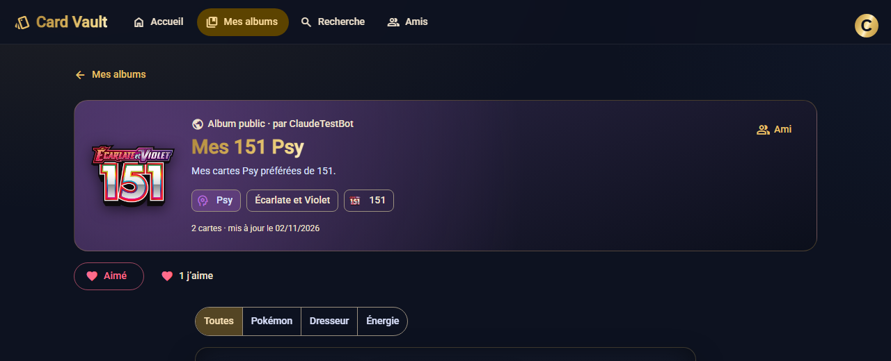

L'ami vient de commenter :

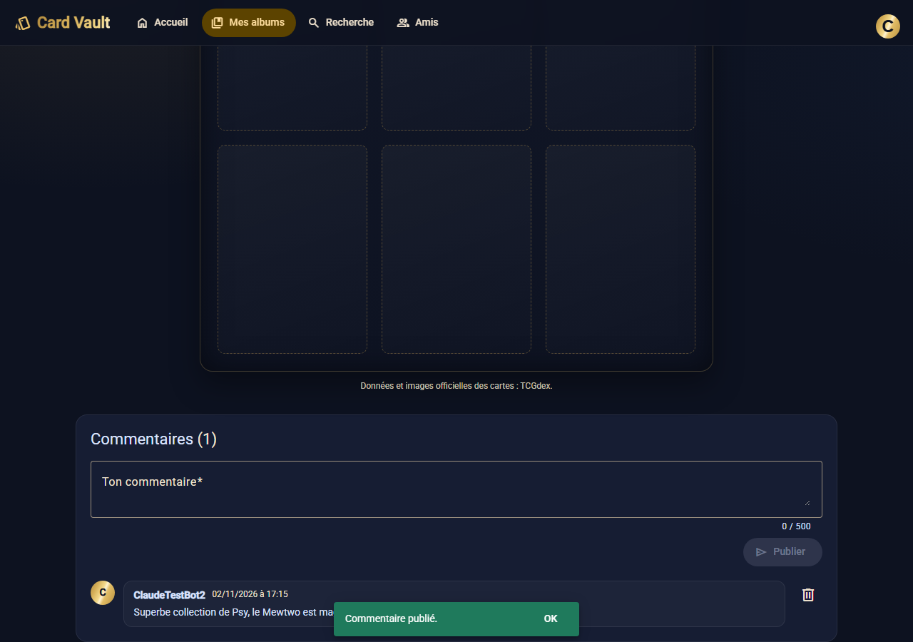

Visiteur non ami, en lecture seule :

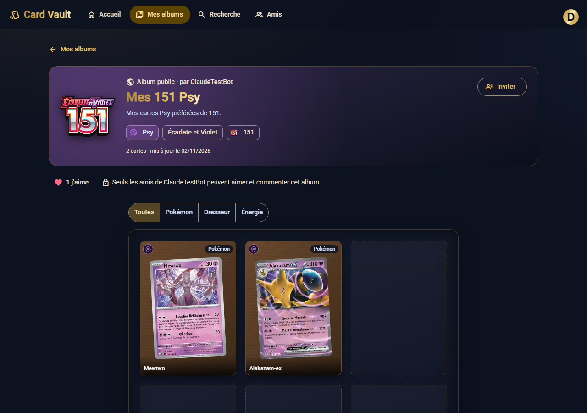

Propriétaire : liste « Aimé par » avec retrait :

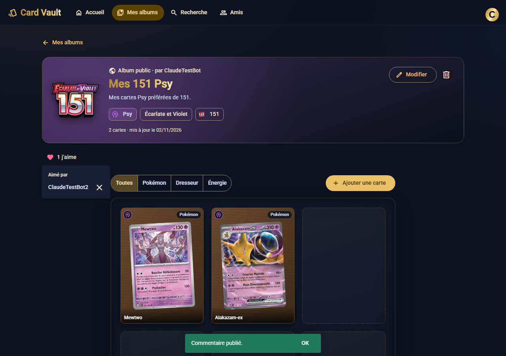

Mobile :

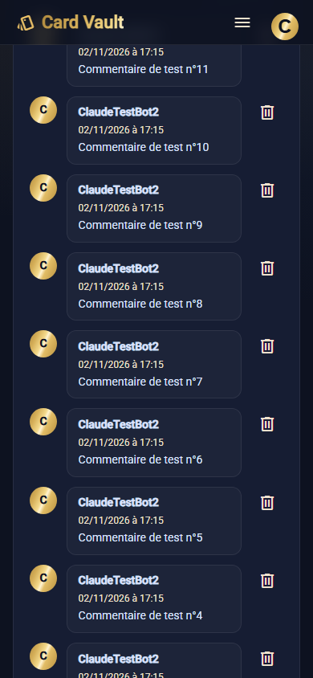

### Correction après essai : le propriétaire répond, il ne commente pas (02/11/2026)

**Constat de l'utilisateur.** Le propriétaire pouvait commenter son
propre album, ce qui était incohérent avec le fait qu'il ne puisse pas
l'aimer.

**Échange.** L'agent a d'abord signalé que les albums avaient déjà une
description (fenêtre « Modifier »). L'utilisateur a choisi de ne rien
ajouter de ce côté et a précisé : le propriétaire **ne commente pas**, il
**répond** aux commentaires des autres. Les réponses sont réservées au
propriétaire, sur un seul niveau, comme la « réponse du vendeur » sous un
avis.

**Fonctionnement.**
- Les amis écrivent des commentaires principaux.
- Sous chacun d'eux, le propriétaire voit un bouton **« Répondre »**, qui
  ouvre un petit formulaire (500 caractères).
- Sa réponse s'affiche en retrait, avec un badge **« propriétaire »**.
- Supprimer un commentaire supprime aussi ses réponses. La confirmation le
  dit : « … et ses réponses seront supprimés ».
- Le serveur refuse un commentaire principal du propriétaire avec un
  message explicite (« Tu ne peux pas commenter ton propre album : réponds
  aux commentaires de tes amis »). Il refuse aussi une réponse écrite par
  un ami, une réponse à une réponse, et une réponse à un commentaire d'un
  autre album.
- L'ancien commentaire « Merci ! » de ClaudeTestBot (écrit avec la
  première version) a été remplacé par une réponse.

**Vérifications.**
- Tests : backend 118/118 (+2), frontend 153/153 (+7), build OK.
- 12 bugs réintroduits, tous détectés.
- Navigateur : 14 vérifications, toutes réussies (tableau ci-dessous).

| Vérification | Attendu | Observé |
|---|---|---|
| Propriétaire : commentaire principal (API) | `403`, message explicite | ✅ |
| Ami : réponse (API) | `403` | ✅ |
| Propriétaire | pas de formulaire de commentaire, pas de message « Seuls les amis… », bouton « Répondre » | ✅ |
| Répondre | SnackBar, réponse en retrait avec badge « propriétaire », formulaire refermé | ✅ |
| Ami | réponse visible, pas de « Répondre », poubelle sur son commentaire seulement | ✅ |
| Non-ami | fil et réponse visibles, aucun formulaire ni bouton | ✅ |
| Suppression du commentaire par le propriétaire | confirmation « … et ses réponses seront supprimés », compteur à 0 | ✅ |
| Console | aucune erreur, ni JWT | ✅ |

Réponse du propriétaire en cours d'écriture, puis vue par l'ami :

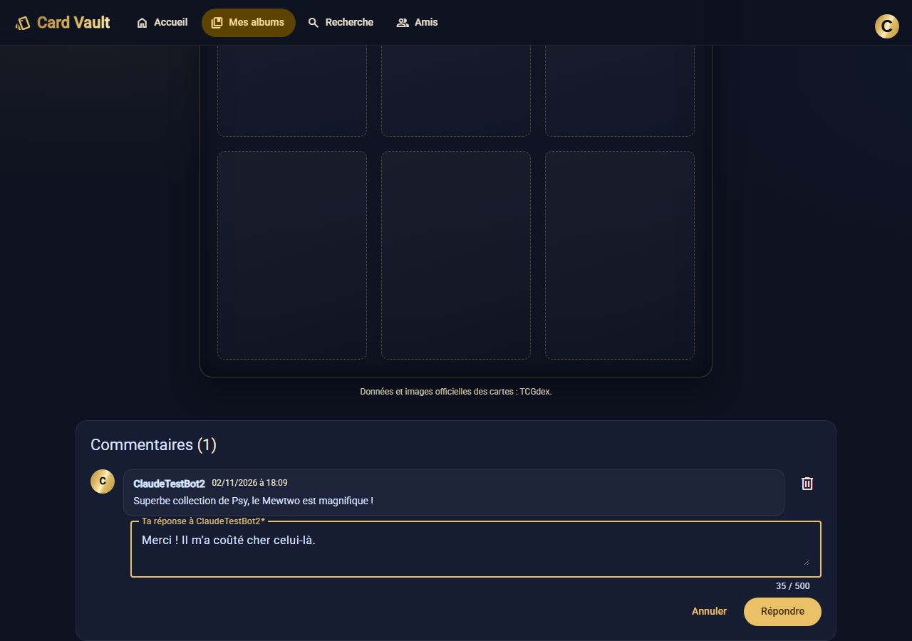
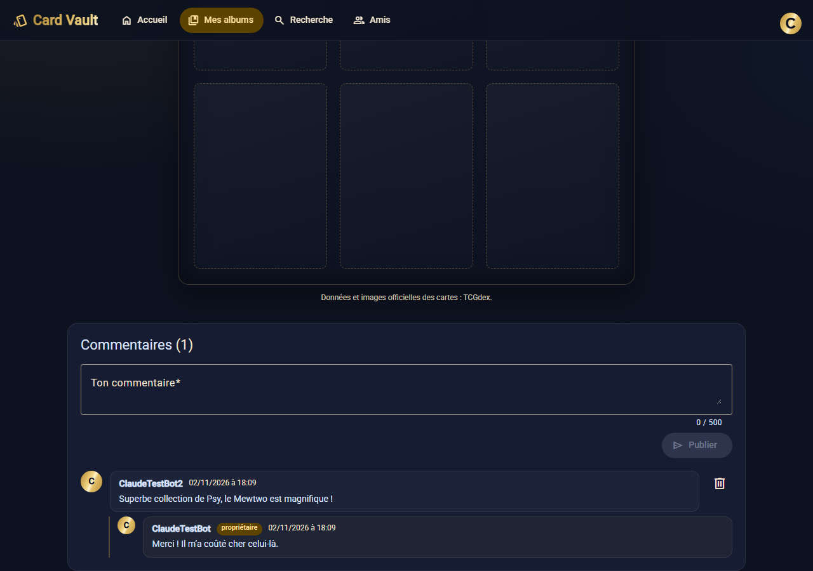

## Étape 7 — Découverte (récents, activité, recherche) (11/11/2026)

L'étape 6 a été commitée juste avant (`b5e87f5`).

Choix faits au plan :
- **Récemment ajouté** : les dernières **cartes** (les « fichiers » du
  sujet sont les photos) **et** les nouveaux **albums**, publics
  seulement ;
- **Recherche** : des **albums et des cartes**, dans deux onglets ;
- **Activité des amis** : albums créés, cartes ajoutées, commentaires et
  likes.

**Écart avec `REPORT.md`, assumé.** Le plan initial prévoyait un modèle
`Activity`, c'est-à-dire un journal d'événements enregistré. L'activité
est finalement **calculée au moment de l'afficher**, à partir des albums,
cartes, commentaires et likes existants. Elle suit donc toujours la
visibilité actuelle : un album repassé en privé, un partage arrêté ou une
suppression disparaissent d'eux-mêmes. En contrepartie, un élément
supprimé ne laisse aucune trace.

- [x] Backend : `GET /discover/recent`, `/activity`, `/albums`, `/cards` ;
      `visibleAlbumsFilter` (la règle de `canView` pour la base) ; recherche
      sans casse ni accents (`textPattern`) ; quatre index
- [x] `API_CONTRACT.md` : 4 nouvelles routes
- [x] Frontend : Accueil (dernières cartes, nouveaux albums, activité),
      Recherche (texte, filtres, onglets Albums / Cartes), tuile de carte
      réutilisable ; la page d'attente des étapes 1 à 6 est supprimée
- [x] Tests backend (131) et frontend (173), vérification croisée (31 bugs)
- [x] `npm run build`, vérification dans le navigateur (3 comptes)
- [x] Documentation

### Le principe, en bref

Une seule règle, déjà utilisée pour ouvrir un album, décide de tout ce que
la découverte peut montrer : **mes albums, les albums publics, et ceux
qu'un ami partage avec moi**. Sur l'Accueil, les nouveautés se limitent aux
albums publics. L'activité ne montre que ce que je pourrais ouvrir.

### Implémentation

**Backend.**
- `visibleAlbumsFilter` exprime la règle de `canView` sous forme de
  requête MongoDB. Les deux sont écrites côte à côte et testées ensemble.
- **Activité** : pour chaque source (albums, cartes, commentaires, likes),
  la route lit les 100 derniers éléments de mes amis, écarte ceux qui
  portent sur un album que je ne vois pas, puis trie et garde les 30 plus
  récents. Les cartes sont regroupées par album **et par jour** (« a ajouté
  6 cartes à Deck Feu »).
- **Recherche d'albums** : titre, description ou pseudo du propriétaire,
  plus les filtres de thème. Sans critère, tous les albums visibles
  s'affichent.
- **Recherche de cartes** : par nom dans les albums visibles, avec les
  mêmes filtres et la catégorie. Un texte ou un filtre est obligatoire.
- **Texte** : cherché tel quel, sans tenir compte de la casse ni des
  accents (« energie » trouve « Énergie Feu »).

**Frontend.**
- **Accueil** : « Bonjour » et le pseudo, puis les **dernières cartes**
  (tuiles au format carte, « album · par X »), les **nouveaux albums**
  (couvertures avec « par X ») et l'**activité de tes amis**.
  - L'activité s'affiche sous forme de phrases (« … a commenté ton
    album… », « … aime l'album de X… »), avec les vignettes des cartes
    ajoutées ou un extrait du commentaire.
  - Sans ami, un lien « Trouver des amis » s'affiche.
  - Les deux parties se chargent séparément : si l'une échoue, l'autre
    s'affiche quand même.
- **Recherche** :
  - un champ texte et quatre filtres (type, série, extension après la
    série, catégorie de carte) ;
  - deux onglets avec leur nombre de résultats ;
  - 300 ms d'attente après chaque modification ; une nouvelle recherche
    annule la précédente ; un seul caractère n'envoie rien.

### Bugs trouvés

1. **« BonjourClaudeTestBot2 »** (vu sur une capture). L'espace était au
   début du pseudo doré, un élément `inline-block`, et le navigateur
   supprime l'espace placé en tête d'un tel élément. L'espace est
   maintenant en dehors. Le test unitaire ne pouvait pas le voir : jsdom
   lit le texte, il ne dessine pas.
2. **Cœur collé au pseudo** dans « … ❤ aime ton album » (vu sur une
   capture) : marge ajoutée.
3. **Tests manquants** (vérification croisée) :
   - le regroupement des cartes **par jour** n'était pas testé : toutes
     les cartes du test dataient du même jour ;
   - le pluriel « carte / cartes » n'était pas testé : le test n'avait
     qu'un groupe de 3 ;
   - l'annulation d'une recherche lors d'un changement de page, ou après
     une saisie trop courte, n'était pas testée ;
   - le retour à la page 1 après une nouvelle recherche n'était pas testé.

   Tests ajoutés pour chacun.
4. **Un bug introduit volontairement n'a pas pu être détecté**, et ce
   n'en est pas vraiment un : « ne charger l'activité que si les récents
   n'ont pas échoué » donne le même résultat que le code correct, car
   aucune réponse n'est encore arrivée quand la page démarre. Rien n'a été
   modifié ; c'est expliqué dans `Tests.md`.

### Vérifications dans le navigateur

Harnais Playwright (hors dépôt), vraie base. ClaudeTestBot possède
« Mes 151 Psy » (public, 2 cartes), « Deck Feu » (privé, partagé avec
ClaudeTestBot2, 6 cartes) et « Épée et Bouclier » (public, vide).
ClaudeTestBot2 est son ami ; Demo ne l'est pas.

| Vérification | Attendu | Observé |
|---|---|---|
| Récents | seulement des albums publics (rien de « Deck Feu ») ; aucun email | ✅ |
| Activité de Demo | `hasFriends: false` | ✅ |
| Cartes « dracau » | Demo : 0 (album privé) ; ClaudeTestBot2 : 2 (album partagé avec lui) | ✅ |
| Accents | « energie » trouve « Énergie Feu » | ✅ |
| Albums par pseudo « claudetestbot » | Demo : 2 (publics) ; ClaudeTestBot2 : 3 (avec l'album partagé) | ✅ |
| 1 caractère ; identifiant invalide | `400` | ✅ |
| Accueil de ClaudeTestBot2 | 2 dernières cartes, nouveaux albums « par ClaudeTestBot » ; activité : réponse du propriétaire, « a ajouté 6 cartes à Deck Feu » (partagé), « a ajouté 2 cartes à Mes 151 Psy », 3 albums créés | ✅ |
| Accueil de ClaudeTestBot | « a commenté ton album », « aime ton album » | ✅ |
| Accueil de Demo | message et lien « Trouver des amis » | ✅ |
| Recherche sans critère | tous les albums visibles ; onglet Cartes en attente d'un critère | ✅ |
| Recherche « dracau » | onglet Cartes : 2 Dracaufeu-ex de « Deck Feu » | ✅ |
| Filtre Type = Psy | « Mes 151 Psy » seulement | ✅ |
| « zzzz » | « Aucun album ne correspond à ta recherche. » | ✅ |
| Mobile (390 px) | Accueil et Recherche sans défilement horizontal | ✅ |
| Console | aucune erreur, ni mot de passe ni JWT | ✅ |

### Captures

Accueil d'un ami : dernières cartes, nouveaux albums, activité :

Accueil du propriétaire : l'activité de son ami sur ses albums :

Accueil sans ami :

Recherche de cartes (« dracau »), puis filtre par type :

Mobile :

## Étape 8 — Profil, finitions, livraison V2

### Partie 1 : profil et finitions (17/11/2026)

L'étape 7 a été commitée juste avant (`8dbbd26`).

Choix faits au plan :
- **avatar** : une **carte du catalogue**, la « carte fétiche » ;
- **chiffres du profil** : albums, cartes, likes reçus et amis ;
- **finitions** : compteurs sur les couvertures, titre de l'onglet, page
  « introuvable » ; plus les liens vers les profils et le retour depuis
  l'album d'un autre.

Le check-up final et la livraison (fusion dans `main`, tag `v2.0`) font
l'objet d'une validation séparée.

- [x] Backend : `bio` et `avatar` sur `User` ; `PUT /users/me` étendu ;
      `GET /users/:id` et `/users/:id/albums` ; avatar dans les identités
      publiques
- [x] `API_CONTRACT.md` : 2 nouvelles routes, `PUT /users/me` étendu, sens
      du compteur de commentaires
- [x] Frontend : page de profil public `/users/:id`, page « Modifier mon
      profil », composant `app-avatar`, noms cliquables, retour « Profil
      de X », titre de l'onglet, page 404, compteurs sur les couvertures
- [x] Tests backend (142) et frontend (200), vérification croisée (32 bugs)
- [x] `npm run build`, vérification dans le navigateur (3 comptes)
- [x] Documentation

#### Le principe, en bref

Chaque collectionneur a maintenant une **page**. On y voit sa carte
fétiche en avatar, sa présentation, ses chiffres, un bouton d'amitié et
ses albums, mais seulement ceux que **moi** j'ai le droit de voir :
- Demo voit 2 albums de ClaudeTestBot (les publics) ;
- ClaudeTestBot2 en voit 3, car « Deck Feu » lui est partagé.

Partout où un pseudo apparaît, il mène à cette page.

#### Implémentation

**Backend.**
- **Avatar** : `PUT /users/me` accepte `bio` et `avatarId`, l'identifiant
  d'une carte TCGdex. Le serveur vérifie que la carte existe et qu'elle a
  une illustration, puis recopie son nom et son image : pas de fichier à
  stocker. `avatarId: null` revient à l'initiale.
- **Profil public** : `GET /users/:id` donne pseudo, bio, avatar, date
  d'inscription, relation et chiffres. Les albums, cartes et likes reçus
  sont calculés sur les albums que je peux voir ; jamais l'email.
  `GET /users/:id/albums` liste ces albums.
- **Identité publique** (`publicUser`) : elle porte l'avatar quand il
  existe. Les listes d'amis, commentaires, likes, activité et partage
  affichent donc les vraies cartes-avatars.

**Frontend.**
- **Page de collectionneur** `/users/:id` :
  - grand avatar, pseudo doré, « Carte fétiche : … », bio, « Membre
    depuis », quatre pastilles de chiffres accordées (« 1 ami », « 3 likes
    reçus ») ;
  - bouton d'amitié de l'étape 4, ou « Modifier mon profil » sur ma propre
    page ;
  - ses albums visibles, paginés.
- **Modifier mon profil** : pseudo (2 à 30 caractères), présentation avec
  compteur « n / 300 », et choix de l'avatar.
  - On cherche une carte par son nom, comme pour l'ajout d'une carte ; les
    cartes sans illustration sont écartées.
  - On clique sur une carte, et l'aperçu change tout de suite.
  - On peut aussi retirer l'avatar.
  - Seuls les champs modifiés sont envoyés.
- **`app-avatar`** : un seul composant affiche la carte, recadrée en rond
  sur l'illustration, ou l'initiale. Il remplace les 6 copies de
  « l'initiale sur fond or » : barre du haut, amis, commentaires, activité,
  partage, profil.
- **Liens vers les profils** : pseudo du propriétaire sur la page d'un
  album, auteurs des commentaires et des réponses, liste « Aimé par »,
  amis et invitations, résultats de recherche d'amis, activité de
  l'Accueil.
- **Menu de profil** : « Ma page de collectionneur » et « Modifier mon
  profil ».
- **Finitions** :
  - sur l'album d'un autre, le retour devient « Profil de X », et « Mes
    albums » n'est plus surligné ;
  - le **titre de l'onglet** suit la page (« Mes 151 Psy · Card Vault ») ;
  - une **page « Page introuvable »** remplace le renvoi silencieux vers
    l'Accueil ;
  - les **couvertures** affichent ♥ et 💬 quand il y a des likes ou des
    commentaires.

#### Bugs trouvés

1. **Compteurs incohérents** (vu sur une capture) : une couverture affichait
   💬 2 alors que la page de l'album indiquait « Commentaires (1) ». Depuis
   l'étape 6, le compteur stocké comptait aussi les réponses du
   propriétaire.
   - Le compteur ne compte plus que les commentaires principaux.
   - Les albums existants ont été recalculés par un script hors dépôt :
     « Mes 151 Psy » est passé de 2 à 1.
2. **Lien de retour qui changeait en route** : sur l'album d'un autre, le
   lien affichait « Mes albums » pendant le chargement, puis « Profil de
   X ». Le harnais l'a lu au mauvais moment. Le lien n'apparaît plus qu'une
   fois l'album chargé, et un test le vérifie.
3. **Tests manquants** (vérification croisée), ajoutés :
   - l'avatar de la barre du haut ;
   - « Mes albums » surligné sur l'album d'un autre ;
   - les noms cliquables dans les commentaires et dans la page Amis ;
   - la lecture de l'avatar en base par `publicUsers`.
4. **Réseau : `querySrv EBADRESP`**. Le backend refusait de démarrer :
   - le DNS du partage de connexion renvoie à Node une réponse SRV
     invalide, alors que Windows résout l'adresse sans problème ;
   - ce n'est pas un problème du code. Pour la vérification, Node a été
     lancé avec des DNS publics (script hors dépôt) ;
   - une note de dépannage a été ajoutée au README.
5. **Test instable observé une fois** : un test de recadrage d'image
   (étape 3) a échoué une fois puis réussi deux fois de suite, pendant que
   la machine était chargée. Rien n'a été modifié.

#### Vérifications dans le navigateur

Harnais Playwright (hors dépôt), vraie base, trois comptes.
ClaudeTestBot2 a choisi Mewtwo comme avatar ; ClaudeTestBot a choisi
Dracaufeu dans la page.

| Vérification | Attendu | Observé |
|---|---|---|
| Carte sans illustration ; bio de 301 caractères | `400` ; `400` | ✅ |
| Profil de ClaudeTestBot vu par son ami / par Demo | `friend`, 3 albums ; `none`, 2 albums ; aucun email ; inconnu `404` | ✅ |
| Modifier mon profil | titre de l'onglet, bio, recherche « dracaufeu », choix, SnackBar, avatar dans la barre du haut | ✅ |
| Ma page | « Modifier mon profil », pas de bouton d'amitié ; titre = mon pseudo | ✅ |
| Profil vu par l'ami | avatar, bio, « Ami », 3 albums ; couverture avec ♥ et 💬 | ✅ |
| Album d'un autre | retour « Profil de ClaudeTestBot » (une fois chargé) ; « Mes albums » non surligné ; titre « Mes 151 Psy · Card Vault » ; auteurs de commentaires cliquables ; retour au profil | ✅ |
| Accueil ; Amis | auteur de l'activité cliquable ; avatar-carte et nom cliquable | ✅ |
| Profil vu par Demo | 2 albums publics, bouton « Inviter » | ✅ |
| Adresse inconnue | « Page introuvable », titre de l'onglet ; même sans être connecté (pas de renvoi à la connexion) | ✅ |
| Mobile (390 px) | profil et « Modifier mon profil » sans défilement horizontal | ✅ |
| Console | aucune erreur, ni mot de passe ni JWT | ✅ |

État laissé pour vos essais : ClaudeTestBot a Dracaufeu pour avatar et une
présentation ; ClaudeTestBot2 a Mewtwo et une présentation.

#### Captures

Page de ClaudeTestBot vue par son ami, puis par Demo :

Modifier mon profil (choix de la carte-avatar) :

Album d'un autre : retour « Profil de X », titre de l'onglet :

Amis : avatars-cartes et noms cliquables :

Page introuvable :

Mobile :

### Partie 2 : check-up et livraison

_À faire (validation séparée)._
