# Compte-rendu V2 — Card Vault (mini projet TP4 à TP6)

> Journal détaillé, étape par étape. Synthèse pour l'enseignant :
> [../REPORT.md](../REPORT.md). Sujet : [../SUJET_ETUDIANT_TP456.md](../SUJET_ETUDIANT_TP456.md).
> Captures : `captures/v2-etapeX-sujet.png`.

## Étape 0 — Préparation (01/11/2026)

### Conception avec l'assistant IA (points 1 à 4 du sujet)

Décisions détaillées dans `../REPORT.md` (sections 2 à 5). En résumé :

1. **Fonctionnalités** : réseau de collectionneurs de cartes Pokémon ;
   albums en classeur, publics ou privés, partagés avec des amis choisis ;
   amis, activité, likes et commentaires (amis seulement), récents,
   recherche.
2. **Interfaces** : Angular Material, thème sombre (holo, puis or / bleu nuit à l'étape 1), classeur 3×3,
   ajout de carte en deux étapes (carte puis photo), barre du haut.
3. **Choix techniques** : catalogue TCGdex appelé par le backend, URL
   signées pour les images, `sharp`, règles d'accès centralisées.
4. **Découpage** : 9 étapes (0 à 8).

Points de vigilance relevés pendant la conception :
- **impossible de vérifier qu'une photo montre une carte Pokémon** sans
  vision artificielle : on vérifie à la place que c'est une image, et que
  la carte déclarée (catalogue) respecte le thème ;
- **le premier modèle social envisagé ne couvrait pas le sujet** (public =
  visible par mes amis seulement) : réadapté pour que public = visible par
  tous, et privé = partageable avec des amis choisis ;
- **données TCGdex incomplètes** : type souvent absent des Énergies, déduit
  du nom.

### Préparation

- [x] Sujet transcrit : `SUJET_ETUDIANT_TP456.md`
- [x] Branche `V2` créée depuis `main` (= tag `v1.0`)
- [x] Base MongoDB `card-vault` (vierge) : seul le nom de base a changé
      dans `backend/.env` (non versionné) ; les données V1 restent dans la
      base `test`
- [x] Règles mises à jour : backend modifiable (`frontend-starter/AGENTS.md`,
      `CLAUDE.md`), tests obligatoires par étape (`Tests.md`)
- [x] `REPORT.md` créé, README mis à jour
- [x] Commit de l'étape 0 (`90ba567`, le 01/11/2026 ; documents complétés à l'étape 1 dans `e9a9f08`)

## Étape 1 — Nettoyage de l'audio, identité, navigation (01/11/2026)

- [x] Backend : modèle `Track`, routes `/api/tracks`, configuration Multer
      audio et `escapeRegExp` supprimés ; 5 fichiers audio (15 Mo)
      supprimés de `data/uploads`
- [x] Frontend : page de pistes, `TrackService`, modèle `Track` et
      `fichiers-audio-de-test/` supprimés
- [x] `serverErrorMessage()` déplacée dans `shared/utils/http-error.ts`
- [x] Identité **Card Vault** : titre, logo, thème Material **sombre**
      **or / bleu nuit**, reflet or métallique, couleurs des 11 types
- [x] Barre du haut `MatToolbar` : Accueil · Recherche · Amis, menu profil
      (`MatMenu`), menu mobile
- [x] Connexion, inscription, profil réécrits en Angular Material
- [x] Pages d'attente Accueil, Recherche, Amis (protégées)
- [x] Tests backend (6) et frontend (23), vérification croisée
- [x] `npm run build`, vérification dans le navigateur
- [x] Documentation : `API_CONTRACT.md`, `analyse.md` (front, back),
      `Tests.md`, `REPORT.md`, README, rapport IA

### Implémentation

**Backend.** `app.js` ne garde que la santé, l'authentification et le
profil. Le dossier `data/uploads` est conservé (créé au démarrage) pour
les photos de l'étape 3, et la dépendance `multer` reste installée pour la
même raison. `API_CONTRACT.md` ne liste plus que les 5 routes restantes.

**Frontend.**
- **Thème** (`material-theme.scss`) : `mat.theme()` avec des palettes
  **générées** par `ng generate @angular/material:theme-color` (fichier
  `_theme-colors.scss`) : or `#C9A24D` (principale), bleu `#4A78C2`
  (accents), neutre bleu nuit `#1B2236` (surfaces). Les palettes
  prédéfinies de Material n'ont pas de vrai doré (`yellow` = jaune
  citron). `color-scheme: dark` choisit la version sombre des couleurs.
- **Identité** (`styles.css`) : fond bleu nuit avec halos discrets or et
  bleu, dégradé **or métallique** (`--cv-gold`, classe `.cv-gold-text`
  pour le logo et les titres), variables de couleur des 11 types pour les
  badges à venir. L'ancien style vert de la V1 est supprimé.
- **Évolution du thème** : une première version violet / cyan
  « holographique » a été écartée après essai (jugée trop « IA
  générique ») ; puis le bleu pastel irisé du dégradé a été retiré au
  profit d'un reflet or métallique. Le thème reste ajustable plus tard.
- **Barre du haut** : `MatToolbar` collante et translucide ; liens
  `mat-button` avec `routerLinkActive` ; avatar (initiale du pseudo sur
  fond or métallique) ouvrant un `MatMenu` (pseudo, email, Mon profil,
  Déconnexion) ; sous 720 px, les liens passent dans un menu « burger ».
- **Formulaires** : `MatCard` + `MatFormField` (`appearance="outline"`)
  + `<mat-error>` ; les erreurs serveur passent par `serverErrorMessage()`.
  Le profil confirme l'enregistrement par une `MatSnackBar`.
- **Pages d'attente** : un seul composant `PlaceholderPageComponent`,
  configuré par la propriété `data` de chaque route.
- **Icônes** : `MAT_ICON_DEFAULT_OPTIONS` aligne `<mat-icon>` sur la
  police *Material Symbols Outlined* chargée par `index.html`.

### Bug trouvé : un test qui ne pouvait pas échouer

La vérification croisée (bugs introduits exprès) a montré que le test
« la page Recherche est protégée par `authGuard` » **passait encore** quand
on retirait le guard. Cause, établie par un test de diagnostic : avec la
version de Vitest du projet, `expect(undefined).toContain(x)` réussit.
Une route sans guard a `canActivate` à `undefined`, donc l'assertion
`toContain(authGuard)` ne pouvait rien détecter. Corrigé avec
`toEqual([authGuard])`. Le même piège touchait les tests du message
d'erreur de connexion (`querySelector('.error')?.textContent`), corrigés
en ramenant le texte à une chaîne (`?? ''`). Détail, et impact sur
5 assertions de la V1 : `../Tests.md`, section V2.

### Vérifications dans le navigateur

Harnais Playwright (hors dépôt), base `card-vault` vierge :

| Vérification | Attendu | Observé |
|---|---|---|
| Visiteur sur `/` | redirection `/login`, barre « Connexion / Inscription » | ✅ |
| Thème | fond bleu nuit `rgb(13, 18, 32)`, icônes en *Material Symbols* (24 px) | ✅ (remesuré avec le thème final) |
| Inscription sur la nouvelle base | `201`, redirection `/profile` | ✅ |
| Navigation | Accueil, Recherche, Amis : bonne page, lien actif surligné | ✅ |
| Menu profil | pseudo, email, Mon profil, Déconnexion | ✅ |
| Modification du pseudo | SnackBar « Profil enregistré. », nouveau pseudo affiché | ✅ (carte de profil, puis menu profil) |
| Mobile (390 px) | liens masqués, menu « burger » complet | ✅ |
| Ancienne URL `/tracks` | redirection vers l'accueil | ✅ |
| Déconnexion | token supprimé, redirection `/login` | ✅ |
| Compte de démonstration | recréé sur la nouvelle base, connexion `200` | ✅ |
| Console | ni mot de passe ni JWT | ✅ |

### Captures

Connexion et inscription (thème sombre or / bleu nuit) :

Accueil (page d'attente) avec le menu profil ouvert :

Profil : enregistrement du pseudo confirmé par une SnackBar :

Mobile : menu de navigation :

## Étape 2 — Albums (01/11/2026)

Choix faits au plan : thème **facultatif** (sans thème = collection
libre) ; **« Mes albums » dans la barre** de navigation ; suppression avec
**confirmation simple**.

- [x] Backend : modèle `Album`, routes `/api/albums` (CRUD), règles
      d'accès `canView` / `isOwner`
- [x] Backend : catalogue TCGdex via le serveur (`/api/catalog` : types,
      séries, extensions), mémoire 24 h, série Pocket exclue, `502` si
      TCGdex est injoignable
- [x] Validation du thème par le serveur (l'extension doit appartenir à la
      série) ; noms et logos recopiés dans l'album
- [x] `API_CONTRACT.md` : 8 nouvelles routes documentées
- [x] Frontend : « Mes albums » (couvertures, état vide, pagination),
      fenêtre de création / modification, page d'album (en-tête, classeur
      3×3 vide, Modifier / Supprimer pour le propriétaire)
- [x] Tests backend (29) et frontend (56), vérification croisée (13 bugs)
- [x] `npm run build`, vérification dans le navigateur (vrai TCGdex)
- [x] Documentation

### Implémentation

**Backend.** Le code est maintenant rangé par rôle :
- `routes/` contient les routes, regroupées en `Router` Express ;
- `services/` gère le catalogue TCGdex et la validation du thème ;
- `access.js` contient les règles d'accès ;
- `errors.js` définit `HttpError`, une erreur qui porte son code HTTP et
  que le gestionnaire central traduit en `{ message }`.

Un album appartient toujours à l'utilisateur du token (`ownerId =
req.auth.sub`). Un refus renvoie **404**, jamais 403 : on ne peut pas
deviner qu'un album privé existe.

**Frontend.**
- **Couverture d'album** : façon classeur, avec un « cuir » teinté par la
  couleur du type, un dos et un liseré doré. L'emblème est le logo de
  l'extension (sinon celui de la série, sinon l'icône du type). La
  visibilité est indiquée par une icône **et** par un texte pour les
  lecteurs d'écran.
- **Formulaire** : l'extension ne se choisit qu'après la série, et elle est
  vidée si on change de série. Les listes du catalogue ne sont demandées
  qu'**une fois par session**. En cas d'erreur serveur, la fenêtre reste
  ouverte avec le message.
- **Page d'album** : un en-tête aux couleurs du thème, puis le classeur (une
  page de 9 pochettes au format d'une carte, 63 × 88). Modifier et Supprimer
  ne sont affichés qu'au propriétaire ; c'est de toute façon le backend qui
  refuse les autres.

### Bugs trouvés

1. **Adresse directe d'un album = page blanche.** En ouvrant
   `/albums/<id>` directement (lien partagé, F5), le navigateur cherchait
   les fichiers de l'application dans `/albums/`. La cause : `index.html`
   n'avait pas de `<base href="/">`, et ce depuis le starter de la V1. Ça
   ne posait pas de problème tant que les adresses n'avaient qu'un niveau.
   Trouvé grâce au second compte de test, qui ouvrait l'adresse d'un album
   directement. Les tests unitaires ne pouvaient pas le voir : ils ne
   chargent pas `index.html`.
2. **Fenêtre de formulaire coupée à gauche** : une largeur minimale sur le
   formulaire, plus grande que la fenêtre. Vu sur une capture, corrigé en
   fixant la taille à l'ouverture de la fenêtre.
3. **Titre doré terne** : le dégradé s'étalait sur toute la largeur du
   titre. Un titre court n'en recevait que la partie sombre. Corrigé
   (`inline-block`), et les extrémités du dégradé ont été légèrement
   éclaircies.
4. **Test manquant** : la vérification croisée a montré qu'aucun test ne
   couvrait la création **sans thème**. Ajouté.

### Vérifications dans le navigateur

Harnais Playwright (hors dépôt), **vrai catalogue TCGdex**, deux comptes :

| Vérification | Attendu | Observé |
|---|---|---|
| « Mes albums » sans album | état vide « Ton coffre est encore vide » | ✅ |
| Création : thème complet (Psy, Écarlate et Violet, 151), public | `201`, SnackBar, logo officiel de l'extension sur la couverture | ✅ |
| Création : type seul (Feu), série seule (Épée et Bouclier), sans thème | `201` ×3 ; icône du type, logo de la série, « Collection libre » | ✅ |
| Liste des extensions | logos officiels, chargées après le choix de la série | ✅ |
| Page d'album | titre, « Album public · par ClaudeTestBot », puces du thème, classeur de 9 pochettes | ✅ |
| Modification | formulaire pré-rempli (extension « 151 » comprise), titre mis à jour, SnackBar | ✅ |
| Second compte, album public (adresse directe) | visible, **sans** Modifier ni Supprimer | ✅ (après correction de `<base href>`) |
| Second compte, album privé | « Album introuvable » | ✅ |
| Suppression | confirmation, `204`, SnackBar, retour à la liste | ✅ |
| Catalogue | types et séries demandés **une fois** pour 5 ouvertures du formulaire | ✅ |
| Mobile (390 px) | couvertures en une colonne | ✅ |
| Console | ni mot de passe ni JWT | ✅ |

### Captures

« Mes albums » vide, puis avec quatre albums (thème complet, série seule,
type seul, collection libre) :

Fenêtre de création : visibilité, type, série et liste des extensions
avec leurs logos :

Page d'un album :

Album privé ouvert par un autre compte :

Confirmation de suppression :

Mobile :

## Étape 3 — Cartes et classeur (01/11/2026)

Choix faits au plan : cartes incompatibles **affichées grisées** (avec la
raison) dans la recherche ; **doublons autorisés** ; photo **obligatoire** ;
couverture d'album **inchangée** (logo), les photos ne se voient que dans
l'album.

- [x] Explication détaillée de l'API TCGdex et de son utilisation (voir
      ci-dessous et `../REPORT.md`, §4.1)
- [x] Backend : recherche et détail de cartes, type des Énergies déduit du
      nom, contrôle de cohérence avec le thème
- [x] Backend : modèle `Card`, ajout avec photo (Multer en mémoire +
      `sharp`), classeur paginé et filtrable, suppression (carte, album en
      cascade), `409` au changement de thème
- [x] Backend : photos servies par **URL signées**
- [x] Frontend : fenêtre d'ajout en deux étapes (`MatStepper`), classeur
      3×3 (pagination, filtre, reflet, squelettes), zoom
- [x] Tests backend (66) et frontend (78), vérification croisée (22 bugs)
- [x] `npm run build`, vérification dans le navigateur (vrai TCGdex, vraies
      photos de test)
- [x] Documentation

### L'API TCGdex en bref

TCGdex est une base publique de toutes les cartes Pokémon : on l'interroge
par une URL (`https://api.tcgdex.net/v2/fr/...`), elle répond en JSON, en
français, sans clé. Quatre questions servent :

| Question | Ce qu'elle donne | Ce qu'elle ne donne pas |
|---|---|---|
| `/cards?name=dracaufeu` (recherche) | id, numéro, nom, image ; recherche partielle, insensible à la casse ; filtre `set.id` possible | type, catégorie, nom de l'extension ; pas de filtre par série ; le tri est ignoré |
| `/cards/sv03.5-006` (détail) | catégorie, types, rareté, extension | la série |
| `/sets/sv03.5` (extension) | sa série | — |
| image `…/006/low.webp` ou `high.webp` | vignette (27 Ko) ou grand format (98 Ko) | certaines cartes n'ont pas d'image |

C'est **le backend** qui l'interroge, jamais Angular, pour quatre raisons :
le contrôle du thème doit être fait par le serveur (un client peut mentir),
la mémoire (une carte n'est demandée qu'une fois), le regroupement des
informations (nom de l'extension, série) et une seule adresse pour Angular.
Seules les images officielles, publiques, sont chargées directement depuis
TCGdex par le navigateur.

Particularités découvertes en interrogeant la vraie API : le type est
souvent absent des Énergies (déduit du nom, y compris des noms anglais et
collés comme « GrassFireWater ») ; la recherche renvoie aussi les cartes
Pocket (retirées) ; 22 des 113 Dracaufeu n'ont pas d'image ; aucune Énergie
Feu n'a d'image en français.

### Implémentation

**Backend.**
- `services/card-info.js` décrit une carte (catégorie, sous-catégorie,
  types, extension, série) et la compare au thème (`checkTheme`), avec la
  raison en clair (« Type Eau : l'album est réservé au type Feu »).
- `services/images.js` traite la photo avec `sharp` :
  - lecture du contenu (un faux fichier est refusé) ;
  - redressement ;
  - suppression des métadonnées, dont la position GPS ;
  - deux versions WebP.

  Il signe aussi les URL : signature HMAC-SHA256 avec le secret du
  serveur, valable 1 à 2 h, identique pendant l'heure pour profiter du
  cache du navigateur.
- À l'ajout d'une carte, le serveur contrôle dans cet ordre :
  1. le propriétaire ;
  2. la photo présente ;
  3. la carte existante ;
  4. la cohérence avec le thème ;
  5. **seulement ensuite**, il traite la photo.
- `config.js` regroupe le dossier des photos et le secret, partagés par
  `app.js` et le service d'images.

**Frontend.**
- **Fenêtre d'ajout** :
  - recherche avec un délai de frappe de 300 ms (`debounceTime`) ; une
    nouvelle frappe annule la requête en cours (`switchMap`) ;
  - options avec vignette officielle, cartes refusées grisées en fin de
    liste ;
  - détail avec le **verdict du serveur** : « Suivant » est bloqué si la
    carte est refusée ;
  - photo vérifiée (format, taille) et prévisualisée, puis envoyée avec
    barre de progression.
- **Classeur** :
  - 9 pochettes par page ;
  - photos au format carte, avec un reflet or qui balaie la carte au
    survol ;
  - pastilles de type et de sous-catégorie ;
  - squelettes animés pendant le chargement ;
  - filtre par catégorie et pagination.
- **Zoom** : ta photo à côté de l'image officielle, avec les informations
  de la carte.

### Bugs et améliorations trouvés

1. **Focus perdu à l'ouverture de la fenêtre d'ajout.** Le focus allait
   sur l'en-tête du stepper, et la frappe au clavier était perdue. Le
   harnais l'a révélé : sa saisie s'arrêtait à « dra ». Le focus est
   maintenant placé sur le champ de recherche.
2. **Cartes compatibles noyées dans la liste.** Dans un album de série, les
   2 cartes acceptées sur 19 arrivaient en dernier. Le serveur les trie
   maintenant en tête ; un test le vérifie.
3. **Test manquant sur l'ordre des contrôles** (vérification croisée) :
   traiter la photo avant le contrôle du thème donnait le même résultat
   final. Un test qui rend l'ordre visible a été ajouté.
4. **Vulnérabilités de dépendances** (Express, Multer) signalées à
   l'installation de `sharp` : corrigées par `npm audit fix`, avec des mises
   à jour compatibles et sans `--force`.
5. **Windows** : un test gardait les fichiers d'image ouverts (`EBUSY` à la
   suppression). Le test a été corrigé ; l'application n'est pas concernée.

### Vérifications dans le navigateur

Harnais Playwright (hors dépôt), vrai TCGdex. Photos de test réalistes :
l'image officielle posée sur une « table en bois », avec une position GPS
dans les métadonnées ; l'une est prise « couchée » (orientation EXIF 6).

| Vérification | Attendu | Observé |
|---|---|---|
| Dracaufeu-ex dans « Mes 151 Psy » | refusé : « Type Feu : l'album est réservé au type Psy », « Suivant » bloqué | ✅ |
| Mewtwo, Alakazam-ex dans « Mes 151 Psy » | ajoutés (`201`), SnackBar | ✅ |
| Dracaufeu-ex, Hyper Ball (Dresseur), Énergie Feu dans « Deck Feu » | ajoutés ; Énergie typée Feu **par son nom** | ✅ |
| Carapuce dans « Deck Feu » | refusé : « Type Eau… » | ✅ |
| Album de série « Épée et Bouclier » | 17 options sur 19 grisées, les 2 acceptées en tête | ✅ |
| Photo prise couchée | affichée droite (1200 × 1600) | ✅ |
| Photo servie | `image/webp`, `Cache-Control: private`, **aucun EXIF** | ✅ |
| Filtre Dresseur / Énergie / Pokémon / Toutes | une seule carte par catégorie, puis les trois | ✅ |
| « Deck Feu » → type Eau | `409` « 2 carte(s) ne le respectent pas (ex. Dracaufeu-ex) » | ✅ |
| Autre compte, album public | 2 cartes visibles, photos chargées, pas de « Ajouter » | ✅ |
| Autre compte, cartes d'un album privé | `404` | ✅ |
| URL d'image sans signature | `403` | ✅ |
| Retrait d'Hyper Ball depuis le zoom | confirmation, SnackBar, carte retirée | ✅ |
| Mobile (390 px) | classeur 3×3 lisible | ✅ |
| Console | ni mot de passe ni JWT | ✅ |

### Captures

Recherche d'une carte, puis carte acceptée et carte refusée :

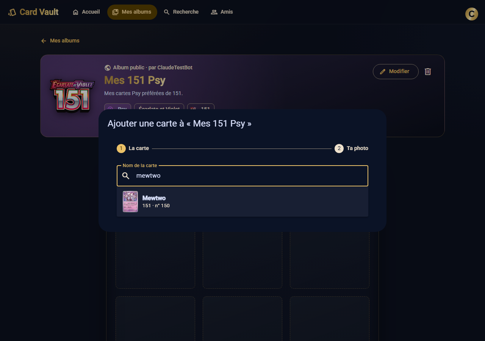
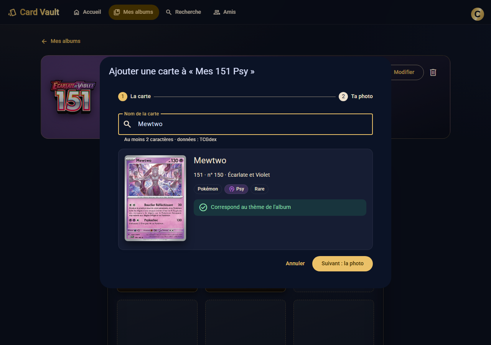
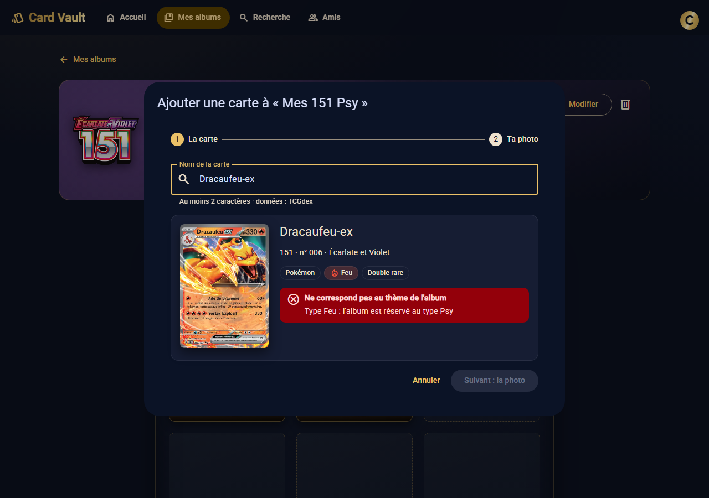

Album de série : cartes acceptées en tête, les autres grisées avec la
raison :

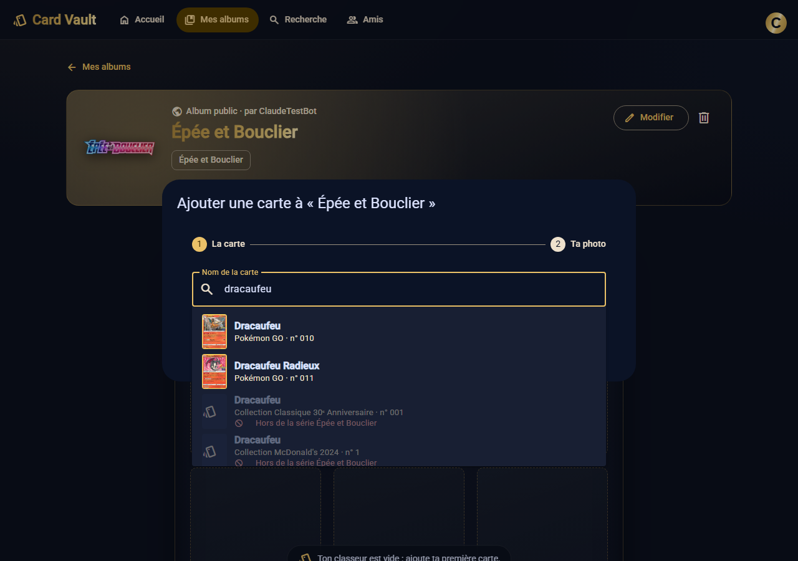

Étape photo :

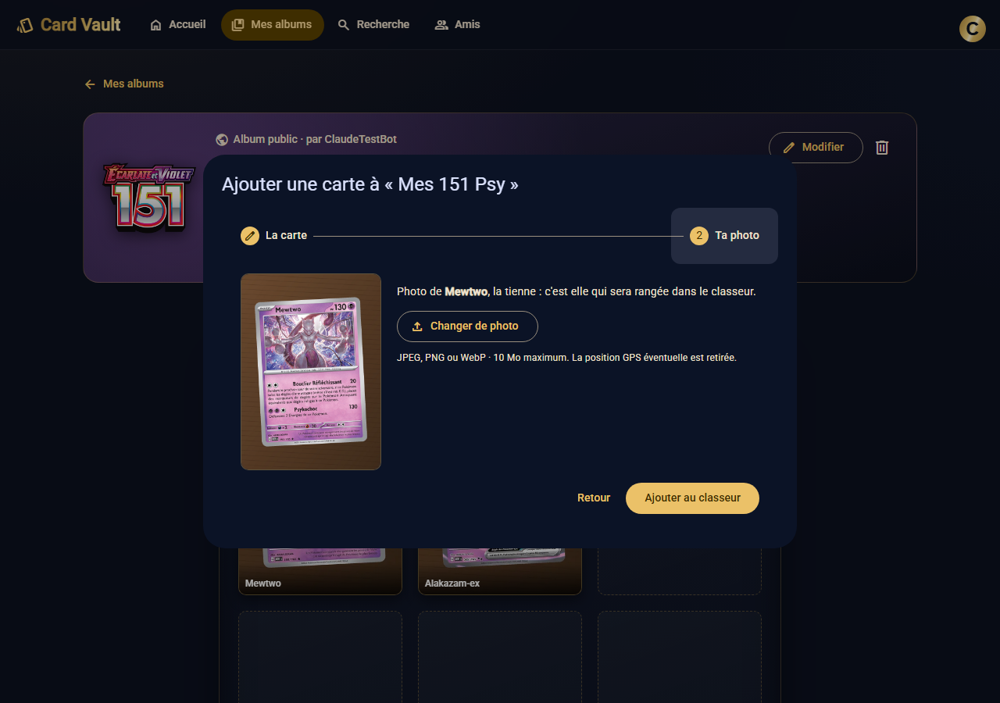

Le classeur, le reflet au survol, et le filtre « Dresseur » :

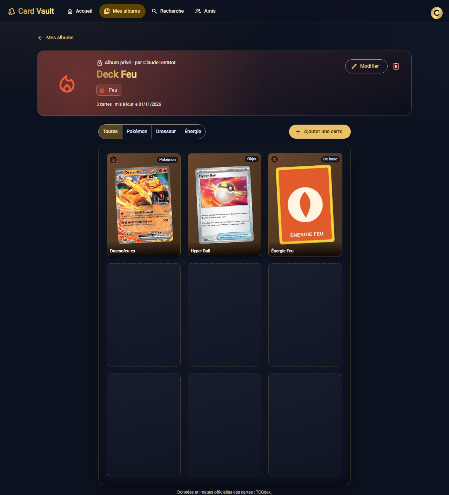
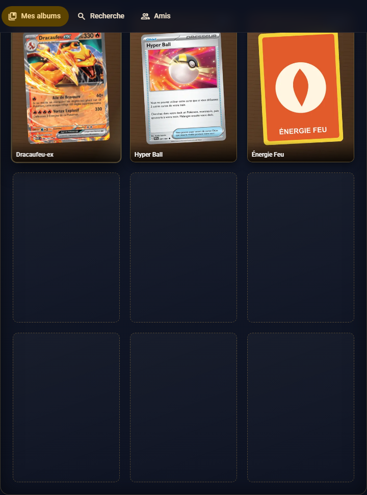
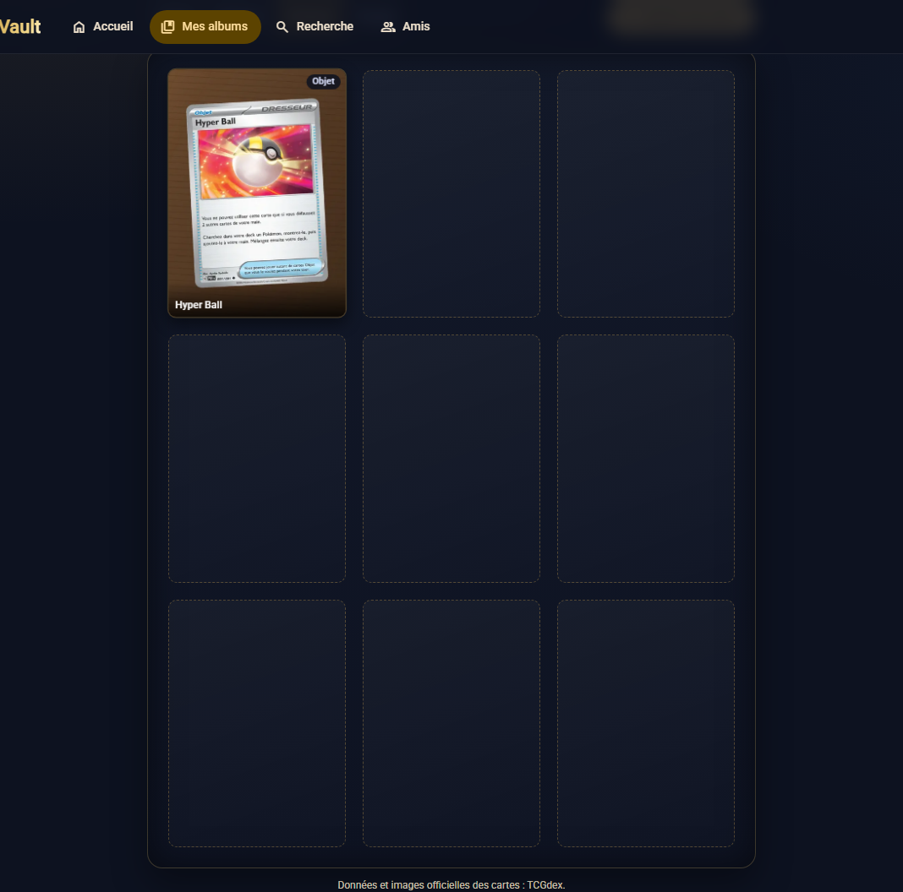

Zoom (photo prise couchée, affichée droite, à côté de l'image officielle) :

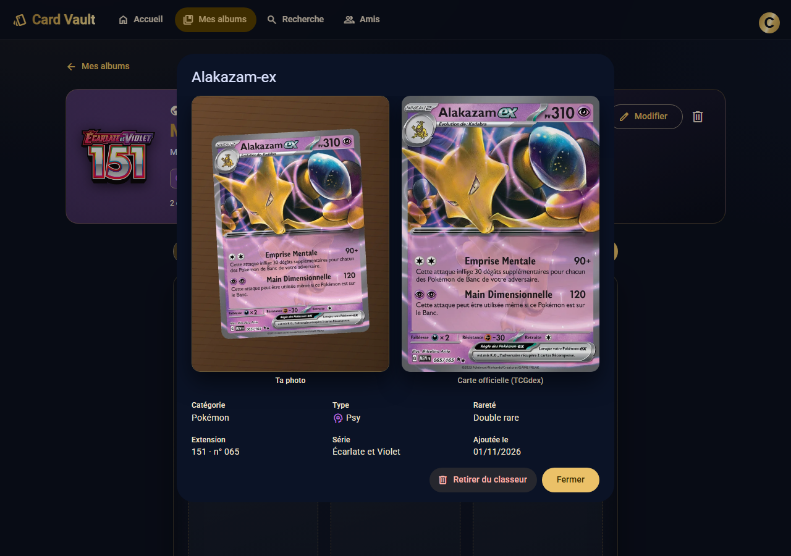

Mobile :

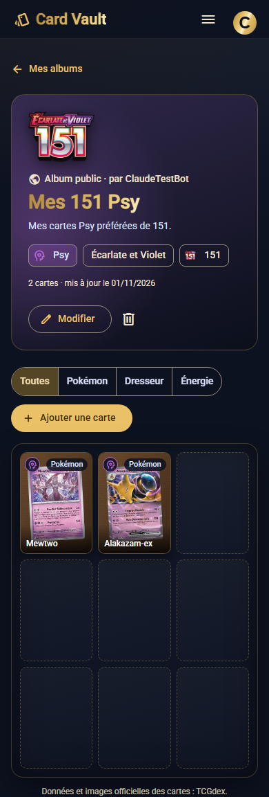

### Complément : recadrage de la photo (01/11/2026)

**Pourquoi.** En testant avec une vraie photo prise au téléphone,
l'utilisateur a demandé si la photo était « juste mise dans le cadre ».
C'était le cas : la pochette affichait la photo en « remplissage », coupée
**au centre**, sans savoir où était la carte. Une photo prise de loin
montrait surtout la table. Trois options ont été comparées (recadrage
manuel, détection automatique des bords, simple conseil de cadrage) ; le
**recadrage manuel** a été retenu, avec des boutons de rotation.

**Fonctionnement.**
- À l'étape « Ta photo », un **cadre au format carte** (63:88) est posé sur
  la photo ; on le déplace et on le redimensionne. Un aperçu montre le
  résultat. Deux boutons tournent la photo d'un quart de tour.
- Le navigateur n'envoie **que les coordonnées** du cadre et le nombre de
  quarts de tour, avec la photo d'origine. Le serveur redresse, tourne,
  vérifie que le cadre est dans l'image, puis **découpe l'original** avec
  `sharp` : la qualité est celle de la photo, pas d'une copie réduite.
- Librairie utilisée : `ngx-image-cropper` (licence MIT, compatible
  Angular 22).

**Tests** : backend 74/74, frontend 84/84, build OK ; 15 bugs introduits
volontairement, tous détectés (l'un seulement après l'ajout d'un test, voir
[Tests.md](../Tests.md)).

| Vérification dans le navigateur | Attendu | Observé |
|---|---|---|
| Photo couchée et décentrée, ¼ de tour à gauche | photo droite dans le recadreur | ✅ |
| Cadre tiré jusqu'aux coins de la carte | aperçu = la carte seule | ✅ |
| Envoi | `rotation: 3`, cadre en pixels, `201` | ✅ |
| Photo rangée | 316 × 441 (format carte), droite, sans la table | ✅ |
| Mobile (390 px) | utilisable, pas de défilement horizontal | ✅ |
| Console | aucune erreur | ✅ |

Défaut trouvé à la capture et corrigé : les icônes des boutons de rotation
étaient décalées (boutons prévus pour du texte) ; ce sont maintenant des
boutons-icônes avec info-bulle.

Photo couchée et décentrée, telle que choisie :

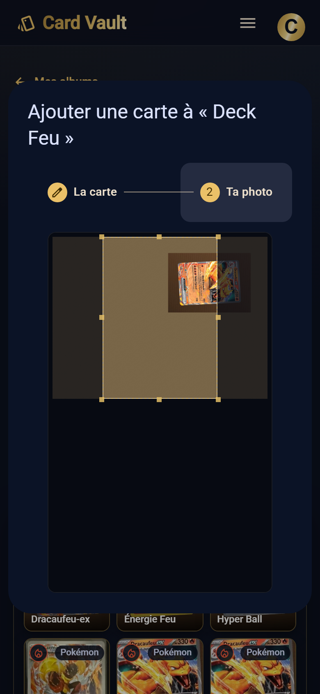

Après un quart de tour et le cadre ajusté sur la carte (aperçu à droite) :

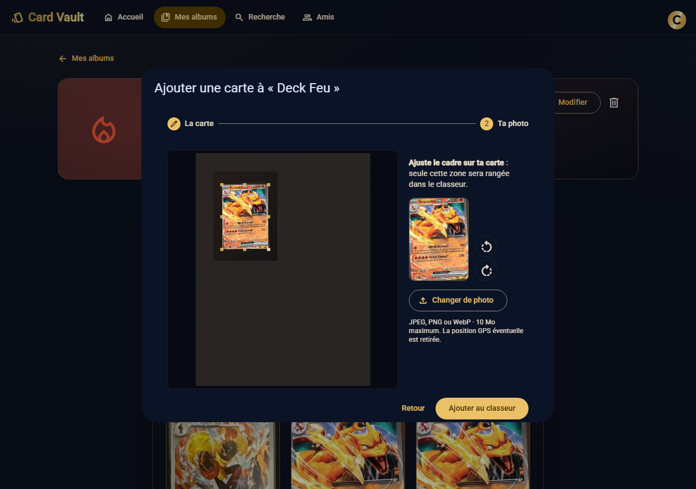

Dans le classeur, la carte recadrée (2e ligne, au centre) remplit sa
pochette, contrairement aux photos non recadrées :

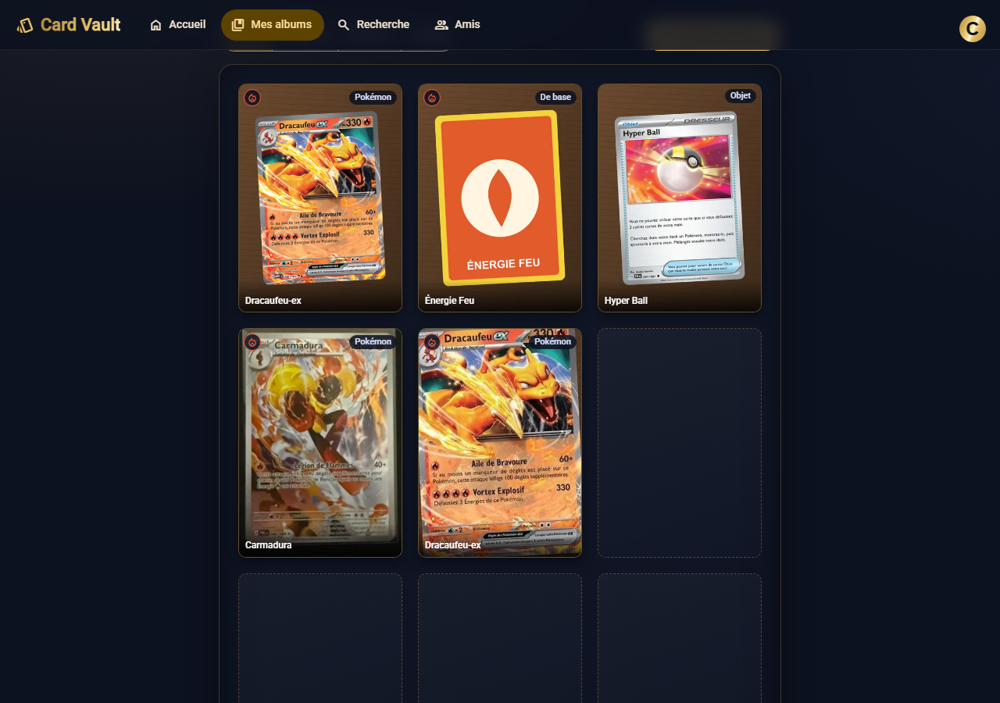

## Étape 4 — Amis (02/11/2026)

Choix faits au plan :
- recherche des collectionneurs **par pseudo** (les emails ne sont jamais
  montrés) ;
- invitation refusée **supprimée sans prévenir** l'expéditeur, qui peut
  réinviter plus tard ;
- badge d'invitations rechargé **à chaque changement de page et après
  chaque action**, sans requête en arrière-plan ;
- bouton **« Inviter en ami » sur la page d'un album** d'un autre
  utilisateur.

Retenu par défaut : si j'invite quelqu'un qui m'avait déjà invité, son
invitation est **acceptée automatiquement** (invitations croisées).

- [x] Backend : modèle `Friendship` (un seul lien par paire
      d'utilisateurs), service `friends.js` (relation, `areFriends`,
      `friendIds` pour les étapes 5 à 7)
- [x] Backend : recherche d'utilisateurs, liste des amis, invitations
      (envoyer, accepter, refuser, annuler), retrait d'un ami ;
      `owner.relation` ajouté à la lecture d'un album
- [x] `API_CONTRACT.md` : 7 nouvelles routes, `GET /albums/:id` complété
- [x] Frontend : page Amis (recherche, onglets Amis / Reçues / Envoyées),
      bouton d'amitié réutilisable, badge dans la barre du haut, bouton
      sur la page d'album
- [x] Tests backend (91) et frontend (110), vérification croisée (27 bugs)
- [x] `npm run build`, vérification dans le navigateur (3 comptes, vraie base)
- [x] Documentation

### Le principe, en bref

Une amitié fonctionne comme **une lettre qui attend une réponse** :
1. Alice invite Bob : un lien « en attente » est créé.
2. Bob accepte, et ils deviennent amis. S'il refuse, le lien disparaît.
3. Chacun peut ensuite retirer l'autre, et le lien disparaît aussi.

Chaque paire d'utilisateurs a **au plus un lien**. La base le garantit
grâce à une clé formée des deux identifiants triés. Le même point de vue
se lit dans les deux sens : pour Alice, Bob est « invité » (`sent`) ; pour
Bob, Alice l'« a invité » (`received`).

### Implémentation

**Backend.**
- Chaque action est **une seule requête** filtrée sur la paire de
  l'utilisateur du token. Seul l'invité peut accepter. Un refus ne peut
  pas supprimer une amitié, et un retrait ne peut pas supprimer une
  invitation.
- La recherche par pseudo traite la saisie comme du texte. Taper `.*` ne
  renvoie donc pas tout le monde.
- Un autre utilisateur n'est jamais décrit que par son identifiant et son
  pseudo.
- La route d'un album renvoie la relation avec son propriétaire. Le bouton
  « Inviter » s'affiche donc sans requête de plus.

**Frontend.**
- **Page Amis** : en haut, une recherche (même principe que la recherche
  de carte : 300 ms d'attente après la frappe, une nouvelle frappe annule
  la requête en cours) ; en dessous, trois onglets avec leur nombre.
  Avatar à l'initiale du pseudo, comme le menu profil.
- **Bouton d'amitié** : un seul composant, qui affiche « Inviter »,
  « Invitation envoyée », « Accepter » ou « Ami ». Il sert dans les
  résultats de recherche et sur la page d'album.
- **Badge** : nombre d'invitations reçues sur le lien « Amis », sur le
  menu « burger » et dans le menu mobile, avec un texte pour les lecteurs
  d'écran.
- Après chaque action, une SnackBar s'affiche et les listes sont
  rechargées. Les boutons concernés restent désactivés pendant l'action.

### Bugs trouvés

1. **Test manquant** (vérification croisée) : afficher le bouton d'amitié
   sur son **propre** album n'était détecté par aucun test. Le cas existe
   pourtant juste après un F5, quand le profil n'est pas encore rechargé.
   Test ajouté.
2. **Badge sans chiffre** : en Material 3, un badge de petite taille
   n'affiche qu'un point. Le test passait, car le nombre est bien présent
   dans la page. Vu sur la capture ; corrigé avec la taille standard.
3. **Erreur de l'agent dans le harnais**, sans effet sur l'application :
   un sélecteur visait deux éléments (la zone de recherche et son champ
   portent le même libellé).

### Remarque, hors étape 4

Sur l'album d'un autre utilisateur, la barre surligne « Mes albums » et
le lien de retour s'appelle « Mes albums ». C'est le comportement des
étapes 2 et 3. À revoir quand les pages de profil et de découverte
existeront (étapes 7 et 8).

### Vérifications dans le navigateur

Harnais Playwright (hors dépôt), vraie base, comptes ClaudeTestBot,
ClaudeTestBot2 et Demo :

| Vérification | Attendu | Observé |
|---|---|---|
| Recherche (API) | `id`, `name`, `relation` seulement ; je ne me trouve pas | ✅ |
| S'inviter soi-même ; utilisateur inconnu | `400` ; `404` | ✅ |
| Page Amis sans ami | message, onglets à 0 | ✅ |
| Invitation depuis la recherche | SnackBar, bouton « Invitation envoyée », onglet Envoyées (1) | ✅ |
| Destinataire | badge « 1 » sur « Amis » | ✅ (chiffre visible après correction) |
| Refus | SnackBar, badge masqué, rien chez l'expéditeur | ✅ |
| Réinvitation ; invitation en double ; l'expéditeur accepte | `201` ; `409` ; `404` | ✅ |
| Acceptation | SnackBar, ami listé avec sa date | ✅ |
| Album d'un ami | « Ami », sans bouton | ✅ |
| Album d'un inconnu | « Inviter » puis « Invitation envoyée » | ✅ |
| Mon propre album | aucun bouton d'amitié | ✅ |
| Recherche de quelqu'un qui m'a invité | bouton « Accepter » | ✅ |
| Invitations croisées | `200`, amis | ✅ |
| Retrait | confirmation, SnackBar, plus amis des deux côtés | ✅ |
| Mobile (390 px) | badge sur le « burger » et dans le menu, pas de défilement horizontal | ✅ |
| Console | aucune erreur, ni mot de passe ni JWT | ✅ |

État laissé pour la suite : ClaudeTestBot et ClaudeTestBot2 sont amis
(utile au partage, étape 5) ; Demo n'a aucun lien.

### Captures

Page Amis vide, puis recherche d'un collectionneur :

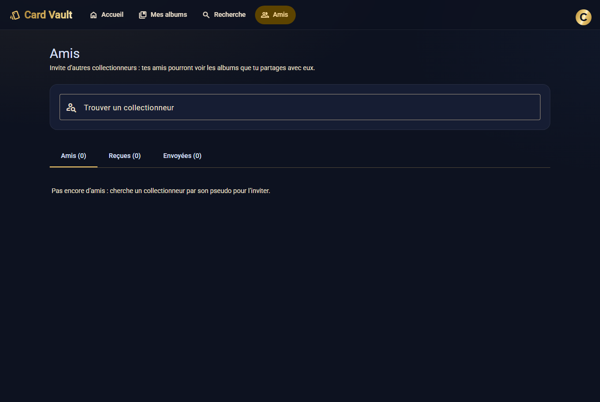
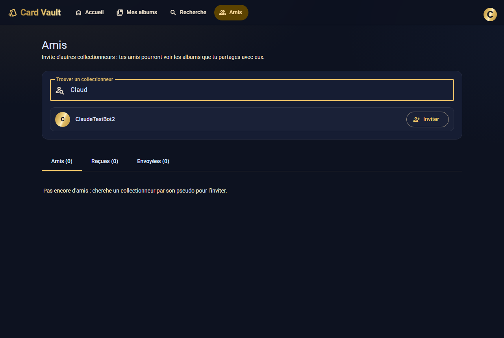

Invitation envoyée, puis vue par le destinataire (badge, onglet Reçues) :

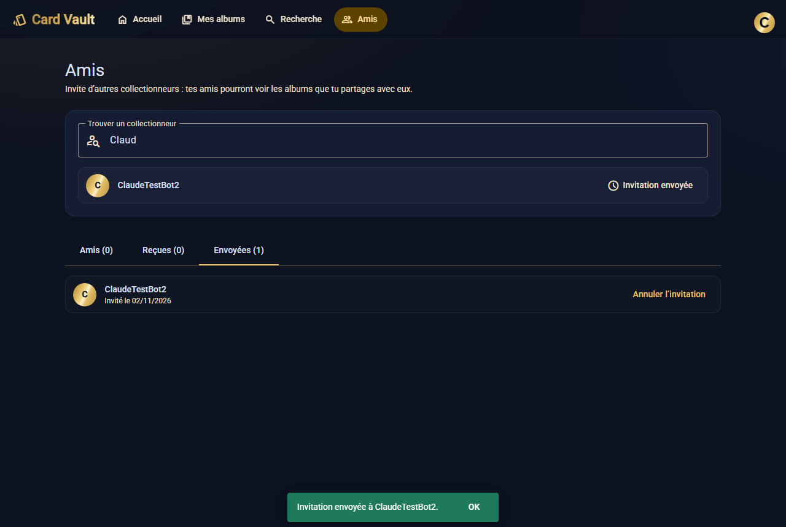
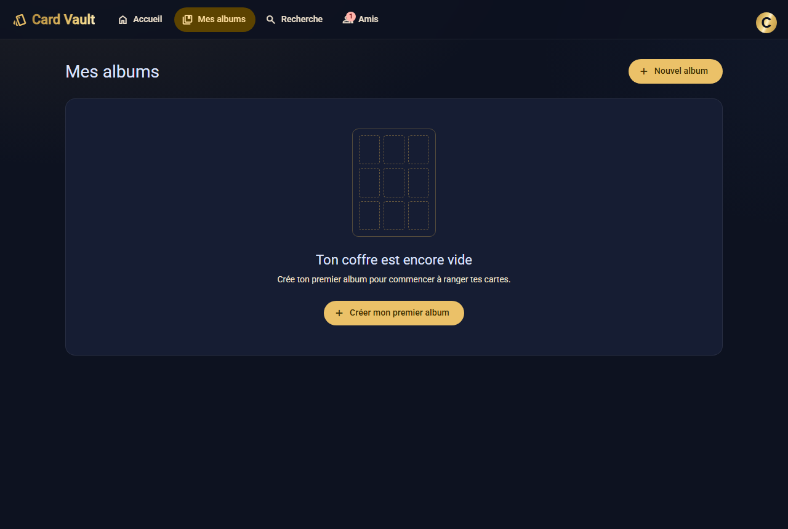
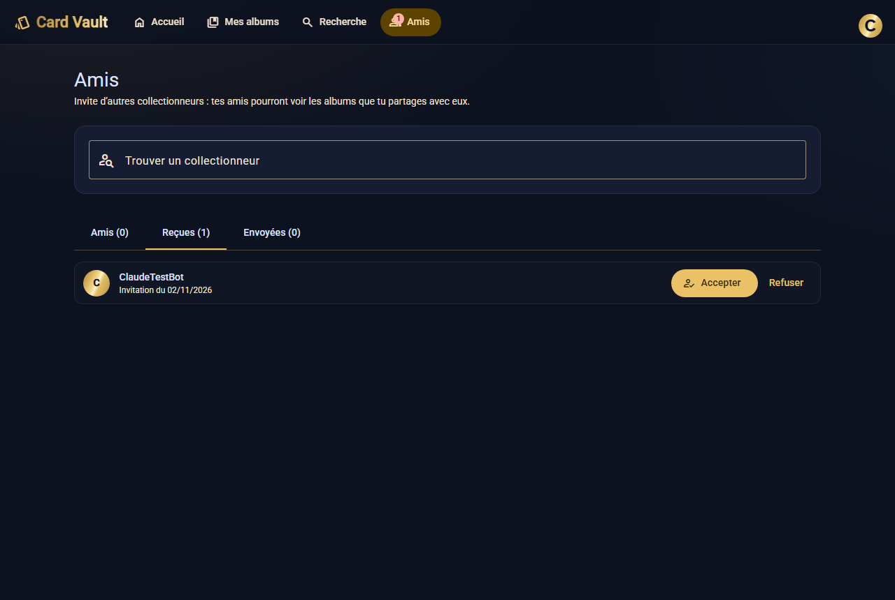

Invitation acceptée :

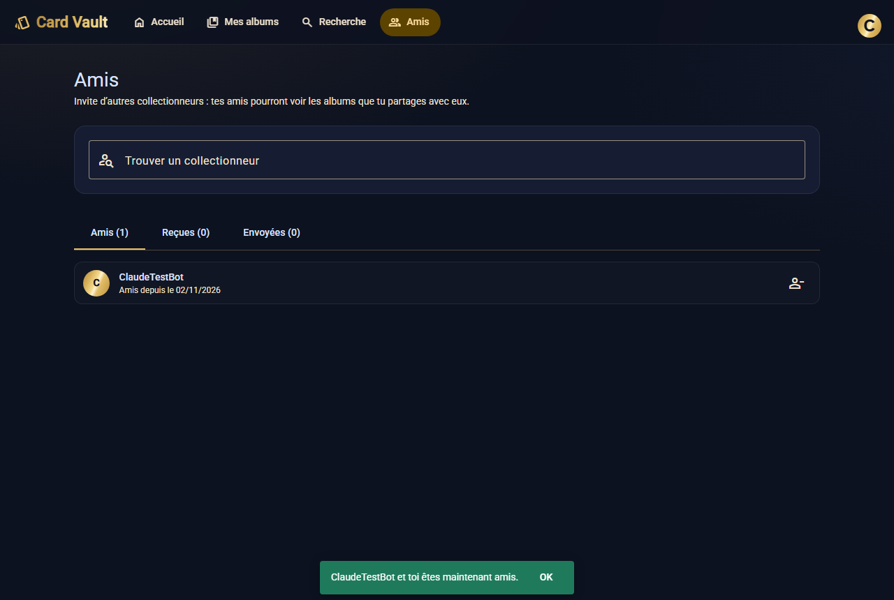

Inviter depuis l'album public d'un autre collectionneur :

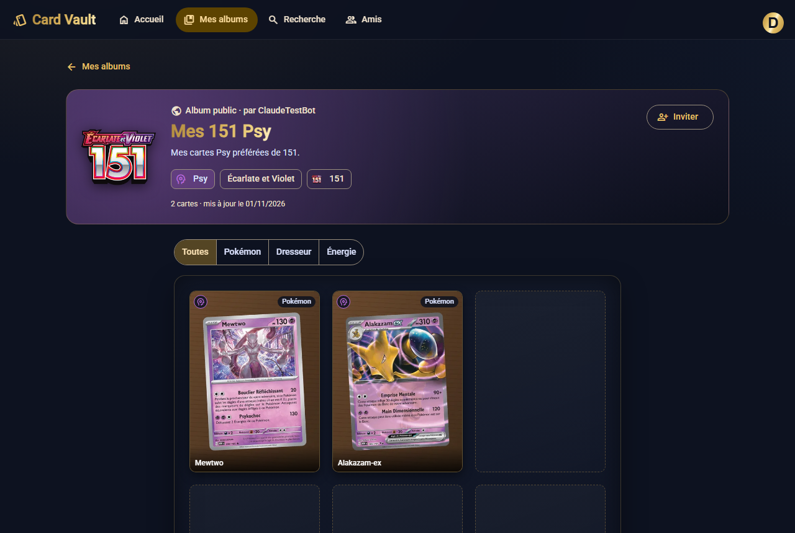

Retrait d'un ami, avec confirmation :

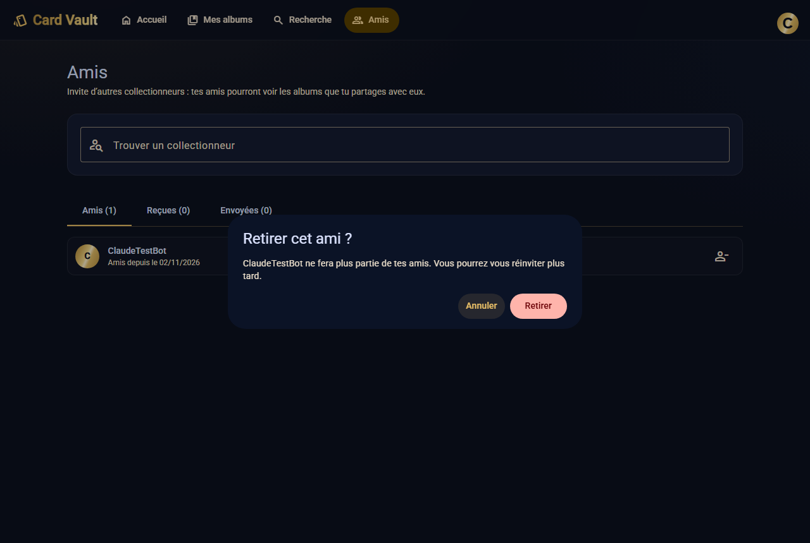

Mobile : onglet Reçues, puis menu avec le nombre d'invitations :

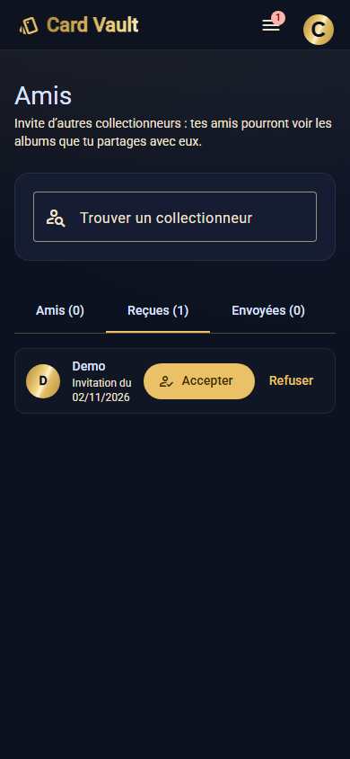
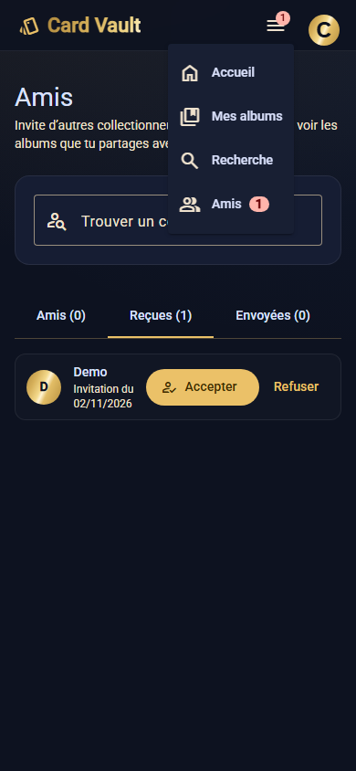

## Étape 5 — Partage (02/11/2026)

Choix faits au plan :
- un ami retrouve les albums partagés avec lui dans un **onglet
  « Partagés avec moi »** de la page Mes albums ;
- la liste de partage est **conservée** si l'album devient public (sans
  effet tant qu'il l'est), et reprend effet s'il redevient privé ;
- **seul le propriétaire** arrête un partage, et le destinataire ne peut
  pas le faire lui-même.

Ce qui était déjà décidé : le partage est réservé aux amis, et retirer un
ami arrête ses partages. L'étape 5 a été lancée juste après l'étape 4,
avant son commit, à la demande de l'utilisateur : les deux seront
commitées ensemble.

- [x] Backend : `canView` étendu au partage ; liste de partage, partager /
      arrêter, « partagés avec moi » ; partages arrêtés au retrait d'un ami
- [x] `API_CONTRACT.md` : 3 nouvelles routes, `sharedCount`, visibilité
      d'un album privé
- [x] Frontend : fenêtre de partage (liste d'amis à cocher), bouton
      « Partager », en-tête et couverture « partagé avec N amis »,
      onglet « Partagés avec moi »
- [x] Tests backend (102) et frontend (125), vérification croisée (24 bugs)
- [x] `npm run build`, vérification dans le navigateur (vraie base, vraies photos)
- [x] Documentation

### Le principe, en bref

Un album privé est une **pièce fermée à clé**. Son propriétaire donne un
double de la clé à certains amis : ils peuvent regarder l'album (classeur
et photos), mais ni le modifier ni le repartager.
- **Décocher** un ami lui reprend sa clé : il tombe sur « Album
  introuvable », comme pour n'importe quel album privé.
- **Retirer** un ami lui reprend toutes les clés, dans les deux sens. Une
  nouvelle amitié ne les rend pas automatiquement.

### Implémentation

**Backend.**
- La règle centrale `canView` accepte maintenant aussi « l'utilisateur
  est dans la liste de partage ». Les cartes et les URL signées des photos
  passaient déjà par `canView` : elles ont suivi sans autre changement.
- Pour partager, l'application envoie la **liste complète** des amis
  cochés, qui remplace l'ancienne. Une liste vide arrête tous les
  partages. Le serveur refuse tout identifiant qui n'est pas un ami (`400`).
- La liste n'est jamais envoyée au navigateur d'un destinataire. Seul le
  propriétaire reçoit le **nombre** de destinataires (`sharedCount`).

**Frontend.**
- **Fenêtre de partage** : liste des amis à cocher, résumé (« Visible par
  toi seul », « Partagé avec 2 amis »). « Enregistrer » ne s'active que si
  la sélection a changé. Sans ami, un message renvoie vers la page Amis.
- **Page d'album** : bouton « Partager » sur ses albums privés ; en-tête
  « Album privé · partagé avec 2 amis » chez le propriétaire, et « Album
  privé · partagé avec toi » chez le destinataire.
- **Mes albums** : icône « groupe » et info-bulle « Privé : partagé avec
  1 ami » sur la couverture. Le nouvel onglet « Partagés avec moi »
  affiche le propriétaire sous le titre (« par ClaudeTestBot »).

### Vérification croisée

24 bugs introduits volontairement (12 backend, 12 frontend), **tous
détectés dès le premier passage**. Détail dans [Tests.md](../Tests.md).

### Vérifications dans le navigateur

Harnais Playwright (hors dépôt), vraie base. ClaudeTestBot partage son
album privé « Deck Feu » (6 cartes) avec ClaudeTestBot2 ; Demo n'est pas
leur ami.

| Vérification | Attendu | Observé |
|---|---|---|
| Avant partage, l'ami ouvre l'album | `404` | ✅ |
| Propriétaire | « Album privé », bouton « Partager » | ✅ |
| Fenêtre | mes amis seulement (pas Demo) ; « Enregistrer » inactif sans changement | ✅ |
| Partage | SnackBar, en-tête et couverture « partagé avec 1 ami » | ✅ |
| Partage avec un non-ami | `400` | ✅ |
| Destinataire : liste de partage, modification | `404`, `404` | ✅ |
| Non-ami | album toujours `404` | ✅ |
| Destinataire | `200` sans la liste ni le nombre de destinataires ; album dans « Partagés avec moi » avec son propriétaire ; « partagé avec toi », ni Partager ni Modifier ; **6 photos chargées** | ✅ |
| Album public | pas de « Partager » | ✅ |
| Passage en public, puis retour en privé | visible mais absent de « Partagés avec moi » ; puis partage de nouveau actif | ✅ |
| Arrêt du partage (décocher) | SnackBar « Partage arrêté », l'ami tombe sur « Album introuvable », onglet vide | ✅ |
| Ami retiré | album de nouveau `404`, plus aucun destinataire ; une nouvelle amitié ne rétablit pas le partage | ✅ |
| Mobile (390 px) | fenêtre sans défilement horizontal | ✅ |
| Console | aucune erreur hors du `404` attendu, ni mot de passe ni JWT | ✅ |

Non vérifié dans le navigateur : la fenêtre **sans aucun ami**, parce
que Demo n'a pas d'album privé. Ce cas est couvert par un test de
composant.

**Erreurs du harnais**, sans effet sur l'application :
- l'image a été vérifiée avant la fin de son chargement ; la capture
  montrait pourtant les photos, et l'attente a été corrigée ;
- le `404` volontaire était compté comme une erreur de console.

État laissé pour vos essais : ClaudeTestBot et ClaudeTestBot2 sont amis,
et « Deck Feu » (privé) est partagé avec ClaudeTestBot2.

### Captures

Fenêtre de partage, puis album partagé côté propriétaire :

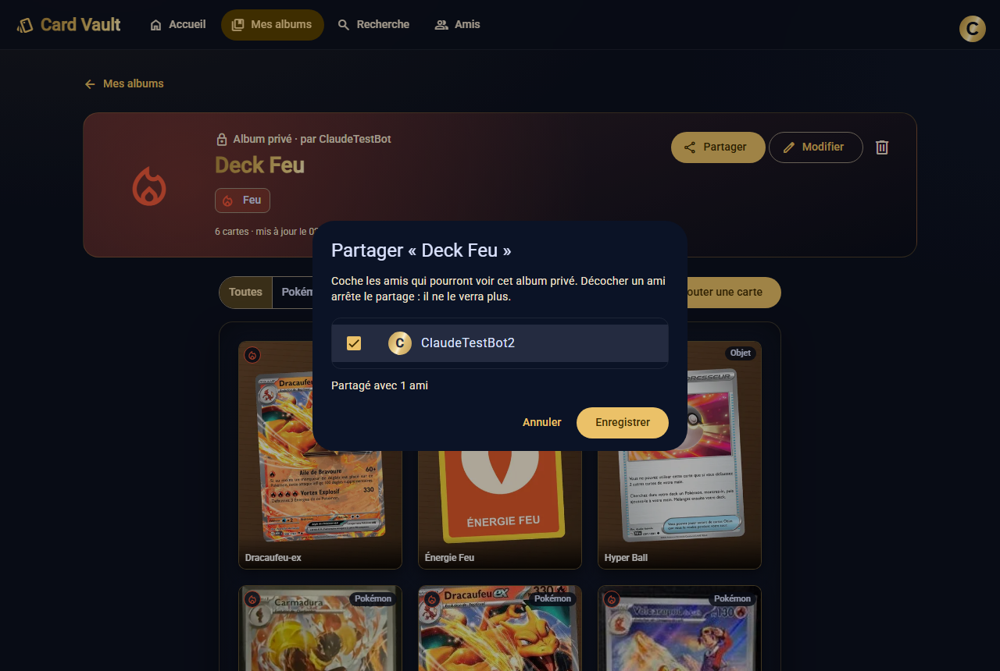
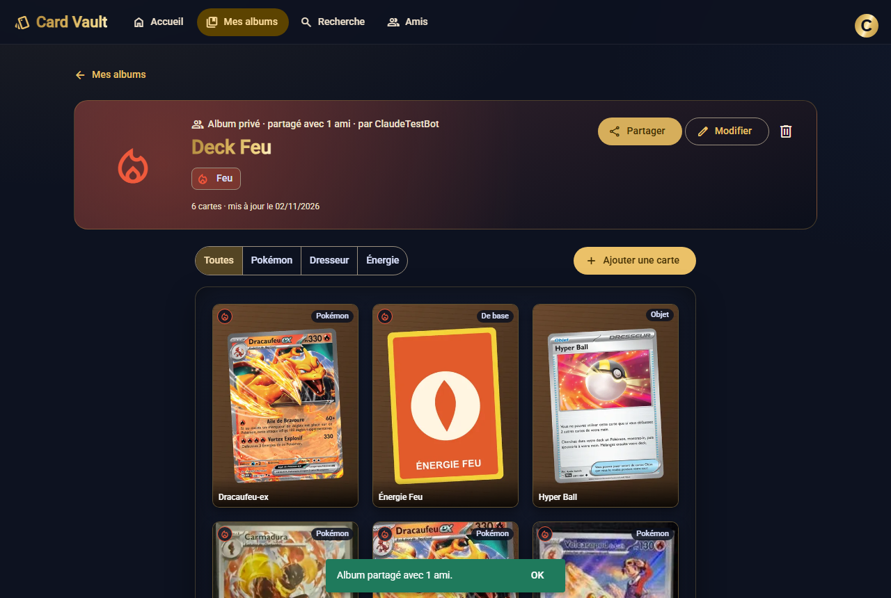

Mes albums : couverture d'un album partagé (info-bulle) :

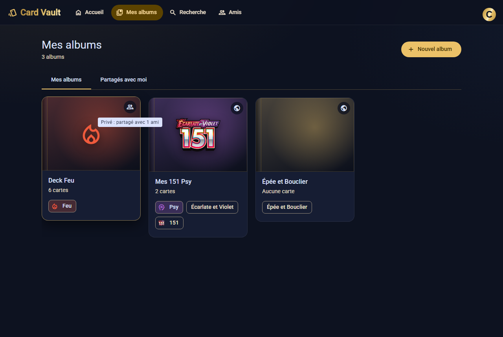

Côté ami : onglet « Partagés avec moi », puis l'album ouvert :

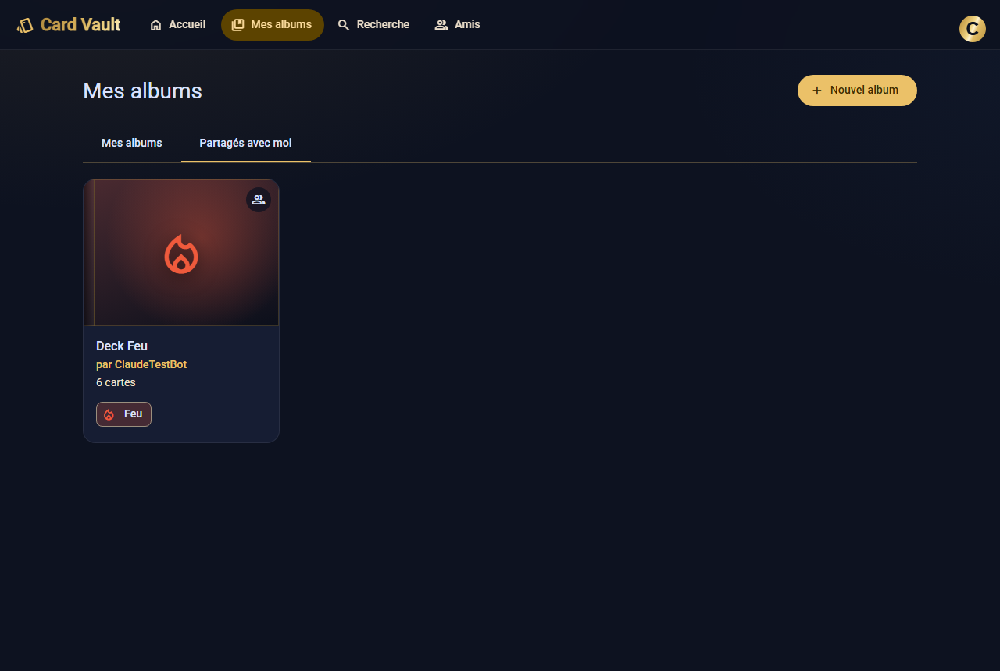
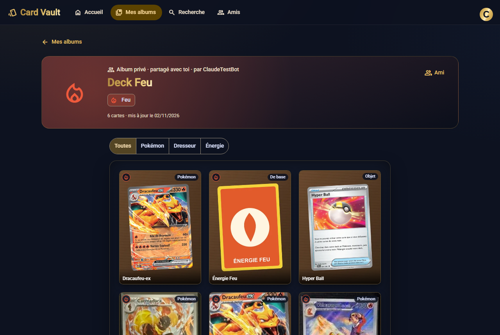

Après l'arrêt du partage :

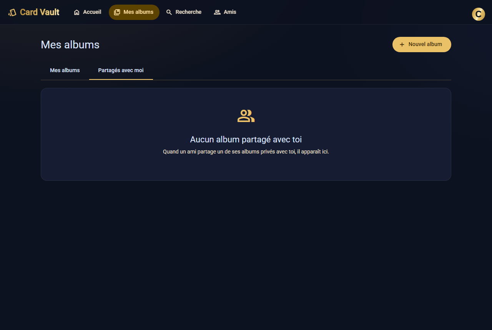

Mobile :

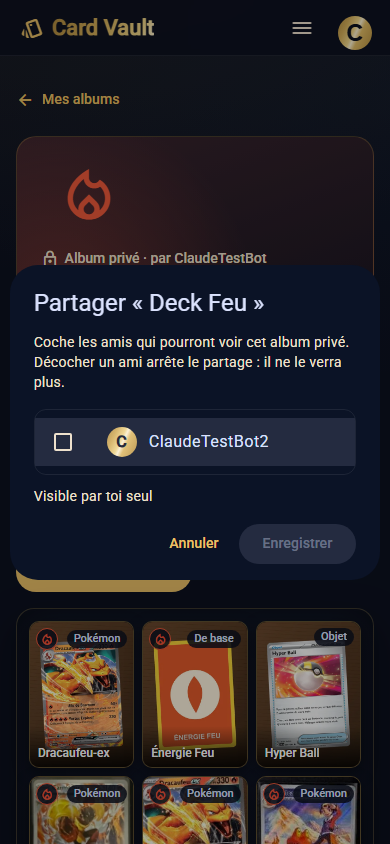

### Correction après test de l'utilisateur : légende du zoom (02/11/2026)

**Constat de l'utilisateur.** Dans un album partagé avec moi, le zoom sur
une carte légendait la photo « Ta photo », alors que c'est la photo de
l'ami. Le défaut existait déjà depuis l'étape 3 pour les albums **publics**
d'un autre utilisateur.

**Correction.** La page d'album transmet au zoom le pseudo du propriétaire
quand l'album n'est pas le mien (`owner.relation !== 'self'`). La légende
devient « Photo de ClaudeTestBot », et reste « Ta photo » dans mes
albums.

**Vérifications.**
- Tests : 127/127 (+2), build OK.
- Les deux bugs réintroduits (pseudo non transmis, légende figée) sont
  détectés par les nouveaux tests.
- Navigateur : « Photo de ClaudeTestBot » pour ClaudeTestBot2, « Ta
  photo » pour ClaudeTestBot.

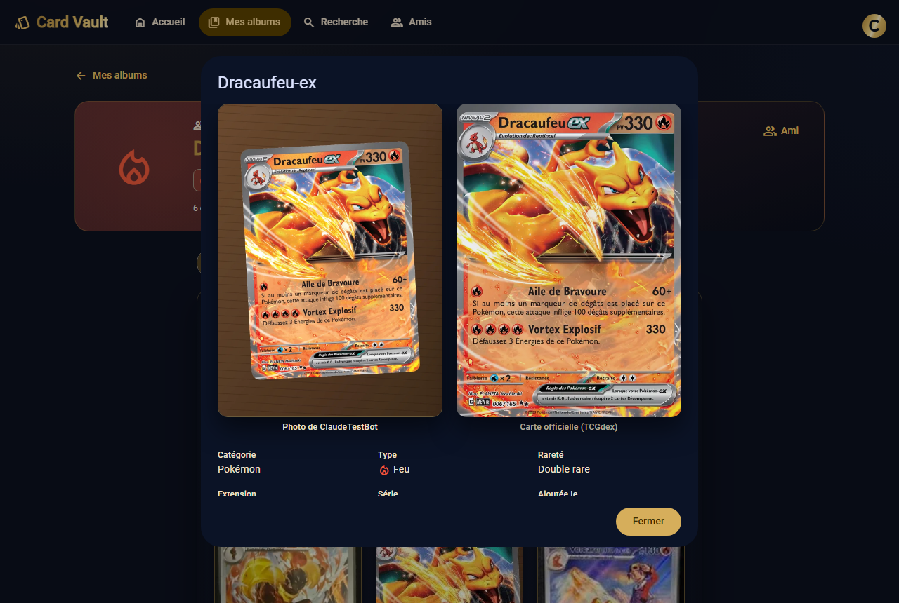

## Étape 6 — Likes et commentaires

_À faire._

## Étape 7 — Découverte (récents, activité, recherche)

_À faire._

## Étape 8 — Profil, finitions, livraison V2

_À faire._
