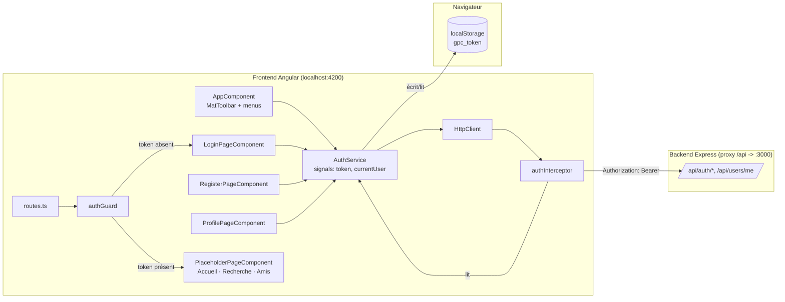
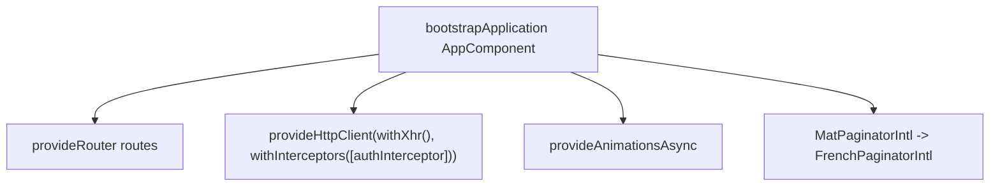
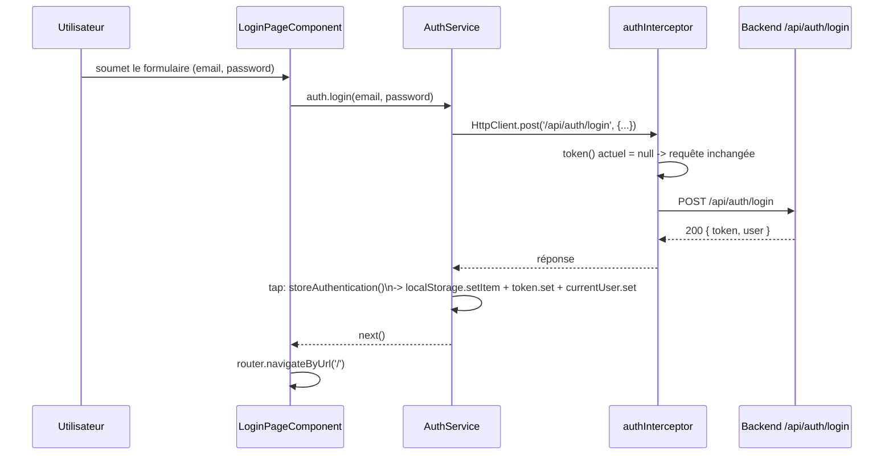
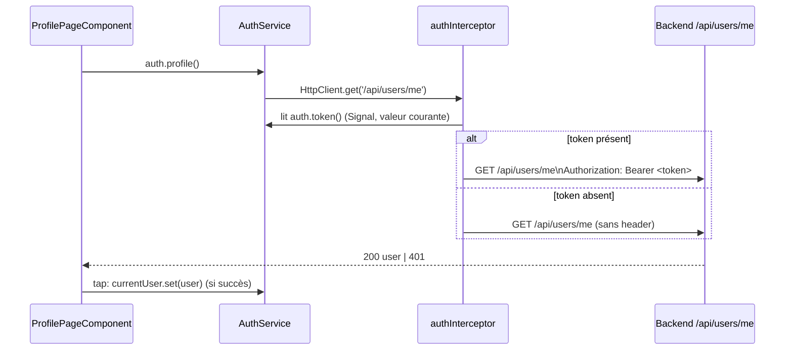

# Analyse du frontend — Card Vault (frontend-starter)

> Généré à partir du code source dans `frontend-starter/src/`. Ce document
> décrit l'architecture Angular **actuelle** et sert de référence technique
> mise à jour au fil des missions (TP1 à TP3), puis des étapes de la V2
> (mini projet **Card Vault**, TP4 à TP6). Pour le backend, voir
> `backend/analyse.md`.
>
> **01/11/2026 — V2, étape 1** : la partie audio de la V1 (page de pistes,
> `TrackService`, lecteur) a été retirée ; sa description détaillée reste
> consultable dans la version taguée `v1.0` de ce fichier.

## 1. Vue d'ensemble

Application **Angular 22** en mode **standalone** (pas de `NgModule`),
consommant l'API décrite dans `backend/analyse.md` et `API_CONTRACT.md`.
Depuis la V2 (01/11/2026), l'application s'appelle **Card Vault** : un
réseau de collectionneurs de cartes Pokémon (voir `../REPORT.md`). À
l'étape 1, elle ne contient que l'authentification, le profil, la
navigation et des pages d'attente ; les albums arrivent à l'étape 2 (voir
§7 "État par rapport aux missions").

### 1.1 Stack technique

| Domaine | Technologie | Rôle |
|---|---|---|
| Framework | Angular 22 (standalone components) | UI, routage, DI |
| Rendu réactif | Signals (`signal`, `computed`, `toSignal` depuis la V2) | État local et partagé |
| Formulaires | Reactive Forms (`FormGroup`, `FormControl`) + `MatFormField`/`matInput` (V2) | Saisie inscription/connexion/profil |
| HTTP | `HttpClient` + intercepteur fonctionnel ; mécanisme XHR forcé par `withXhr()` (TP3, Mission 6, 08/10/2026) | Appels API, ajout du JWT, progression d'upload |
| Routage | `provideRouter`, routes standalone, `CanActivateFn` | Navigation + protection de pages |
| Build/test | Angular CLI 22, Vitest 4 (TP3 : `jsdom` + config `build:development` ajoutés ; V2 étape 1 : 7 fichiers `*.spec.ts` / 23 tests au 01/11/2026) | `ng serve`, `ng build`, `ng test` |
| Proxy dev | `proxy.conf.json` → `http://localhost:3000` | Évite le CORS en développement (`/api` → backend) |
| Composants UI | Angular Material 22.2.1 + CDK | **V2 (01/11/2026)** : utilisé dans toute l'application — `MatToolbar`, `MatMenu`, `MatCard`, `MatFormField`, `MatButton`, `MatIcon` (police *Material Symbols Outlined*), `MatSnackBar`, `MatDivider`. Thème Material 3 **sombre or / bleu nuit** (`material-theme.scss`, palettes générées) + identité visuelle dans `styles.css` (reflet or métallique, couleurs des 11 types) |

### 1.2 Arborescence

```text
frontend-starter/
├── proxy.conf.json                  # /api -> http://localhost:3000
├── src/
│   ├── main.ts                      # bootstrap standalone + providers globaux
│   ├── material-theme.scss          # thème Material 3 sombre (or / bleu nuit)
│   ├── _theme-colors.scss           # palettes générées (ng generate @angular/material:theme-color)
│   ├── styles.css                   # identité Card Vault : fond, reflet or, types
│   ├── app/
│   │   ├── routes.ts (+ .spec)      # déclaration des routes + guards
│   │   ├── components/
│   │   │   ├── app/                 # racine : barre MatToolbar + <router-outlet>
│   │   │   ├── login-page/          # connexion (MatCard + MatFormField)
│   │   │   ├── register-page/       # inscription
│   │   │   ├── profile-page/        # profil (protégée)
│   │   │   └── placeholder-page/    # page d'attente commune (Accueil, Recherche, Amis)
│   │   └── shared/
│   │       ├── guards/auth.guard.ts         # bloque l'accès sans token
│   │       ├── interceptors/auth.interceptor.ts  # ajoute Authorization: Bearer
│   │       ├── i18n/french-paginator-intl.ts     # textes français de mat-paginator
│   │       ├── models/              # User, AuthResponse, Page<T>
│   │       ├── services/            # AuthService (seul point d'appel HTTP pour l'instant)
│   │       └── utils/http-error.ts  # serverErrorMessage() (message d'erreur lisible)
```

### 1.3 Diagramme de composants et flux général



Le flux respecté partout dans le code : **composant → service → HttpClient →
API**. Aucun composant n'injecte `HttpClient` directement — c'est une règle
explicite des sujets de TP, déjà respectée par le starter.

---

## 2. Bootstrap et routage

### 2.1 `main.ts`



Tous les appels HTTP de l'application passent donc systématiquement par
`authInterceptor` (configuration globale, pas de config par service).

**`withXhr()` (TP3, Mission 6, 08/10/2026).** Depuis Angular 22,
`provideHttpClient()` envoie les requêtes avec l'API **`fetch`** du
navigateur par défaut (`FetchBackend`). Or `fetch` ne sait pas suivre la
progression d'un **envoi** (seulement d'un téléchargement) : la barre de
progression de l'upload restait bloquée à 0 %. `withXhr()` remet
`XMLHttpRequest` (`HttpXhrBackend`), qui expose `xhr.upload.onprogress`.
Choix global : il s'applique à **toutes** les requêtes de l'app ; vérifié
sans régression (connexion, liste, lecture audio, suppression),
l'intercepteur fonctionnant de la même façon avec les deux mécanismes. Les
avertissements Angular liés à `withXhr()` ne concernent que le rendu
serveur (SSR) et des options non utilisées ici (`keepalive`, `priority`…).
`provideAnimationsAsync()` (ajouté TP2, Mission 3) est nécessaire pour les
interactions Angular Material (ripple, transitions de `mat-dialog`,
etc.) ; sans lui ces composants fonctionnent mais sans retour visuel
d'interaction. `MatPaginatorIntl` est surchargé par `FrenchPaginatorIntl`
(`shared/i18n/french-paginator-intl.ts`) : sans ça, `mat-paginator`
affiche ses textes par défaut en anglais ("Items per page:", "0 of 0"),
incohérent avec le reste de l'app — fourni globalement ici, ce qui le
rend disponible pour les listes paginées de la V2 (albums, recherche).

**Icônes (V2, étape 1, 01/11/2026).** `index.html` charge la police
*Material Symbols Outlined*, mais `<mat-icon>` utilise par défaut la classe
`material-icons`. `MAT_ICON_DEFAULT_OPTIONS` (`fontSet:
'material-symbols-outlined'`) aligne les deux : vérifié dans le navigateur
(police calculée « Material Symbols Outlined », icônes de 24 px).

### 2.2 Table des routes (`routes.ts`)

| Path | Composant | Protégée (`authGuard`) |
|---|---|---|
| `''` | `PlaceholderPageComponent` (Accueil, rempli à l'étape 7) | oui |
| `/search` | `PlaceholderPageComponent` (Recherche, étape 7) | oui |
| `/friends` | `PlaceholderPageComponent` (Amis, étape 4) | oui |
| `/profile` | `ProfilePageComponent` | oui |
| `/login` | `LoginPageComponent` | non |
| `/register` | `RegisterPageComponent` | non |
| `**` | redirect → `''` (dont l'ancienne URL `/tracks`) | — |

**Page d'attente commune (V2, étape 1).** Plutôt que trois composants
quasi identiques, une seule `PlaceholderPageComponent` lit son titre, son
icône, sa description et le numéro d'étape dans la propriété `data` de la
route (`toSignal(ActivatedRoute.data)`). Chaque route sera remplacée par
son vrai composant à l'étape indiquée.

`authGuard` (fonctionnel, `CanActivateFn`) vérifie simplement
`auth.token()` (un Signal) : présent → accès autorisé, absent → redirection
vers `/login` via `router.createUrlTree`. **Ce garde ne vérifie toujours
pas que le token est encore valide côté serveur** au moment de la
navigation — mais depuis Mission 1 (TP1, point 10), `authInterceptor`
détecte a posteriori un token rejeté par le backend (`401` sur une requête
qui en portait un) et nettoie/redirige (voir §3.6 et §7). Les deux
mécanismes sont complémentaires : le guard filtre à l'entrée sur la route,
l'intercepteur rattrape un token qui devient invalide pendant la
navigation (expiration, secret changé côté serveur, etc.).

---

## 3. Authentification (côté frontend)

### 3.1 `AuthService` — état et responsabilités

`AuthService` (`providedIn: 'root'`, donc singleton applicatif) centralise :
- deux Signals exposés : `token` (initialisé depuis `localStorage.getItem('gpc_token')`
  au chargement du service) et `currentUser` (initialisé à `null`, rempli
  uniquement après un appel réussi à `/api/auth/*` ou `/api/users/me`) ;
- les méthodes `login`, `register`, `profile`, `update`, `logout` ;
- la persistance du token dans `localStorage` (clé `gpc_token`) via
  `storeAuthentication()`, appelée en `tap()` après un login/register réussi.

### 3.2 Diagramme de séquence — Connexion



En cas d'échec (401), l'`Observable` émet une erreur : `LoginPageComponent`
l'intercepte dans `error: (error) => ...` et affiche `error.error?.message`
(le message JSON renvoyé par le backend) via le Signal `error`.

### 3.3 Diagramme de séquence — Requête protégée (ex. profil)



`authInterceptor` est un **intercepteur fonctionnel** (`HttpInterceptorFn`,
API Angular ≥ 15) : il lit le Signal `token` à chaque requête sortante et
clone la requête avec l'en-tête `Authorization` uniquement s'il existe. Il
s'applique à **toutes** les requêtes HTTP de l'app (y compris login/register,
où le header est simplement absent puisque `token()` vaut `null`). Depuis
Mission 1 (TP1, point 10), il observe aussi la réponse pour détecter un
token rejeté par le backend — détail en §3.6.

### 3.4 Composants d'authentification

| Composant | Formulaire | Champs + validateurs | Comportement |
|---|---|---|---|
| `LoginPageComponent` | `form` (email, password) | `required`, `email` (pas de `minLength` sur le mot de passe : le backend ne vérifie une longueur qu'à l'inscription) | Pré-rempli avec le compte démo ; bouton `[disabled]="form.invalid"` ; messages par champ en `<mat-error>` (V2) ; `submit()` bloque aussi si invalide (`markAllAsTouched()`) avant d'appeler `auth.login()`, redirige vers **`/`** au succès (V2 ; `/tracks` en V1), affiche l'erreur via `serverErrorMessage()` (message de repli si le serveur ne répond pas) |
| `RegisterPageComponent` | `form` (name, email, password) | `required` (+ `email` sur l'email, **+ `minLength(8)`** sur le mot de passe depuis Mission 1 TP1, aligné sur la contrainte du backend) | Bouton `[disabled]="form.invalid"` ; message d'erreur par champ sous `name`/`email`/`password` (`touched \|\| dirty`) ; `submit()` bloque aussi si invalide avant d'appeler `auth.register()`, redirige vers `/profile` au succès |
| `ProfilePageComponent` | `form` (name) | `required` | Chargement automatique au constructeur (`GET /api/users/me` dès l'arrivée sur `/profile`, Mission 1 point 8) ; le bouton "Charger mon profil" du TP1 a été retiré en V2 (redondant) ; `save()` appelle `auth.update()` (`PUT /api/users/me`) et confirme par une `MatSnackBar` (succès ou erreur) |

### 3.5 `AppComponent` — état de connexion global (header)

Depuis Mission 1 (TP1, point 7), `AppComponent` (`components/app/app.ts`)
n'est plus un simple conteneur de layout : il injecte `AuthService` et
`Router` et pilote l'affichage du header en fonction de l'état
d'authentification, pour toutes les pages (`<router-outlet />` étant son
seul contenu variable).

```ts
constructor() {
  if (this.auth.token()) {
    this.auth.profile().subscribe({ error: () => {} });
  }
}

logout(): void {
  this.auth.logout();
  void this.router.navigateByUrl('/login');
}
```

- **Rechargement du profil au démarrage.** `currentUser` n'est pas
  persisté (contrairement à `token`, relu depuis `localStorage`) : il
  repart à `null` à chaque ouverture de l'app. Le constructeur appelle donc
  `auth.profile()` une fois si un token existe déjà, pour que le header
  puisse afficher qui est connecté dès le chargement, y compris après un
  F5. Le `error: () => {}` reste volontairement minimal ici : la gestion
  globale d'un token invalide/expiré (401) est centralisée dans
  `authInterceptor` depuis le point 10 (§3.6), pas dupliquée à cet endroit.
- **Barre du haut (V2, étape 1, 01/11/2026)** — `app.html`, en Angular
  Material :
  - `MatToolbar` collante (`position: sticky`), logo « Card Vault » en
    dégradé or métallique ;
  - **connecté** (`auth.token()`) : liens **Accueil · Recherche · Amis**
    (`mat-button` + `routerLinkActive`, lien actif surligné), puis un
    avatar (initiale du pseudo, `computed`) qui ouvre un `MatMenu` : pseudo
    et email, **Mon profil**, **Déconnexion** ;
  - **visiteur** : **Connexion** et **Inscription** uniquement ;
  - **mobile** (< 720 px) : les liens passent dans un menu « burger ».
    Les liens sont définis une seule fois dans `links` et réutilisés par
    la barre et par le menu mobile.
- **Déconnexion sans requête réseau.** `logout()` ne fait qu'un nettoyage
  client (`localStorage` + Signals) : un JWT est stateless, le backend ne
  garde aucune trace des tokens émis et n'expose aucune route `logout`
  (absente d'`API_CONTRACT.md`). Un token émis avant déconnexion reste donc
  techniquement valide côté serveur jusqu'à son expiration naturelle — pas
  de révocation possible sans mécanisme supplémentaire (hors scope du TP).

### 3.6 Gestion d'un token invalide/expiré (401) — `authInterceptor`

Depuis Mission 1 (TP1, point 10), `authInterceptor` ne se contente plus
d'ajouter le header `Authorization` : il observe aussi la réponse de
**chaque** requête HTTP de l'app.

```ts
return next(authorizedRequest).pipe(
  catchError((error: HttpErrorResponse) => {
    if (token && error.status === 401) {
      auth.logout();
      void router.navigateByUrl('/login');
    }
    return throwError(() => error);
  }),
);
```

- **Condition `token &&`, volontaire.** Un `401` peut aussi survenir sur
  `/api/auth/login` avec un mauvais mot de passe — une requête qui ne
  portait **aucun** token. Sans cette condition, l'intercepteur
  interférerait avec la gestion d'erreur déjà faite localement par
  `login-page.ts` (affichage du message via le Signal `error`). Seul un
  `401` sur une requête qui **portait** un token déclenche le nettoyage —
  cas où le backend vient de rejeter un token censé être valide
  (expiré, signature invalide, etc.).
- **`throwError(() => error)` en fin de pipe** : l'erreur continue de
  remonter jusqu'au composant appelant, qui garde son propre traitement
  s'il en a un (ex. `console.error` local) — l'intercepteur ajoute un
  comportement global, il ne remplace pas la gestion d'erreur existante.
- **Limite de test à connaître** : `auth.token` ne relit `localStorage`
  qu'une seule fois, à la création du service. Modifier `gpc_token` dans
  `localStorage` en direct (DevTools) ne change donc rien tant que l'app
  n'est pas rechargée — toutes les requêtes continuent d'utiliser
  l'ancien token, valide, en mémoire. Pour tester ce mécanisme, il faut
  recharger la page (F5) après avoir corrompu le token, pour que le Signal
  se ré-hydrate depuis la valeur invalide.

---

## 4. Albums et cartes

_À venir (étapes 2 et 3 de la V2)._

La bibliothèque audio de la V1 (`TracksPageComponent`, `TrackService`,
pagination, upload avec progression, lecture, suppression) a été
**retirée le 01/11/2026** (V2, étape 1). Ce qui en est réutilisé :
`withXhr()` (progression d'upload), `Page<T>`, `FrenchPaginatorIntl`,
`serverErrorMessage()` (déplacée dans `shared/utils/http-error.ts`), les
patterns SnackBar et confirmation `MatDialog`. Description complète de la
V1 : version taguée `v1.0` de ce fichier.

---

## 5. Formulaires réactifs — pattern commun

Tous les formulaires suivent le même schéma :

```text
FormGroup/FormControl (typé, nonNullable) --template [formGroup]/formControlName--
  → (ngSubmit) → méthode submit()/save() du composant
  → form.getRawValue() → appel service → .subscribe({next, error})
```

- `nonNullable: true` évite d'avoir `string | null` sur des champs texte
  obligatoires.
- Depuis Mission 1 (TP1, points 1+2) : chaque champ de `login-page` et
  `register-page` affiche son propre message d'erreur (`required`, `email`,
  `minlength`), conditionné par `control.touched || control.dirty` plutôt
  que `touched` seul — ce dernier ne suffisait pas pour un champ pré-rempli
  modifié sans jamais perdre le focus (bug trouvé en test manuel, corrigé).
  Le bouton de soumission est grisé via `[disabled]="form.invalid"`, en plus
  de la garde `if (form.invalid) { markAllAsTouched(); return; }` dans
  `submit()`. L'erreur globale au niveau du formulaire (Signal `error`)
  reste utilisée séparément pour les erreurs renvoyées par le backend
  (ex. `401` au login).

---

## 6. Style, accessibilité, configuration

- **Thème (V2, étape 1, 01/11/2026)** : `material-theme.scss` applique
  `mat.theme()` (Material 3) avec des palettes **générées** par
  `ng generate @angular/material:theme-color` (`_theme-colors.scss`) : or
  `#C9A24D` (principale), bleu `#4A78C2` (accents), neutre bleu nuit
  `#1B2236` (surfaces et menus teintés de bleu, pas de gris). Les palettes
  prédéfinies de Material n'offrent pas de doré (`yellow` est un jaune
  citron). `color-scheme: dark` sur `body` sélectionne la version sombre
  des couleurs `light-dark()` générées par Material. Premier essai
  violet / cyan abandonné (jugé trop générique).
- **Identité** (`styles.css`) : fond bleu nuit avec halos discrets or et
  bleu, variables `--cv-surface`, `--cv-gold` (dégradé or métallique,
  classe `.cv-gold-text`), et **11 variables de couleur de type** (`--cv-type-feu`,
  `--cv-type-eau`…) prêtes pour les badges des étapes 2 et 3. L'ancien
  style « bouton vert » fait maison de la V1 a été supprimé : les boutons
  sont tous des boutons Material.
- **SnackBar** : rendue dans un overlay CDK hors des composants, son style
  (`snack-success` / `snack-error`) est donc global.
- **Accessibilité** : liens et boutons Material focusables au clavier,
  `aria-label` sur les boutons à icône (menu, avatar), icônes décoratives
  en `aria-hidden`, erreurs de formulaire en `<mat-error>` et `role="alert"`.
- `proxy.conf.json` redirige `/api` vers `http://localhost:3000` en
  développement : chemins relatifs (`/api/...`) dans les services, pas de
  problème CORS. Aucun `environment.ts`.

---

## 7. État actuel par rapport aux missions des TP (repères)

Ce tableau suit, mission par mission, ce qui a été réalisé. Les lignes
TP1 à TP3 décrivent la V1 (tag `v1.0`) ; les fonctionnalités audio qu'elles
mentionnent ont été retirées en V2. Les lignes V2 suivent les étapes du
mini projet.

| Mission | Exigence | État dans le starter |
|---|---|---|
| TP1 · M1 | Formulaires login/register + appels API | ✅ Présent |
| TP1 · M1 | JWT stocké, Signal `currentUser` à jour | ✅ Présent |
| TP1 · M1 | Bouton de déconnexion + nettoyage état | ✅ Fait (Mission 1, point 7) — bouton dans le header (`AppComponent`), redirection vers `/login` après déconnexion |
| TP1 · M1 | Chargement de `/api/users/me` à la demande du profil | ✅ Fait (Mission 1, point 8) — corrigé un faux positif : l'affichage dépendait du Signal `currentUser` déjà rempli par ailleurs (login), sans jamais émettre sa propre requête ; `ProfilePageComponent` appelle désormais `load()` dans son constructeur |
| TP1 · M1 | Gestion d'un 401 → retour `/login` | ✅ Fait (Mission 1, point 10) — `authInterceptor` nettoie l'état et redirige sur un 401 portant un token ; les 401 sans token (login/register) restent gérés localement |
| TP1 · M1 | Messages d'erreur compréhensibles par champ | ✅ Fait (Mission 1, points 1+2) — message par champ, `minLength(8)` sur le mot de passe à l'inscription, bouton désactivé si formulaire invalide |
| TP2 · M2 | Pagination serveur avec Signals (`tracks`,`page`,`total`,`loading`) | ✅ Présent (déjà dans le starter) |
| TP2 · M2 | Signal `error` dédié à la liste, affiché à l'utilisateur | ✅ Fait (Mission 2) — absent du starter, ajouté avec affichage dans `tracks-page.html` |
| TP2 · M2 | Boutons Préc./Suiv. désactivés aux bornes | ✅ Présent (remplacés par `mat-paginator`, AVANCÉ, qui gère ça nativement) |
| TP2 · M2 AVANCÉ | Paginator Angular Material | ✅ Fait — `<mat-paginator>`, Signal `total` ajouté, `pages`/`go()` supprimés ; `FrenchPaginatorIntl` pour l'i18n (textes anglais par défaut, trouvé via le harnais de test Playwright) |
| TP2 · M3 | Validation frontend du fichier (type/taille) avant envoi | ✅ Fait (Mission 3) — mêmes règles que le backend (`ALLOWED_AUDIO_TYPES`, `MAX_FILE_SIZE` dans `tracks-page.ts`), Signal `uploadError` affiché |
| TP2 · M3 | État de chargement + anti double-soumission pendant l'upload | ✅ Fait (Mission 3) — Signal `uploading`, garde `if (!file \|\| uploading())`, bouton désactivé pendant l'envoi |
| TP2 · M3 | Message de succès + affichage des erreurs serveur (upload) | ✅ Fait (Mission 3) — Signal `uploadSuccess`, `uploadError` réutilisé ; bug "Failed to fetch" corrigé (`serverErrorMessage()`, appliqué aussi à `load()`) |
| TP2 · M3 | Affichage du morceau en cours de lecture | ✅ Fait (Mission 3) — Signal `playingTrack` (piste entière), badge + lecteur `<audio>` dans la card de la piste |
| TP2 · M3 | Erreur audio compréhensible | ✅ Fait (Mission 3) — Signal `audioError` (échec HTTP ou décodage natif via `onAudioError()`) ; Signal `playbackFailed` distinct pour ne pas propager l'échec à une piste différente déjà en lecture |
| TP2 · M3 | Révocation de l'`ObjectURL` à la destruction du composant | ✅ Fait (Mission 3) — `TracksPageComponent implements OnDestroy`, révoque `audioUrl()` s'il existe |
| TP2 · M3 | Cards responsives/accessibles avec plus de métadonnées | ✅ Fait (Mission 3) — refonte avec Angular Material (`mat-card`), format/taille/date lisibles |
| Facultatif | Suppression d'une piste (`DELETE /api/tracks/:id`) + confirmation | ✅ Fait — `TrackService.delete()`, confirmation via `MatDialog`, rafraîchissement + nettoyage du lecteur regroupés dans la même implémentation |
| Facultatif | Filtre par titre | ✅ Fait — paramètre `title` sur `GET /api/tracks` (premier changement backend de la session), Signal `titleFilter` |
| TP3 · M5 | Suppression : SnackBar, piste déjà supprimée / pas au propriétaire (404), anti double-clic | ✅ Fait (08/10/2026) — base TP2 + `MatSnackBar` (`notify()`), réaction par statut (204/404/500/0, 401 laissé à l'intercepteur), `afterTrackRemoved()`, garde `openDialogs` dans `confirmDelete()` |
| TP3 · M6 | Progression d'upload (événements HTTP) | ✅ Fait (08/10/2026) — `reportUploadProgress` + `observe: 'events'`, Signal `uploadProgress`, `mat-progress-bar`, 4 états, contrôles désactivés ; `withXhr()` dans `main.ts` (`fetch`, défaut d'Angular 22, ne remonte pas la progression d'envoi) |
| TP3 · M7 | Tests frontend (services, intercepteur, guard, composants) | ✅ 7/7 (08/10/2026) — `AuthService`, `TrackService`, `authInterceptor`, `authGuard`, + `tracks-page.spec.ts` (erreur HTTP affichée, suppression, upload avec progression). Détail : `Tests.md` |
| V2 · Étape 1 | Retrait de l'audio, identité Card Vault, thème sombre, navigation | ✅ Fait (01/11/2026) — pages audio supprimées ; `MatToolbar` + `MatMenu` (+ menu mobile) ; thème Material sombre or / bleu nuit ; connexion/inscription/profil en Material ; pages d'attente Accueil/Recherche/Amis ; 23 tests |

---

## 8. Journal des mises à jour de ce document

- **Version initiale** — analyse du starter fourni, avant toute mission.
- **20/09** — Mise à jour après Mission 1 (TP1), points 1+2 : formulaires
  réactifs + validations/messages d'erreur par champ implémentés dans
  `login-page`/`register-page` (§3.4, §5, §7).
- **20/09** — Mise à jour après Mission 1 (TP1), point 7 : bouton de
  déconnexion, affichage de l'utilisateur connecté dans le header et
  rechargement du profil au démarrage, nav conditionnelle selon
  l'authentification (nouveau §3.5, §7).
- **20/09** — Mise à jour après Mission 1 (TP1), points 8+9 : correction
  d'un faux positif sur `ProfilePageComponent` (l'affichage dépendait du
  Signal `currentUser` déjà rempli par le login, sans émettre sa propre
  requête `GET /api/users/me`) — chargement désormais déclenché dans le
  constructeur du composant, à l'arrivée sur `/profile` (§3.4, §7).
- **20/09** — Mise à jour après Mission 1 (TP1), point 10 : `authInterceptor`
  détecte un token rejeté (`401` sur une requête qui en portait un),
  nettoie l'état et redirige vers `/login` (nouveau §3.6, §2.2, §7).
  **Mission 1 (TP1) complète : 10/10 points.**
- **24/09** — Mise à jour après Mission 2 (TP2, branche `TP2`) : la
  pagination serveur était déjà conforme dans le starter ; ajout du Signal
  `error` (absent) sur `TracksPageComponent`, affiché à l'utilisateur en
  cas d'échec de `GET /api/tracks` (§4.2, §7).
- **27/09** — Mise à jour après Mission 3 (TP2), points 1+2 : validation
  frontend du fichier (type/taille, mêmes règles que le backend) et
  Signal `uploadError` ajoutés dans `choose()` (§4.2, §4.4, §7).
- **27/09** — Mise à jour après Mission 3 (TP2), points 3+4 : Signal
  `uploading` ajouté dans `upload()`, garde anti double-soumission
  partagée entre la logique et le bouton (§4.2, §4.4, §7).
- **27/09** — Mise à jour après Mission 3 (TP2), points 5+6 : Signal
  `uploadSuccess` ajouté, `uploadError` réutilisé pour les erreurs
  serveur ; bug "Failed to fetch" corrigé (`serverErrorMessage()`,
  appliqué aussi à `load()`) (§4.2, §4.4, §7).
- **27/09** — Mise à jour après Mission 3 (TP2) : Signal `playingTrack`
  ajouté, badge "En cours de lecture" dans la liste + titre au-dessus du
  lecteur `<audio>` (§4.2, §4.4, §7).
- **27/09** — Mise à jour après Mission 3 (TP2) : Signaux `audioError` et
  `playbackFailed` ajoutés (erreur HTTP vs erreur de décodage natif de
  `<audio>`) ; `uploadSuccess` désormais vidé par `load()`/`play()` en
  plus de `choose()`/`upload()` (§4.2, §4.4, §7).
- **27/09** — Mise à jour après Mission 3 (TP2) : `TracksPageComponent`
  implémente `OnDestroy`, révoque l'`ObjectURL` restante à la
  destruction du composant (§4.4, §7). **10/11 points de la Mission 3
  traités**, seules les cards responsives restent à faire.
- **08/10** — Mise à jour majeure après Mission 3 (TP2), dernier point +
  AVANCÉ + facultatifs : installation d'**Angular Material** (`@angular/material`,
  `@angular/cdk`, `@angular/animations`, `provideAnimationsAsync()`,
  `material-theme.scss` palette verte) ; refonte des cards en `mat-card`
  (§1.1, §2.1, §4.2, §4.4) ; `mat-paginator` remplace le pager fait maison
  (Signal `total` ajouté, `pages`/`go()` supprimés, §4.2, §4.3) ;
  suppression de piste avec confirmation `MatDialog` + rafraîchissement
  (§4.4) ; lecteur `<audio>` déplacé dans la card de la piste plutôt
  qu'un bloc global (§4.4). **Mission 3 (TP2) complète : 11/11 points**,
  AVANCÉ Paginator et 2 améliorations facultatives faits en plus.
- **08/10** — Amélioration facultative "filtre par titre" : paramètre
  `title` ajouté à `GET /api/tracks` côté backend (**premier changement
  backend de la session**, voir `backend/analyse.md`), Signal
  `titleFilter` + `applyFilter()` côté frontend. Bug `ngSubmit` sans
  `FormsModule`/`[formGroup]` trouvé et corrigé (§4.2, §4.4, §7).
- **08/10** — Mise en place d'un harnais de test automatisé (Playwright,
  hors dépôt projet, dans le scratchpad de session) + `curl` pour les
  tests API directs. Bug trouvé dès le premier test : `mat-paginator` en
  anglais par défaut — corrigé avec `FrenchPaginatorIntl`, fourni dans
  `main.ts` (§2.1, §7).
- **08/10** — TP3, Mission 7 : `npm test` rendu fonctionnel (`jsdom`
  manquant, config `build:development` absente), 5 fichiers `*.spec.ts`
  (15 tests) ; `serverErrorMessage`/`formatFileSize`/`formatAudioType`
  exportées depuis `tracks-page.ts` pour être testables isolément. Voir
  `Tests.md` (§1.1, §7).
- **08/10/2026** — TP3, Mission 6 : progression de l'upload
  (`reportUploadProgress` + `observe: 'events'`, Signal `uploadProgress`,
  `mat-progress-bar`, contrôles désactivés, sélecteur vidé après succès) ;
  `withXhr()` ajouté dans `main.ts` après le bug « barre bloquée à 0 % »
  (`fetch` par défaut depuis Angular 22) (§1.1, §2.1, §4.1, §4.2, §4.4, §7).
- **08/10/2026** — TP3, Mission 5 : suppression complétée (`MatSnackBar`
  via `notify()`, réaction par statut 204/404/500/0, `afterTrackRemoved()`,
  garde anti double-fenêtre dans `confirmDelete()`, Signal `deleteError`
  retiré) ; style global `button` : exclusion `.mat-mdc-button-base`
  (§1.1, §4.1, §4.2, §4.4, §7).
- **08/10/2026** — TP3, Mission 7 terminée : `tracks-page.spec.ts`
  (10 tests de composant : erreur HTTP, suppression, upload/progression) ;
  6 fichiers / 25 tests (§1.1, §7).
- **01/11/2026** — V2, étape 1 : retrait de l'audio (section 4 réduite à un
  renvoi vers le tag `v1.0`), identité Card Vault, thème Material sombre,
  barre de navigation `MatToolbar`/`MatMenu`, pages d'attente,
  `serverErrorMessage()` déplacée dans `shared/utils`, police d'icônes
  (`MAT_ICON_DEFAULT_OPTIONS`) (§1, §1.1, §1.2, §1.3, §2.1, §2.2, §3.4,
  §3.5, §4, §6, §7).
